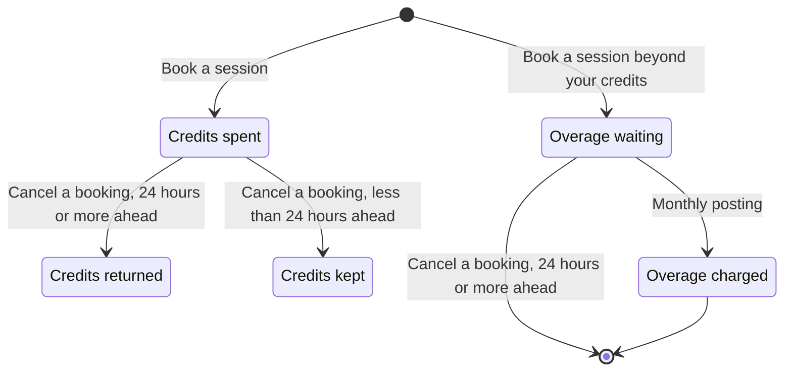

# Golden example, Level 1 — `areas/<area>.md` (the guide)

The Level 1 example for `dev:doc-business-model`: one area guide as a `be-documenter` run would write it into `docs/business-model/areas/credits-and-charges.md`. The system is the same **workshop-booking** toy the planner examples build — imagined here as an *inherited* codebase being documented after the fact. **Shape, tone and the example discipline are normative; domain content and citations are illustrative.**

Note what the example demonstrates: a guide that reads in the order a person meets the product — who uses it, the few ideas and one picture of how it fits together, then each person's tasks in lifecycle order, with the example beside the rule it shows. Three hard cases are in it: the **member tasks have no screen** in this codebase, so they carry no `**Where:**` and no bold label; the **staff tasks** show only labels the staff screen has (each is in Level 3's vocabulary table); and **a task two people do** (cancelling a booking) sits under two headings. The rules nobody triggers (the 24-hour cut-off, the posting moment) sit in *Rules and limits* as "no — fixed in the system". There are no ids in the body, the metadata closes the file in *About this document*, and an inferred purpose lives only in *Open questions*. There is no `file:line`, tier tag, code noun, defect word or evidence table (those are Level 3: [example-technical.md](example-technical.md); the connections and failure handling are Level 2: [example-behind-the-scenes.md](example-behind-the-scenes.md)). Optional sections that do not apply (*Good to know*) are dropped, and the search that proved it is a row in Level 3's evidence index.

---

# Session credits & charges

Spend your plan's monthly credits on sessions, and pay only for the bookings that go beyond them.

**Levels:** [Guide](credits-and-charges.md) · [Behind the scenes](credits-and-charges.behind-the-scenes.md) · [Technical reference](credits-and-charges.technical.md)

> [!IMPORTANT]
> A booking is priced once, after it is confirmed, from the tier cost and rate in force at that point — it is never re-priced afterwards. A credit returned by a later cancellation is available for future bookings; it does not reduce an overage already accrued.

## Who uses it

| Who | What they do here |
|---|---|
| Members | Book and cancel their own sessions, which are priced automatically; see their own credits used, credits remaining and accrued overage. This applies to every member. |
| Staff | Define plans and session tiers, set or clear a member's personal overage rate, and cancel anyone's booking. |

## How it fits together

Every membership plan comes with a number of session credits per month. Booking a session spends credits according to the session's tier. When you run out, the booking still goes ahead and the shortfall is charged as an overage. Overage charges build up during the month and are charged once, at the start of the next month, when credits reset.

- **Credit** — what a booking spends. A plan grants a number each month, such as 8 on Basic; unused credits do not carry over.
- **Session tier** — how many credits one seat costs: Standard 1, Workshop 2, Masterclass 3.
- **Overage** — the part of a booking that your credits do not cover, charged at a per-credit rate.
- **Overage rate** — the price of one overage credit, set on the plan. A member can carry a personal rate, which wins over the plan's.

## For members

### Book a session

You can book a seat on any session. If your credits have run out, the booking still goes ahead and the extra is charged later.

1. Choose the session you want.
2. Book a seat on it.

**What happens next**

- You see the booking confirmed. Its cost in credits comes from the session's tier:

  Credit cost = the session tier's *Credits per seat*

- If your credits cover it, the booking spends them and nothing is charged:

  Credits remaining = Monthly credits − Credits used this month

  The test is simple: when Credits remaining is at least the Credit cost, the booking spends that many credits.

- If they do not, the booking spends whatever credits remain and the shortfall becomes an overage:

  Overage credits = Credit cost − Credits remaining
  Overage charge = Overage credits × Overage rate

  Where: *Overage rate* is your personal rate if one is set, otherwise the plan's rate.

- The overage charge is recorded against you, not yet charged. It is posted at the start of next month.
- A booking is never refused for lack of credits.

**Example**

Ana is on the Basic plan: 8 monthly credits, an overage rate of £6.00. On 11 March she has used 6 credits. She books *Sculpture masterclass*, a Masterclass that costs 3 credits.

Credits remaining = 8 − 6 = 2
Overage credits = 3 − 2 = 1
Overage charge = 1 × £6.00 = £6.00

Two credits are spent, and £6.00 is recorded for the month end.

> [!NOTE]
> The seat itself is allocated by [Bookings](bookings.md); this guide covers what the booking costs.

### Cancel a booking

You can cancel a booking yourself. Whether your credits come back depends on how long before the session starts you cancel.

1. Choose the booking you want to cancel.
2. Cancel it.

**What happens next**

- If you cancel 24 hours or more before the session starts, the credits the booking spent are returned and any overage accrued for that booking is removed.
- If you cancel less than 24 hours before the start, nothing is returned. The credits stay spent and any overage accrued for the booking stays.
- Returned credits are available for future bookings only.

> [!WARNING]
> A late cancellation cannot be undone: the credits stay spent.

## For staff

### Set up plans and tiers

You define the plans, the session tiers and, for a member who needs one, a personal overage rate.

**Where:** **Session credits**

1. Open **Session credits**.
2. Give a plan a name, its monthly credits in **Monthly allowance**, and its **Overage rate (per credit)**.
3. Set *Credits per seat* for each session tier.
4. To give one member their own rate, set **Personal overage rate** on the member. Clear it to go back to the plan's rate.

**What happens next**

- The plan, tier or rate is saved and applies to future bookings only. Nothing already booked is re-priced.
- A member's personal rate wins over the plan's rate.

**If it doesn't go through**

| Situation | What you see | What to do |
|---|---|---|
| A plan is saved with a name another plan already has | “That plan name is already taken.” | Nothing is saved. Choose a different name |
| Monthly credits or a rate is below 0 | “Monthly credits must be 0 or more.” / “Overage rate must be 0 or more.” | Nothing is saved. Enter 0 or more |

### Cancel a member's booking

You cancel a member's booking the same way a member does (see *Cancel a booking*). The difference is that the credits always come back.

1. Find the member's booking.
2. Cancel it.

**What happens next**

- The credits the booking spent are returned, however close the session is, and any overage accrued for that booking is removed.

> [!NOTE]
> When you cancel a whole session with **Cancel session**, [Scheduling](scheduling.md) cancels each booking on it, so every member's credits come back.

## What happens automatically

### Monthly posting

**Trigger:** the 1st of every month at 00:00, for every member.

1. Sum the member's accrued overage charges that have not yet been posted.
2. If the sum is greater than 0, post it as one charge to the member's account and mark those accruals as posted.
3. Set Credits used to 0 — the new month starts with the plan's full allowance. Unused credits from the previous month are lost.

**Result:** each time the posting runs, one overage charge on the account of every member with unposted overage, and a fresh credit balance for every member.

## Rules and limits

The most specific overage rate wins: member, then plan.

| Rule | Level | Value | Can it be changed? |
|---|---|---|---|
| Plan name | Plan | Unique; for example Basic | On the Session credits screen |
| Monthly credits | Plan | A whole number, 0 or more; for example 8 | On the Session credits screen |
| Overage rate | Plan | 0 or more; for example £6.00 per credit | On the Session credits screen |
| Overage rate override | Member | 0 or more; for example £4.50 per credit | On the Session credits screen |
| Credits per seat | Session tier | Standard 1 · Workshop 2 · Masterclass 3; every session has exactly one tier | On the Session credits screen |
| Effect of a change | Plan, tier | A new tier cost or plan rate affects future bookings only | No — fixed in the system |
| Late-cancellation cut-off | — | 24 hours before the session starts | No — fixed in the system |
| Posting moment | — | The 1st of the month at 00:00 | No — fixed in the system |
| Unused credits | — | Do not carry over to the next month | No — fixed in the system |

## A month in numbers

**Setup**

| Plan | Monthly credits | Overage rate |
|---|---|---|
| Basic | 8 | £6.00 |

| Tier | Credits per seat |
|---|---|
| Standard | 1 |
| Workshop | 2 |
| Masterclass | 3 |

Ana is on the Basic plan with no personal override. Ben is also on Basic but carries a personal overage rate of £4.50. It is March; both start the month with 0 credits used.

**Ana's month**

| Date | What happens | Credit cost | Credits remaining before | Spent from credits | Overage | Credits used after |
|---|---|---|---|---|---|---|
| 2 Mar | Books *Wheel basics* (Standard, starts 9 Mar 18:00) | 1 | 8 | 1 | — | 1 |
| 4 Mar | Books *Glazing workshop* (Workshop, starts 16 Mar 10:00) | 2 | 7 | 2 | — | 3 |
| 6 Mar | Books *Raku masterclass* (Masterclass, starts 21 Mar 14:00) | 3 | 5 | 3 | — | 6 |
| 11 Mar | Books *Sculpture masterclass* (Masterclass, starts 28 Mar 14:00) | 3 | 2 | 2 | 1 credit × £6.00 = **£6.00 accrued** | 8 |
| 15 Mar 09:00 | Cancels *Glazing workshop* — 25 hours before it starts | — | 0 | 2 returned | — | 6 |
| 20 Mar 20:00 | Cancels *Raku masterclass* — 18 hours before it starts | — | 2 | nothing returned (late) | — | 6 |
| 25 Mar | Books *Wheel basics II* (Standard, starts 30 Mar 18:00) | 1 | 2 | 1 | — | 7 |
| 1 Apr 00:00 | Monthly posting | — | — | — | **£6.00 charged** to Ana's account | 0 |

Walking through the lines that matter:

- **11 Mar.** Credit cost 3, credits remaining 8 − 6 = 2. 2 is less than 3, so 2 credits are spent. The shortfall is 3 − 2 = 1 overage credit. Overage charge = 1 × £6.00 = £6.00, accrued.
- **15 Mar.** The workshop's 2 credits come back, so Ana has 2 credits again. The £6.00 accrued on 11 Mar stays, because a returned credit never re-prices an earlier booking.
- **1 Apr.** One charge of £6.00 is posted. Ana's 1 unused credit is lost; she starts April with 8.

**Ben's override.** Had Ben made the 11 Mar booking in Ana's position, his shortfall would have been charged at his personal rate: 1 × £4.50 = £4.50.

## Related areas

**Starts from**

- [Bookings](bookings.md): a confirmed booking is priced here, and a cancelled booking — by the member or by staff — has its credits returned here.
- [Scheduling](scheduling.md): when staff cancel a whole session, every confirmed booking on it is cancelled by staff, one cancellation per booking, so each member's credits come back.

**Sets off:** nothing outside this area. Pricing, returns and posting finish here; no other area is told.

**Shares:** this area reads bookings, which [Bookings](bookings.md) owns. Credits used is changed only by pricing, returns and the monthly reset.

## Open questions

These are questions for the product owner that the code cannot answer.

| # | Question | Why it matters |
|---|---|---|
| Q1 | Unused credits are lost at month end. Is that the intended policy, or is roll-over missing? | Members on lighter months pay for credits they cannot use; either is a valid policy, but nobody wrote it down |
| Q2 | A credit returned by a cancellation does not reduce an overage already accrued that month. Intended? | It is the rule most likely to generate a support query ("I cancelled, why was I still charged?") |
| Q3 | Is the 24-hour late-cancellation cut-off a policy you chose, and is it yours to change? | It is fixed in the system, not configurable |
| Q4 | A late cancellation forfeits the credits but carries no fee. Was a fee intended? | The forfeiture is the only consequence today |
| Q5 | Is the overage there so that members can keep booking beyond their plan without being refused? | The system never refuses a booking for lack of credits; if that is not the intent, a limit is missing |

## About this document

**Id:** AREA-004
**Created:** 2026-08-02
**Owned by:** `dev:doc-business-model`
**Derived from:** code by `be-documenter` @ `a3f9c21` on 2026-08-02
**Audience:** shareable
**Models:** [FLOW-004 pricing a booking] · [ENT-003 accrued charge lifecycle] · [DEC-002 credit / overage split]
