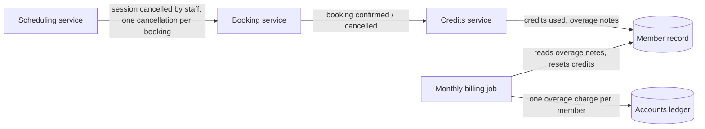

# Golden example, Level 2 — `areas/<area>.behind-the-scenes.md`

The Level 2 example for `dev:doc-business-model`: the same **Session credits & charges** area as [example-area.md](example-area.md), written for a project manager or support lead who wants to know how the work gets done. Same cast (Ana, Ben), same numbers, same question numbers — nothing here re-explains a rule; it adds the parts, the timing and the failure handling. **Shape, tone and the language limits are normative; domain content is illustrative.** Every statement has a row in the Level 3 evidence index ([example-technical.md](example-technical.md)).

Note what the example demonstrates: it follows the guide's sections and tasks — *For members*, *For staff*, *What happens automatically* — under the guide's own headings and in its order, and leaves out the one task with nothing behind it (*Set up plans and tiers*: the guide already says everything that happens, and what is remembered is in its own section); the metadata closes the file in *About this document*, with only the Audience line staying on top; plain role names for the parts, used the same way throughout; only the lanes each flow actually uses (straight away · afterwards · on a schedule — *Monthly posting* has just one); optional sections that do not apply (*Outside services*, *Settings and switches*) dropped, with the search behind each a row in Level 3's index; an honest *Timing and ordering* section that says what the system does **not** guarantee; a failure table where "No" under *Fixes itself?* is a valid answer; no class names, file names, status codes or framework words; and behaviour stated neutrally — what happens, never whether it is right. The verdict on the double return lives only in Level 3's Findings (F1), which the evidence index cites. In a `be-documenter` run the diagram shows only who tells whom; the pricing branches are a flow model, linked under *About this document*, and are not redrawn. No id appears in the body.

---

# Session credits & charges — Behind the scenes

How the work in **Session credits & charges** gets done: which parts are involved, what happens while you wait and afterwards, and what happens when a part is slow or down.

**Levels:** [Guide](credits-and-charges.md) · [Behind the scenes](credits-and-charges.behind-the-scenes.md) · [Technical reference](credits-and-charges.technical.md)
**Audience:** internal

## At a glance

When a booking is made or cancelled, the **booking service** saves it and then tells the **credits service** in the background. The credits service works out what the booking costs, updates the member's credits and, if the member has run out, notes an overage charge. Once a month, the **monthly billing job** adds up the notes, posts one charge for each member who has any, and resets everyone's credits. Nothing here talks to an outside service. The pricing decision's branches are drawn once, in the pricing flow model linked under *About this document*; the picture below shows only who tells whom.

## The parts involved

| Part | What it does here | Runs when |
|---|---|---|
| Booking service | Saves and cancels bookings; the one that tells the credits service | When a member or staff books or cancels |
| Scheduling service | Cancels a whole session on staff's say-so, which cancels every booking on it | When staff press *Cancel session* |
| Credits service | Prices a booking, spends and returns credits, notes overages | In the background, after a booking is saved or cancelled |
| Monthly billing job | Turns the month's overage notes into one charge per member and resets credits | The 1st of every month at 00:00 |
| Member record | Holds the member's plan, personal overage rate and *credits used* | Always (a record, not a process) |
| Accounts ledger | Holds the charges members owe | Always |

## For members

### Book a session

**Straight away (while the person waits)**

1. The booking service checks the seat, saves the booking and shows the member their confirmation.

**Afterwards (in the background)**

2. The booking service tells the credits service "booking confirmed". How soon it arrives is not visible from the code (see *Open questions*).
3. The credits service copies the tier's cost onto the booking, works out whether the member has enough credits, and updates *credits used* on the member record.
4. If there was a shortfall, it adds an overage note to the booking. Nothing is charged yet.

**What the member notices if a later step fails:** nothing at confirmation. If the credits service cannot do its part, the booking exists with no cost on it, and the member's credits look unchanged until someone sets it right (see *When parts fail or are slow*).

### Cancel a booking

**Straight away (while the person waits)**

1. The booking service marks the booking cancelled and shows the member a confirmation.

**Afterwards (in the background)**

2. The booking service tells the credits service "booking cancelled", saying whether it was the member or staff.
3. The credits service decides: credits come back and the booking's overage note is removed, or (late cancellation by a member) nothing changes. It updates *credits used*. It does not check whether it has already handled this cancellation, so if the "booking cancelled" message arrives twice, the credits are returned twice.

**What the member notices if a later step fails:** the cancellation looks complete, but their credits are not returned. There is no message about it.

## For staff

### Cancel a member's booking

The booking service sends the same "booking cancelled" message as for a member's cancellation, saying that staff cancelled it, so steps 1–3 of *Cancel a booking* apply.

When **staff cancel a whole session**, the scheduling service cancels each booking on it one by one, so every affected member goes through those steps and gets their credits back.

## What happens automatically

### Monthly posting

**On a schedule**

1. At 00:00 on the 1st the monthly billing job goes through every member.
2. For each member with overage notes not yet charged, it adds them up and writes one charge to the accounts ledger, marking the notes as charged.
3. It then resets the member's *credits used* to 0, whether or not there was a charge.

**What the member notices if it fails:** the charge arrives late, or credits are not reset when the month begins. The job does not report its own failures.

## What is remembered, and where

| Information | Kept as | Who may change it |
|---|---|---|
| Plan, monthly credits, overage rate | On the plan | Staff only |
| Credits per seat | On the session tier | Staff only |
| Personal overage rate | On the member record | Staff only |
| Cost of a booking in credits | A line on the booking, copied at the moment it is priced | The credits service, once |
| Credits used this month | On the member record | Only the three flows in this area: pricing, return, monthly reset |
| Overage notes | A line attached to the booking | The credits service (adds, removes); the monthly billing job (marks charged) |
| The monthly charge | A line in the accounts ledger | The monthly billing job |

## Timing and ordering

- **Pricing happens after the booking is saved**, not before. Until it is priced, a booking exists with no cost on it; how long that lasts is not visible from the code (see *Open questions*).
- **The cost is copied onto the booking when it is priced**, so a later change to a tier's cost or a plan's rate never touches earlier bookings.
- **The same "booking confirmed" message can be delivered more than once**, and nothing checks whether it has been priced already. A repeat spends the credits, and accrues the overage, a second time.
- **Order between a booking and its cancellation is not guaranteed** by anything in the code. Whether a cancellation can reach the credits service before the booking has been priced is not visible from the code (see *Open questions*).
- **The monthly reset and a booking made at the same moment** are not coordinated: a booking priced just before 00:00 on the 1st counts against the old month, one priced just after against the new.

## When parts fail or are slow

| Situation | What happens | What people notice | Fixes itself? |
|---|---|---|---|
| The credits service fails while pricing a booking | Tried 3 times in all, then set aside | The booking has no cost; credits unchanged | No — needs a person to look at the set-aside item |
| The credits service fails while returning credits | Nothing is retried and nothing is recorded | Credits are not returned; no message | No |
| The monthly billing job fails part way | Members already done keep their charge; the rest are not processed | Some members charged, others not, credits reset for some only | No — nothing re-runs it |
| A cancellation message is delivered twice | The credits are returned twice | Credits used can go below what was spent | No |

## If you change this

- **Changing the cost or rate of a tier or plan** affects only future bookings; a report that recomputes from the plan will disagree with what was charged.
- **Anything else that changes *credits used*** would be a second writer: today only this area's three flows write it, and the monthly reset assumes that.
- **The booking service's "cancelled" message** is what returns credits. A new way of cancelling a booking must send it, or credits will not come back.
- **The accounts ledger** receives one line per member with unposted overage each time the monthly billing job runs.

## Open questions

| # | Question | Why it matters |
|---|---|---|
| Q6 | Can a cancellation ever reach the credits service before the booking has been priced? | If so, credits could be returned that were never spent |
| Q7 | The monthly job does not report failures and nothing re-runs it. Who is expected to notice a missed month? | A silent failure here means members are not charged or reset |
| Q8 | Pricing is retried and then set aside; who looks at what is set aside, and how often? | Set-aside bookings stay unpriced until someone does |
| Q9 | How soon after a booking is the credits service told? | A member can see stale credits until it is; the code sets no target |

## About this document

**Created:** 2026-08-02
**Owned by:** `dev:doc-business-model`
**Derived from:** code by `be-documenter` @ `a3f9c21` on 2026-08-02
**Models:** [FLOW-004 pricing a booking]
