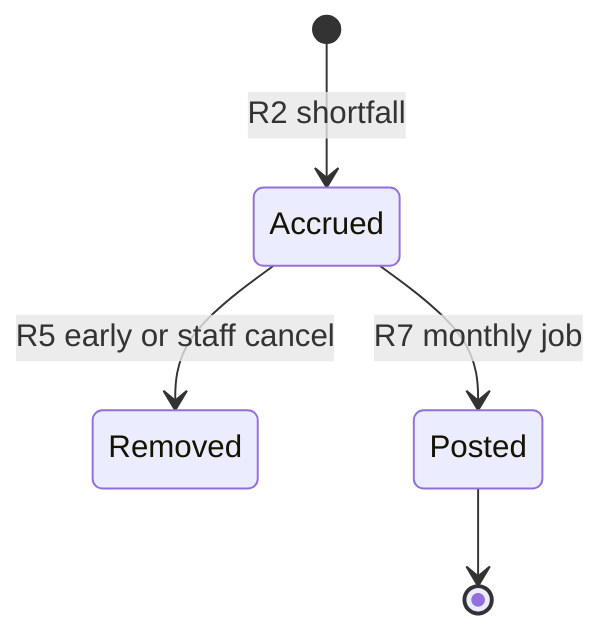
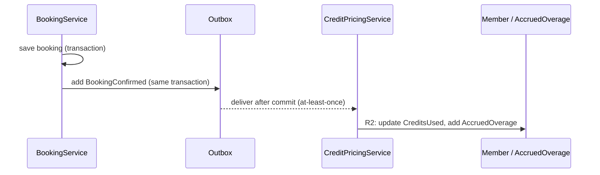

# Golden example, Level 3 — `areas/<area>.technical.md`

The Level 3 example for `dev:doc-business-model`: the same **Session credits & charges** area as [example-area.md](example-area.md) (Level 1) and [example-behind-the-scenes.md](example-behind-the-scenes.md) (Level 2), written for developers and AI agents. Every code name, path, status code and tier tag the other two levels keep out is here. **Shape, heading names, local ids and the evidence index are normative; domain content, paths and line numbers are illustrative.**

Note what the example demonstrates: tables over prose; one fact per row with its evidence on the same row; local ids (`EP1`, `R4`, `DB2`…) the evidence index and other agents can cite; Mermaid for the state machine and the multi-participant flow; the same plain part names as Level 2 mapped to class names; a section with nothing to report (*Integrations*, *Configuration*) stating the search that found nothing; a Finding carrying its boundary condition — the only place in the set where behaviour is called a defect; and an evidence index whose Section cells cite `Task · step N` (and, in Level 1, `Task · outcome N`) for every flow of Levels 1 and 2, with its one `#inferred` row naming the open question that carries it.

---

# Session credits & charges — Technical reference

**Created:** 2026-08-02
**Owned by:** `dev:doc-business-model`
**Derived from:** code by `be-documenter` @ `a3f9c21` on 2026-08-02
**Audience:** internal
**Levels:** [Guide](credits-and-charges.md) · [Behind the scenes](credits-and-charges.behind-the-scenes.md) · [Technical reference](credits-and-charges.technical.md)
**Stack:** .NET 8, ASP.NET Core minimal APIs, EF Core 8, PostgreSQL, in-process outbox · **Depth:** full · **Traced:** 2026-08-02

## How to read this

- Tiers: `#observed` = code read this session at the cited `path:line`; `#inferred` = intent, always tied to an open question (`Q` in Levels 1–2, `T` here). Never `#confirmed`.
- Paths are repo-relative; `a-b` after a colon is a line range. Citations are valid only at the commit above.
- Local ids: `EP` entry point · `R` rule · `DB` data · `EV` event/reaction · `INT` integration · `CFG` configuration · `ERR` error · `F` finding · `T` technical open question. Code map, Tests, vocabulary and Changing-this-safely rows carry no id.
- Models: [FLOW-004] · [ENT-003] · [DEC-002]. Dependency map: EVT-004–006, RX-004–007, INV-004.

## Quick facts

| Area id | Modules | Entry points | Entities | Events in / out | Integrations | Flags |
|---|---|---|---|---|---|---|
| AREA-004 | `src/Credits/` | 4 HTTP · 1 job · 2 consumers | `MembershipPlan`, `SessionTier`, `Member.CreditsUsed`, `AccruedOverage` | in: `BookingConfirmed`, `BookingCancelled` · out: none | none | none |

## Code map

| Concern | Path | Notes |
|---|---|---|
| Routing | `src/Credits/CreditEndpoints.cs`, `src/Credits/PlanAdminEndpoints.cs` | Minimal API route groups |
| Pricing and returns | `src/Credits/CreditPricingService.cs`, `src/Credits/BookingCancelledHandler.cs` | Plain-language name: *credits service* |
| Monthly posting | `src/Credits/OverageChargeJob.cs` | Plain-language name: *monthly billing job* |
| Domain | `src/Credits/MembershipPlan.cs`, `SessionTier.cs`, `AccruedOverage.cs` | |
| Validation | `src/Credits/MembershipPlanValidator.cs` | FluentValidation |
| Persistence | `src/Credits/Migrations/`, `migrations/007` | |
| Outbox | `src/Shared/Outbox.cs` | Shared with Bookings |

## Entry points

| Id | Trigger | Handler | Auth | Contract | Evidence |
|---|---|---|---|---|---|
| EP1 | `GET /members/me/credits` | `CreditEndpoints.cs:21` | policy `credits:own` | → `{creditsUsed, creditsRemaining, accruedOverage}` | `CreditEndpoints.cs:21` |
| EP2 | `PUT /plans/{id}` | `PlanAdminEndpoints.cs:17` | policy `workshops:manage` | `{name, monthlyCredits, overageRate}` → `204` | `PlanAdminEndpoints.cs:17` |
| EP6 | `PUT /tiers/{id}` | `PlanAdminEndpoints.cs:36` | policy `workshops:manage` | `{creditsPerSeat}` → `204` | `PlanAdminEndpoints.cs:36` |
| EP7 | `PUT /members/{id}/overage-rate` | `PlanAdminEndpoints.cs:48` | policy `workshops:manage` | `{overageRate: decimal \| null}` → `204`; `null` clears | `PlanAdminEndpoints.cs:48-55` |
| EP3 | consumer: `BookingConfirmed` | `CreditPricingService.cs:31` | internal | event `BookingConfirmed.cs:6` | `CreditPricingService.cs:31` |
| EP4 | consumer: `BookingCancelled` | `BookingCancelledHandler.cs:19` | internal | event `BookingCancelled.cs:8` | `BookingCancelledHandler.cs:19-33` |
| EP5 | job: cron `0 0 1 * *` | `OverageChargeJob.cs:12` | internal | — | `OverageChargeJob.cs:12` |

## Rules, validations and decisions

| Id | Rule | Condition | Effect | Evidence | Tier |
|---|---|---|---|---|---|
| R1 | Credit cost | always | `cost = SessionTier.CreditsPerSeat`, copied onto the booking | `CreditPricingService.cs:31` | `#observed` |
| R2 | Spend or overage | `cost <= plan.MonthlyCredits - member.CreditsUsed` | spend `cost`, no overage; else spend remainder, `overage = (cost - remaining) * rate` | `CreditPricingService.cs:31-61`, [DEC-002] | `#observed` |
| R3 | Rate precedence | `member.OverageRateOverride != null` | member rate, else `plan.OverageRate` | `CreditPricingService.cs:48` | `#observed` |
| R4 | Never refuse | credits exhausted | no refusal branch | `CreditPricingService.cs:55` | `#observed` |
| R5 | Return on cancel | `hoursBeforeStart >= 24` or `cancelledBy == Staff` | return booking's credits, delete its `AccruedOverage` | `BookingCancelledHandler.cs:19-33` | `#observed` |
| R6 | Late forfeit | member cancels `< 24 h` before start | nothing returned, accrual kept; no fee path | `BookingCancelledHandler.cs:27` | `#observed` |
| R7 | Monthly post | unposted accruals sum `> 0` | one ledger charge, accruals marked posted | `OverageChargeJob.cs:40-58`, `:44` | `#observed` |
| R8 | Monthly reset | every member, every run | `CreditsUsed = 0`; no roll-over | `OverageChargeJob.cs:58` | `#observed` |
| R9 | Plan and override validation | EP2, EP7 | `MonthlyCredits >= 0` integer; plan rate and override `>= 0` | `MembershipPlanValidator.cs:15-19`, `PlanAdminEndpoints.cs:52` | `#observed` |
| R10 | Constants | — | cut-off 24 h at `BookingCancelledHandler.cs:19`; posting time at `OverageChargeJob.cs:12`; fixed in code, Q1, Q3 | as cited | `#observed` |

## Data

| Id | Entity / table | Reads | Writes | Also written by | Constraints / migration |
|---|---|---|---|---|---|
| DB1 | `MembershipPlan` / `membership_plans` | pricing, EP1 | EP2 | — | unique `name`, `migrations/007:22` |
| DB2 | `Member.CreditsUsed` | R2, EP1 | R2, R5, R8 | no other writer (search: `CreditsUsed` under `src/`) | none |
| DB3 | `AccruedOverage` | R7, EP1 | R2 (add), R5 (delete), R7 (mark posted) | — | FK to `Booking`, `migrations/009` |
| DB4 | `Booking.CreditCost` | R5 | R1 | — | copied at pricing time, `CreditPricingService.cs:31` |

Refused: `Posted → Removed` (a posted accrual is never reversed; no code path), `Removed → Posted`. `[ENT-003]`

## Control flow

- **Transaction boundary:** booking save and outbox row commit together; pricing runs after commit (`Outbox.cs:22`).
- **Retries:** pricing consumer gets 3 attempts in all, then is parked; the cancellation handler has no failure path (`Outbox.cs:22`, `BookingCancelledHandler.cs:19-33`).
- **Idempotency:** none found (search: `IdempotencyKey`, `Processed` under `src/`); see **F1**.
- **Concurrency:** no lock or version column on `Member.CreditsUsed`; ordering between `BookingConfirmed` and `BookingCancelled` for one booking is `?` — **T1**.

## Events and reactions

| Id | Entry point | Kind | Reads | Writes | Also written by | Emits | Reacted to by | Mode | On failure | Evidence |
|---|---|---|---|---|---|---|---|---|---|---|
| EV1 | `BookingService.Confirm` | command | `Session` | `Booking` (insert; `CreditCost` left null for R1) | — | `BookingConfirmed` (EVT-005) | `CreditPricingService.cs:31` (RX-004) | after commit, at-least-once | 3 attempts in all, then parked | `Outbox.cs:22` |
| EV2 | `BookingService.Cancel` | command | `Booking` | `Booking.Status` | — | `BookingCancelled` (EVT-006) | `BookingCancelledHandler.cs:19` (RX-006) | after commit, `?` | unhandled | `BookingCancelledHandler.cs:19-33` |
| EV3 | `SessionService.CancelSession` | command | `Booking` | `Booking.Status` | — | one `BookingCancelled` per booking (EVT-004 → RX-005 → EVT-006) | RX-006 | after commit, `?` | `?` | `SessionService.cs:70-96` |
| EV4 | `OverageChargeJob` | schedule | `AccruedOverage` | `AccruedOverage.Posted`, `Member.CreditsUsed`, ledger | — | none (search: `Publish`, `Emit`, `Outbox.Add` under `src/Credits/`) | — | scheduled | unhandled | `OverageChargeJob.cs:40-58` (RX-007) |

## Integrations

None. Search: `HttpClient`, `IHttpClientFactory`, `*Client` under `src/Credits/` — no match.

## Configuration

None. Search: `IOptions<`, `Configuration[`, `appsettings` keys `Credits:*` — no match; all values are constants (R10).

## Errors

| Id | Condition | Status / problem type | Body | User-visible text | Evidence |
|---|---|---|---|---|---|
| ERR1 | Plan name not unique | `409` `plan-name-taken` | problem details | “That plan name is already taken.” | `migrations/007:22` → `PlanAdminEndpoints.cs:31` |
| ERR2 | Invalid plan or override values (R9) | `400` `validation-failed` | field errors | “Monthly credits must be 0 or more.” · “Overage rate must be 0 or more.” | `MembershipPlanValidator.cs:15-19` |
| ERR3 | `credits:own` or `workshops:manage` missing | `403` | empty | — | `CreditEndpoints.cs:21`, `PlanAdminEndpoints.cs:17` |

## Telemetry

None found. Search: `ActivitySource`, `Meter`, `ILogger` calls in `src/Credits/` — only a start-up log line at `OverageChargeJob.cs:9`; no span, metric or log at R2, R5, R7 — **F2**.

## Tests

| Test | Covers | Gaps |
|---|---|---|
| `tests/Credits/CreditPricingServiceTests.cs:18-90` | R1–R4 | boundary `cost == remaining`; override precedence |
| `tests/Credits/OverageChargeJobTests.cs:12-44` | R7 | partial failure; R8 |
| — | R5, R6 untested | late-cancel boundary at exactly 24 h |

## Business ↔ code vocabulary

| Business / Level 2 name | Code |
|---|---|
| Credits service | `CreditPricingService`, `BookingCancelledHandler` |
| Monthly billing job | `OverageChargeJob` |
| Booking service | `BookingService` (`src/Bookings/`) |
| Scheduling service | `SessionService` (`src/Scheduling/`) |
| Overage note | `AccruedOverage` |
| Plan (client term on the staff screen) | `MembershipPlan` |
| Session credits | `nav.credits` in `Resources/staff-ui.en.json` |
| Monthly allowance | `plans.monthlyCredits`; `MembershipPlan.MonthlyCredits` |
| Overage rate (per credit) | `plans.overageRate`; `MembershipPlan.OverageRate` |
| Personal overage rate | `members.overageOverride`; `Member.OverageRateOverride` |
| Cancel session | `sessions.cancel`; `SessionService.CancelSession` |
| Overage rate override (staff screen) | `Member.OverageRateOverride` |
| Session tier: Standard · Workshop · Masterclass | `SessionTier` enum display names |
| Credits used | `Member.CreditsUsed` |

## Changing this safely

| Item | Why | Evidence |
|---|---|---|
| Keep `CreditsUsed` single-writer | the monthly reset assumes no other writer | search: `CreditsUsed` under `src/` |
| Every cancellation path must emit `BookingCancelled` | it is the only trigger for returns | `BookingCancelledHandler.cs:19` |
| Copy the cost at pricing time | later tier changes must not re-price | `CreditPricingService.cs:31` |

## Findings

| # | Finding | Boundary condition | Evidence | Kind | Route to |
|---|---|---|---|---|---|
| F1 | No idempotency on pricing or returns | A redelivered `BookingConfirmed` for a 3-credit booking spends 6 credits and accrues the overage twice | `Outbox.cs:22`; no key (search above) | defect | `be-dotnet` / `code-auditor` |
| F2 | No telemetry at decision points | A mis-priced booking leaves nothing to trace in Grafana | search under *Telemetry* | gap | `be-dotnet` |
| F3 | Monthly job has no failure path or re-run | A crash after member 40 of 100 leaves 60 members unposted and unreset | `OverageChargeJob.cs:40-58` | defect | `be-dotnet` |

## Technical open questions

| # | Question |
|---|---|
| T1 | Is `BookingCancelled` guaranteed to follow `BookingConfirmed` for the same booking? Nothing in the outbox ordering shows it. |

## Evidence index

| Level | Section | Statement | Evidence | Tier |
|---|---|---|---|---|
| Guide | Important | A booking is priced once, after it is confirmed, and never re-priced | see **EV1**, **R1**; no re-pricing path (search: `Reprice`, `Recalculate` under `src/Credits/`) | `#observed` |
| Guide | Important | Returned credits never reduce an accrued overage | no reader of returned credits outside future pricing (search: `ReturnedCredits` under `src/`); Q2 | `#observed` |
| Guide | Who uses it | Members see own balances; staff manage plans, tiers and overrides and always return credits | see **EP1**, **EP2**, **EP6**, **EP7**, **R5** | `#observed` |
| Guide | Who uses it | Applies to every member — no eligibility limits | search: `Eligib`, `AppliesTo` under `src/Credits/` — none | `#observed` |
| Guide | How it fits together | Overage accrues during the month, posted once at month start | see **R7**, **EV4** | `#observed` |
| Guide | How it fits together | Credit, session tier, overage and overage rate as defined; Credits per seat by tier | see **R1**, **R2**, **R3**, **DB1**, `SessionTier.cs:11` | `#observed` |
| Guide | How it fits together | A booking's credits: spent, returned or kept, overage accrued then posted | see **DB3**, **R2**, **R5**, **R6**, **R7** | `#observed` |
| Guide | Book a session | No member screen found; steps are plain verbs without labels | search: member-facing routes, pages and `Resources/*.en.json` keys for booking under `src/` — only `Resources/staff-ui.en.json` | `#observed` |
| Guide | Book a session · steps 1–2 | A member books a seat; the seat is allocated by Bookings | see **EV1** | `#observed` |
| Guide | Book a session · outcome 1 | Credit cost from the session tier | see **R1** | `#observed` |
| Guide | Book a session · outcome 2 | Credits remaining; enough credits means spend, no charge | see **R2** | `#observed` |
| Guide | Book a session · outcome 3 | Shortfall becomes an overage; rate precedence | see **R2**, **R3** | `#observed` |
| Guide | Book a session · outcome 4 | Overage recorded against the member, not yet charged | see **R2**, **DB3** | `#observed` |
| Guide | Book a session · outcome 5 | A booking is never refused for lack of credits | see **R4** | `#observed` |
| Guide | Book a session | Example: 2 of 3 credits remain, shortfall 1 × £6.00 = £6.00 | see **R2** | `#observed` |
| Guide | Cancel a booking | No member screen found; steps are plain verbs without labels | search: as under Book a session | `#observed` |
| Guide | Cancel a booking · steps 1–2 | A member cancels; the cancellation says who cancelled | see **EV2** | `#observed` |
| Guide | Cancel a booking · outcome 1 | 24 hours or more ahead returns credits and removes the accrual | see **R5** | `#observed` |
| Guide | Cancel a booking · outcome 2 | Late member cancellation returns nothing | see **R6**; Q4 | `#observed` |
| Guide | Cancel a booking · outcome 3 | Returned credits are for future bookings only | see **R5**; no reader of returned credits outside future pricing (search: `ReturnedCredits` under `src/`) | `#observed` |
| Guide | Cancel a booking | A late cancellation cannot be undone | see **R6** | `#observed` |
| Guide | Set up plans and tiers · steps 1–4 | Staff set plan, monthly credits, rate, tier cost and a member's personal rate with the staff screen's labels | see **EP2**, **EP6**, **EP7**, **DB1**; labels at `staff-ui.en.json:2`, `:5`, `:6`, `:8` | `#observed` |
| Guide | Set up plans and tiers · outcome 1 | A change applies to future bookings only | see **R1**, **DB4** | `#observed` |
| Guide | Set up plans and tiers · outcome 2 | A member's personal rate wins over the plan's | see **R3** | `#observed` |
| Guide | Set up plans and tiers | Validations and the messages staff see | see **R9**, **DB1**, **ERR1**, **ERR2** | `#observed` |
| Guide | Cancel a member's booking · steps 1–2 | Staff cancel a member's booking | see **EV2** | `#observed` |
| Guide | Cancel a member's booking · outcome 1 | A staff cancellation always returns the credits and removes the accrual | see **R5** | `#observed` |
| Guide | Cancel a member's booking | Cancel session cancels each booking one by one; label at `staff-ui.en.json:11` | see **EV3** | `#observed` |
| Guide | Monthly posting · steps 1–2 | One charge per member per run; zero sum posts nothing | see **R7** | `#observed` |
| Guide | Monthly posting · step 3 | Credits reset, no roll-over | see **R8** | `#observed` |
| Guide | Rules and limits | Plan, tier, member override and precedence; staff set them | see **DB1**, **R3**, **EP2**, **EP6**, **EP7**, `SessionTier.cs:11` | `#observed` |
| Guide | Rules and limits | Validations: unique name, whole-number credits, non-negative rates | see **R9**, **DB1** | `#observed` |
| Guide | Rules and limits | Cut-off, posting time, no roll-over fixed in code | see **R10**; Q1, Q3 | `#observed` |
| Guide | Rules and limits | A tier or rate change affects future bookings only | see **R1**, **DB4** | `#observed` |
| Guide | A month in numbers | Ana's March, her £6.00 posted, one unused credit lost; Ben's £4.50 | see **R2**, **R3**, **R5**, **R6**, **R7**, **R8** | `#observed` |
| Guide | Related areas | Starts from Bookings and Scheduling; sets off nothing; shares bookings read-only | see **EV1**, **EV2**, **EV3**, **EV4**, **DB2** | `#observed` |
| Guide | Open questions | Appears to exist so members can book beyond their plan without being refused | comment at `CreditPricingService.cs:9`; Q5 | `#inferred` |
| Behind the scenes | At a glance | Nothing here talks to an outside service | search under Integrations | `#observed` |
| Behind the scenes | The parts involved | Part names and what each does | see Business ↔ code vocabulary; **EV1**–**EV4** | `#observed` |
| Behind the scenes | The parts involved | Credits service runs after the booking is saved; billing job at 00:00 on the 1st | see **EV1**, **EP5** | `#observed` |
| Behind the scenes | Booking a seat · step 1 | Booking saved and confirmed before pricing | see **EV1** | `#observed` |
| Behind the scenes | Booking a seat · step 2 | How soon the credits service is told is not shown | no delay, poll interval or schedule visible at `Outbox.cs:22`; Q9 | `#observed` |
| Behind the scenes | Booking a seat · steps 3–4 | Cost copied onto the booking; overage note added | see **R1**, **R2**, **DB4** | `#observed` |
| Behind the scenes | Cancelling a booking · steps 1–2 | Cancellation saved, then the credits service is told who cancelled | see **EV2** | `#observed` |
| Behind the scenes | Cancelling a booking · step 3 | A repeated cancellation message returns the credits twice | see **F1** | `#observed` |
| Behind the scenes | Cancelling a booking | Staff cancelling a session cancels each booking one by one | see **EV3** | `#observed` |
| Behind the scenes | Monthly posting · steps 1–3 | Runs at 00:00 on the 1st; one charge per member per run; reset for everyone | see **EP5**, **R7**, **R8** | `#observed` |
| Behind the scenes | What is remembered, and where | Plan values, tier costs and personal rate changed only by staff | see **EP2**, **EP6**, **EP7**, **DB1** | `#observed` |
| Behind the scenes | What is remembered, and where | Booking cost written once at pricing; credits used has three writers; notes and ledger writers | see **DB2**, **DB3**, **DB4**, **EV4** | `#observed` |
| Behind the scenes | Timing and ordering | Pricing after save; unpriced until then, duration not shown | see **EV1**; Q9 | `#observed` |
| Behind the scenes | Timing and ordering | A redelivered confirmation is priced again | see **F1** | `#observed` |
| Behind the scenes | Timing and ordering | Order of booking and cancellation not guaranteed | no ordering key or sequence number (search: `Sequence`, `OrderingKey`, `Version` in `src/Credits/` and `src/Shared/Outbox.cs`); **T1**, Q6 | `#observed` |
| Behind the scenes | Timing and ordering | Monthly reset and a booking at the same moment are not coordinated | no lock or version column (search: `RowVersion`, `Lock`, `ConcurrencyToken` under `src/Credits/`) | `#observed` |
| Behind the scenes | When parts fail or are slow | Pricing gets 3 attempts in all; returns and monthly job have no failure path | see **EV1**, **EV2**, **EV4**, **F3** | `#observed` |
| Behind the scenes | Settings and switches | No *Settings and switches* section — nothing differs by environment or switch | search under Configuration | `#observed` |
| Behind the scenes | If you change this | Cost copied at pricing; single writer of credits used; only the cancelled message returns credits | see Changing this safely; **DB2**, **EV2** | `#observed` |
| Behind the scenes | If you change this | Ledger gets one line per member with unposted overage per run | see **R7**, **EV4** | `#observed` |
