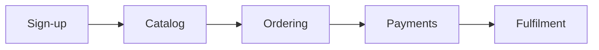

# System overview — the guide to the whole system

Load this when writing or refreshing `system-overview.md` — never for an area or feature guide.

`system-overview.md` is the entry point for a reader who knows nothing. It reads like an area's guide: who uses the system, one picture of the main journey, then the areas grouped by who uses them. It closes with `## About this document` (the metadata of `SKILL.md`'s *About this document*, with `**Audience:** shareable` and no `**Screenshots:**` line — the overview holds none).

````markdown
# <System>

<One sentence: what it is and for whom, in the client's words.>

> [!IMPORTANT]
> <The rule that governs the whole system.>                ← optional

## Who uses it
| Who | What they do | Start here |
|---|---|---|
| Customers | Browse, order and track what they bought | [Ordering](areas/ordering.md) |
| Administrators | Set up the catalogue, prices and who can sign in | [Shop settings](areas/shop-settings.md) |

## The journey


## Areas, by who uses them
### For customers
| Area | What you can do there |
|---|---|
| [Ordering](areas/ordering.md) | Place, change and cancel an order |

### For administrators
| Area | What you can do there |
|---|---|
| [Shop settings](areas/shop-settings.md) | Set prices, delivery options and staff accounts |

### Running the shop
| Area | What it does |
|---|---|
| [Billing](areas/billing.md) | Takes payment and posts the month's charges |

## End-to-end flows
### New customer's first order
1. **Sign-up** — the customer registers and verifies their email
2. **Catalog** — they browse and add items to a basket
3. **Ordering** — they place the order

## Foundations
<How sign-in and permissions work, how people learn something failed, how organisations' data is kept apart. One or two plain lines each.>

## What is not documented
| Area / surface | Why | Revisit when |
|---|---|---|

## Open questions
| # | Question | Why it matters |
|---|---|---|

## About this document
**Created:** YYYY-MM-DD
**Owned by:** `dev:doc-business-model`
**Derived from:** code by `be-documenter` @ `<sha>` on YYYY-MM-DD
**Audience:** shareable
````

- **`## Who uses it`** lists the people in the order they meet the system, administrators included; *Start here* is the first guide that person reads, linked by name.
- **`## The journey`** is one `flowchart LR` of the main end-to-end journey: nodes are area names in double quotes, nine at most, and every arrow is a step of an end-to-end flow below. The lint reads it like an area guide's diagram.
- **`## Areas, by who uses them`** has one `### For <person>` per person in *Who uses it*, in that order, each a `| Area | What you can do there |` table whose first cell links the area's guide **by name**. An area several people use sits under the first, and the others link to it. `### Running the shop` holds automatic areas, when there are any. An area's row here is the description its `INDEX.md` line carries (at most 20 words).
- **`## End-to-end flows`** — a `###` per journey, numbered steps naming each area's guide by name, never by `AREA-` id.
- **`## Foundations`** — sign-in and roles in the words a user meets them (who can see what, what an administrator can do that others cannot), in plain lines. No technology names.
- **An old-shape overview** (`## Overview` and `## The areas` and no `## Who uses it`) is updated in place into this shape under `SKILL.md`'s reconcile procedure — the `## The areas` rows move under the person who uses each area, nothing is regenerated. Its `system-overview.behind-the-scenes.md` and `system-overview.technical.md` are retired levels: read as leads, then deleted.

**"What is not documented" is mandatory.** A documentation set that does not state its own limits gets read as complete, and the parts nobody traced become the parts everyone assumes are fine. Every entry point, job and consumer the survey parked is a row here, with its reason; the orientation cache, `docs/agent-context/be-documenter.md`, keeps the surface counts.
