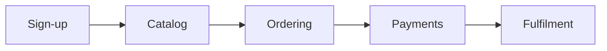

# System overview — the same three levels

Load this when writing or refreshing `system-overview.md` and its two siblings — never for an area or feature set.

`system-overview.md` is the entry point for a reader who knows nothing; its two siblings carry what that reader later wants. It reads like an area's guide: who uses the system, one picture of the main journey, then the areas grouped by who uses them. Level 1 keeps `**Levels:**` on top and closes with `## About this document` (the metadata block of `SKILL.md`'s Header block, with `**Audience:** shareable`); Level 2 keeps `**Levels:**` and `**Audience:** internal` on top and closes the same way; Level 3 keeps its whole block on top. The three share one `Derived from` sha.

**`system-overview.md` (Level 1)** — plain:

````markdown
# <System>

<One sentence: what it is and for whom, in the client's words.>

**Levels:** [Guide](system-overview.md) · [Behind the scenes](system-overview.behind-the-scenes.md) · [Technical reference](system-overview.technical.md)

> [!IMPORTANT]
> <The rule that governs the whole system.>                ← optional

## Who uses it
| Who | What they do | Start here |
|---|---|---|
| Customers | Browse, order and track what they bought | [Ordering](areas/ordering.md) |

## The journey


## Areas, by who uses them
### For customers
| Area | What you can do there |
|---|---|
| [Ordering](areas/ordering.md) | Place, change and cancel an order |

### Running the shop
| Area | What it does |
|---|---|
| [Billing](areas/billing.md) | Takes payment and posts the month's charges |

## End-to-end flows
### New customer's first order
1. **Sign-up** — the customer registers and verifies their email
2. **Catalog** — they browse and add items to a basket
3. **Ordering** — they place the order

## Foundations
<How sign-in and permissions work, how failures reach users, how organisations' data is kept apart. One or two plain lines each.>

## What is not documented
| Area / surface | Why | Revisit when |
|---|---|---|

## Open questions
| # | Question | Why it matters |
|---|---|---|

## About this document
**Created:** YYYY-MM-DD
**Owned by:** `dev:doc-business-model`
**Derived from:** code by `be-documenter` @ `<sha>` on YYYY-MM-DD
**Audience:** shareable
````

- **`## Who uses it`** lists the people in the order they meet the system; *Start here* is the first guide that person reads, linked by name.
- **`## The journey`** is one `flowchart LR` of the main end-to-end journey: nodes are area names in double quotes, nine at most, and every arrow is a step of an end-to-end flow below. The lint reads it like an area guide's diagram.
- **`## Areas, by who uses them`** has one `### For <person>` per person in *Who uses it*, in that order, each a `| Area | What you can do there |` table whose first cell links the area's guide **by name**. An area several people use sits under the first, and the others link to it. `### Running the shop` holds operator and automatic areas, when there are any. An area's row here is the description its `INDEX.md` line carries (at most 20 words).
- **`## End-to-end flows`** is unchanged: a `###` per journey, numbered steps naming each area's guide by name, never by `AREA-` id.
- **An old-shape overview** (`## Overview` and `## The areas` and no `## Who uses it`) is updated in place into this shape under `SKILL.md`'s reconcile procedure — the `## The areas` rows move under the person who uses each area, nothing is regenerated.

**`system-overview.behind-the-scenes.md` (Level 2)** — written from the dependency map; `EVT-`/`RX-`/`INV-` ids appear only in Level 3 (and, with the other ids, in `## About this document`), and Level 2's neutral wording, banned words and guarantee words apply:

```markdown
# <System> — Behind the scenes

<One sentence: what this explains.>

**Levels:** …
**Audience:** internal

## At a glance                ← a few sentences and one Mermaid map of the areas and what starts what
## What runs when              ← scheduled and background work, in plain words
## Outside services            ← optional: each service the system talks to, and what happens if it is down
## Where information lives     ← which area owns which records, and which areas read them
## How a failure travels       ← where a problem in one area is noticed in another
## End-to-end flows
### <Flow — same heading as in system-overview.md>
                               ← lanes used only where needed: Straight away (while the person waits) ·
                                 Afterwards (in the background) · On a schedule
## About this document         ← the metadata block, last
```

**`system-overview.technical.md` (Level 3)** — the architecture an agent needs on arrival:

```markdown
# <System> — Technical reference
<header block — Audience: internal>

## How to read this            ← tier legend, path convention, id scheme
## Stack and versions
## Module structure            ← where each area's code lives
## Foundations                 ← authentication and authorisation, tenancy, error handling and problem types,
                                 logging and telemetry, configuration and secrets handling, background-work framework
## Coverage ledger             ← every entry point, job and consumer assigned to exactly one area or parked, with a reason
## Findings                    ← system-wide; links to events.md, shared-data.md, invariants.md, glossary.md
## Evidence index              ← backs both plain files
```

Flows sit under `## End-to-end flows` as `###` headings in both plain files, and the evidence index cites them exactly as an area's: `<Flow heading> · step N`.

**"What is not documented" is mandatory.** A documentation set that does not state its own limits gets read as complete, and the parts nobody traced become the parts everyone assumes are fine.
