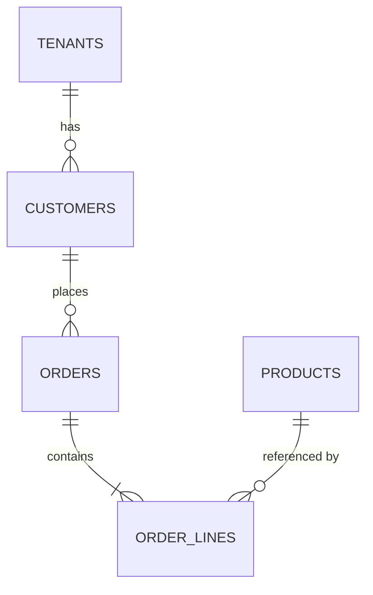
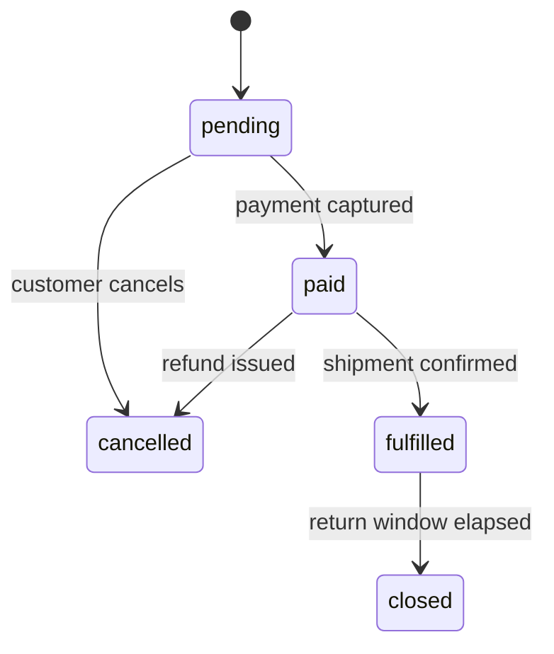

# Data Model Plan — the logical DB structure

The plan altitude: **every table, every column, every key, every index — and why each exists** — expressed so an implementing agent writes the migration without inventing structure, and a reviewer can see the shape of the system in one read. Engine-specific DDL, index internals, partitioning, and row-level-security mechanics are `data-architect`'s; this document states the *requirement* they satisfy.

**Prerequisite:** an **approved** `blueprint.md`. Its Key entities column and its tenancy decision are the inputs. Do not run this on an unapproved blueprint.

## When to use

- Step 2 of a `solution-planner` run, after blueprint approval
- A new functional area is being added to an existing planned system (`EXTEND` — model the delta, reuse the existing conventions)
- An existing schema needs documenting as the baseline a plan will extend (`RESUME` — read it out of migrations and entities, mark everything `#observed` — repo-read facts are never `#confirmed`, that tier is human-stated only — then plan the delta)

## When NOT to use

- The blueprint is not approved → the model will be rewritten; wait
- The question is *which engine*, or how to make one query fast, or whether to partition → `data-architect`
- The output wanted is actual DDL or ORM entity classes → `be-<stack>`'s `database-code` skill, executed by the `be-<stack>` agent

## Output

**`docs/plans/<NNN>-<initiative>/data-model.md`** in the initiative folder the blueprint established.

**A filled golden example is at `references/example-data-model.md`** (the shared `001-workshop-booking` pack — shapes normative, domain content illustrative).

---

## Procedure

### Step 1 — Fix the cross-cutting conventions first

Decide these **once**, at the top of the document, before any table. Every table then inherits them silently, and only deviations are noted per table. Getting this order wrong — tables first, conventions later — produces a model where the same decision is made three different ways.

| Convention | Default | Decide by |
|---|---|---|
| **Primary key** | `UUIDv7` (time-ordered, index-friendly, safe to expose) | Exposure in URLs, insert volume, whether an external system dictates ids |
| **Natural / business keys** | A unique constraint alongside the surrogate PK, never *as* the PK | Does the business value ever change? If it can, it is not a key |
| **Money** | Integer minor units, or `decimal(19,4)` — **never** float/double | The currency set; whether multi-currency (then an explicit currency column, no implicit default) |
| **Timestamps** | `created_at` / `updated_at`, UTC, timezone-aware type | Whether business time differs from system time (an event's local time is its own column) |
| **Soft delete** | **Off by default.** On only where the business requires recovery or audit | If on: every query filters it, every unique constraint becomes partial, and that is stated here once |
| **Tenancy** | Per the blueprint's decision | Whether isolation is enforced by the DB (RLS) or by the application — if the latter, `qa-security`'s cross-tenant leak test is **mandatory**, not optional |
| **Concurrency** | A version/rowversion column on entities with concurrent edits | Which entities actually have contended writes — not all of them |
| **Audit trail** | `created_by` / `updated_by` where accountability matters; a separate audit table where history matters | "Who changed it" vs "what did it look like then" are different requirements |
| **Enums** | Stored as a stable string or a lookup table, never an ordinal int | Whether the set is closed and app-owned (string) or business-editable (lookup table) |
| **Naming** | Match the existing schema; otherwise `snake_case`, plural tables, singular column nouns | The existing schema always wins |

State each choice with its reason. In an existing schema, **the project's convention wins over every default above** — record what it does, not what you would have chosen.

### Step 2 — Catalog the entities

One row per entity, derived from the blueprint's functional areas:

| Entity | Owning area | Purpose | Lifecycle states | Volume / growth | Notes |
|---|---|---|---|---|---|

- **In a modular monolith the owning-area cell also names the module's schema** (`Booking · schema booking`), taken from the blueprint's `Modules:` line.
- **Lifecycle states** matter more than they look: a column of `—` means the entity is created and never changes, which is worth confirming. Anything with real states gets its transitions drawn in Step 5, and those transitions become both `409` state-conflict validations in `api-surface.md` and state-transition test cases downstream.
- **Every blueprint area must appear** as an owner of at least one entity. An area owning none is either a cross-cutting concern mislabeled as an area, or a gap — say which.
- **Volume/growth** is what tells the reader whether an index matters. `[TBD - <owner>]` is fine; a guess presented as fact is not.

### Step 3 — Specify each table

For every entity, one block. This is the level of detail that lets an implementer write the migration without a decision:

````markdown
### `orders` — Ordering area (schema `ordering`)
Purpose: one customer purchase, from placement through fulfilment.
Lifecycle: `pending → paid → fulfilled → closed`; `pending|paid → cancelled`.

| Column | Type | Null | Default | Constraint / note |
|---|---|---|---|---|
| `id` | uuid | no | — | PK, UUIDv7 |
| `tenant_id` | uuid | no | — | FK → `tenants.id`; every query filters on it |
| `customer_id` | uuid | no | — | FK → `customers.id`, restrict on delete |
| `status` | text | no | `'pending'` | one of `pending,paid,fulfilled,cancelled,closed` |
| `total_minor` | bigint | no | — | minor units; `>= 0` |
| `currency` | char(3) | no | — | ISO 4217 |
| `placed_at` | timestamptz | no | `now()` | business time of placement |
| `version` | int | no | `0` | optimistic concurrency |
| `created_at` / `updated_at` | timestamptz | no | `now()` | convention |

**Keys & constraints**
- PK `id`
- UNIQUE (`tenant_id`, `order_number`) — the customer-facing reference
- CHECK `total_minor >= 0`
- FK `customer_id` → `customers.id` ON DELETE RESTRICT — an order outlives a customer edit

**Indexes**
| Index | Columns | Serves |
|---|---|---|
| `ix_orders_tenant_status_placed` | (`tenant_id`, `status`, `placed_at` DESC) | the order list screen, filtered by status |
| `ix_orders_customer` | (`tenant_id`, `customer_id`) | "orders for this customer" |

**Retention:** closed orders retained 7 years (finance); cancelled purged after 90 days. `#inferred`
````

Rules that keep this section honest:

- **Every index names the query it serves.** An index with no named query is either speculative or a missing requirement. FKs do not index themselves in every engine — say so where it matters.
- **Every FK states its delete behavior** (`RESTRICT` / `CASCADE` / `SET NULL`) and why. This is the single most common source of "it worked until someone deleted a customer".
- **Composite index order is not arbitrary** — leading column is the one every query filters on (in a multi-tenant system, that is nearly always `tenant_id`). If ordering needs real analysis, state the access pattern and route the decision to `data-architect`.
- **Nullable is a decision.** A nullable column is a state the code must handle; if it is nullable because the value arrives later, that is a lifecycle fact worth naming.
- **Denormalization is allowed but never silent** — state what it duplicates, what keeps it consistent, and what happens if they drift.

### Step 4 — Reference and seed data

Lookup tables, enum tables, and any row the system cannot boot without: what it is, who owns its contents (app migration vs business-editable), and whether it differs per environment. A seeded row that production needs and staging invents is a class of bug this section exists to prevent.

**Existing data & backfill** — where the blueprint names a system of record being replaced, the data living there is part of the model, not an afterthought at cutover. One row per source:

| Source | Data | Target tables | One-time or sync | Validated by | Delivery task |
|---|---|---|---|---|---|

State the mapping at column level only where it is non-obvious (a spreadsheet column that splits into two fields, a legacy status that has no successor value). Every import feeds a delivery task — `dev:plan-delivery` sequences it after the schema it targets — and names the human who validates the imported data before cutover. No source of record being replaced → one line saying so.

### Step 5 — Diagrams

An ER diagram of the whole model, and a state diagram for each entity with a non-trivial lifecycle:

````markdown



````

The state diagram is not decoration — every arrow that does *not* exist becomes a `409 illegal state transition` rule in `api-surface.md`. Where the project keeps a business-model KB, load `business-analysis:state-grid` and record the lifecycle there as an `ENT-nnn` state × event grid instead of drawing it twice — its `—` cells are exactly the refused transitions, and it forces you to say whether each is impossible, ignored, or an error.

### Step 6 — Ownership map

Runs for a modular monolith too. Each table belongs to one module's schema (or one service); say how every other module or service reads it: **an API call to the owner's public surface**, a replicated read model, or — services only — a shared database. Record each cross-module read as a row: reader, table, the public API it goes through.

A **cross-module join, a cross-module write, or a foreign key into another module's schema is a finding**, not a design — the other module holds the id, and the owner keeps referential integrity. So is two services writing one table. Call each out and route it back to the blueprint's `Modules:` line.

### Step 7 — Migration sequence

Ordered, each mapped to the delivery task that will apply it:

| # | Migration | Contains | Depends on | Delivery task | Online-safe? |
|---|---|---|---|---|---|
| 1 | `001_tenancy_and_identity` | `tenants`, `users`, `roles` + seeds | — | T3 | yes |
| 2 | `002_catalog` | `products`, `categories` | 1 | T7 | yes |

Rules:
- **Reference tables before the tables that point at them** — FK order is the dependency order.
- **Changes to an existing schema use expand-contract**: add the new nullable column → backfill → make it required and start reading it → drop the old one, in **separate** migrations across separate deployments. Never one migration that adds a NOT NULL column with a default onto a large live table. `data/_shared/migrations` owns the full pattern; state that it applies and let the executing agent read it.
- **Say which migrations are online-safe** and which need a maintenance window. If you cannot tell, that is a `data-architect` question, flagged here.
- **Seed data is a migration too**, and it is ordered with the rest.

---

## Data model template

```markdown
# <Initiative> — Data Model Plan

**Date:** YYYY-MM-DD · **Written by:** `dev:plan-data-model`
**Blueprint:** `./blueprint.md` (approved YYYY-MM-DD)
**Engine:** <engine + version> — detected | proposed

## 1. Conventions
| Convention | Choice | Reason |
|---|---|---|
<!-- ids, natural keys, money, timestamps, soft delete, tenancy, concurrency, audit, enums, naming -->

**Tenancy & isolation:** <the model, and whether it is DB-enforced or app-enforced.>
> App-enforced isolation makes `qa-security`'s cross-tenant leak test mandatory.

## 2. Entity catalog
| Entity | Owning area | Purpose | Lifecycle states | Volume / growth | Notes |
|---|---|---|---|---|---|

## 3. Tables
<!-- one block per entity: columns table, keys & constraints, indexes with the query each serves, retention -->

## 4. Reference & seed data
| Table | Contents | Owned by | Per-environment? |
|---|---|---|---|

**Existing data & backfill:** <one row per source being replaced, or "none — no predecessor system">
| Source | Data | Target tables | One-time or sync | Validated by | Delivery task |
|---|---|---|---|---|---|

## 5. Diagrams
<!-- ER diagram; state diagram per entity with a real lifecycle -->

## 6. Ownership map
| Table | Owner (module schema or service) | Reader | How it reads |
|---|---|---|---|

## 7. Migration sequence
| # | Migration | Contains | Depends on | Delivery task | Online-safe? |
|---|---|---|---|---|---|

## 8. Open questions & deferrals
| # | Question | Blocks | Owner |
|---|---|---|---|

## 9. Routed to `data-architect`
| Decision | Why it needs depth |
|---|---|
```

## Self-check before handing off

1. Every blueprint functional area owns at least one entity — or is reclassified as a cross-cutting concern. In a modular monolith, no table is read, written or referenced by foreign key from outside its module's schema.
2. Every table has a PK, a stated tenancy position, and — if it has concurrent writers — a concurrency column.
3. Every FK states its delete behavior. Every index names its query. Every enum column names its allowed values.
4. Every entity with a lifecycle has a state diagram, and every impossible transition is listed for `api-surface.md` to turn into a `409`.
5. The migration order satisfies every FK dependency, and every migration maps to a delivery task.
6. Nothing here is DDL, ORM code, or an index-tuning decision — those crossed the fence.

## Handoffs

- **→ `dev:plan-experience`** (Step 3, when the routing map names a frontend agent). The entity catalog is what the screens display; screens' data needs then feed the API surface.
- **→ `dev:plan-api-surface`** (Step 4). Entities become resources; lifecycle transitions become state-conflict validations; unique constraints become `409 duplicate` rules; FKs become "referenced id must exist and be visible" rules.
- **→ `data-architect`** for engine selection, index strategy that needs plan analysis, partitioning, RLS policies, and cross-engine migration. Everything in the "Routed to" table.
- **→ `be-<stack>`'s `database-code` skill** (via the `be-<stack>` agent) to write the entities, configurations, and migrations.
- **→ `qa-api-<stack>`'s `db-testing` skills** — this document is the seed/assert/clean basis.
- **→ `qa-security`** whenever tenancy is app-enforced.

## Version policy

Version-aware per `CLAUDE.md`: **PostgreSQL 18 primary / 15–17** · **SQL Server 2025 / 2022 / 2019 / Azure SQL evergreen** · **MySQL 8.4 LTS primary / 9.x / 8.0** (+ MariaDB fork deltas) · **MongoDB 8.0 LTS / 7.0** · **Redis 8.x / 7.2–7.4 + Valkey**. On an existing database the **detected** version wins and every recipe is keyed to it — never plan a feature the running server does not have (`UUIDv7` generation, native `MERGE`, partial indexes, native histograms), and never flag a down-level server for lacking one.
