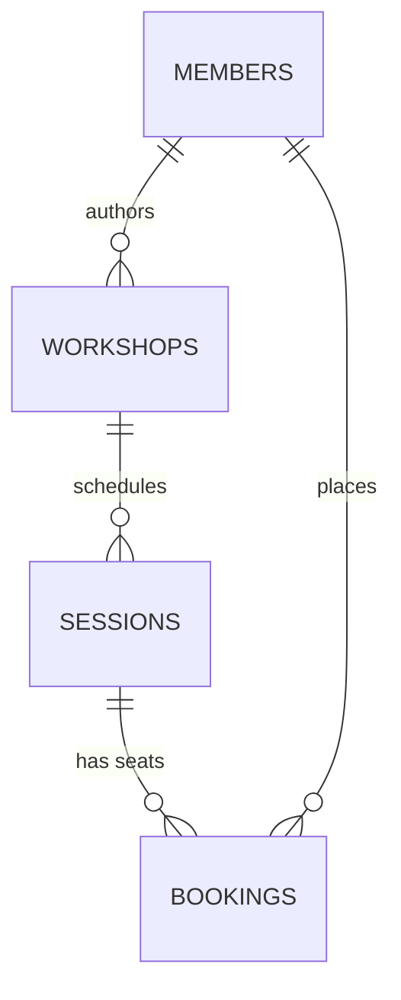
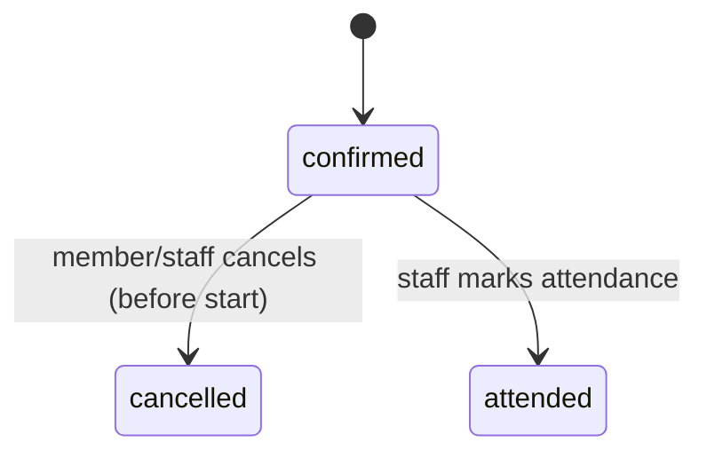

# Golden example — `data-model.md`

The filled example for `dev:plan-data-model`, from the **workshop-booking** toy initiative shared by all five planner examples (`backend/_shared/*/references/example-*.md`). **Shapes and disciplines are normative; domain content is illustrative.** A real artifact writes a full table block for *every* entity — this example writes two in full (`sessions`, `bookings`, the load-bearing ones) and abbreviates the rest, saying so.

---

# Workshop Booking — Data Model Plan

**Date:** 2026-08-02 · **Written by:** `dev:plan-data-model`
**Blueprint:** `./blueprint.md` (approved 2026-08-02)
**Engine:** PostgreSQL 18 — proposed (greenfield), approved with the blueprint

## 1. Conventions

| Convention | Choice | Reason |
|---|---|---|
| Primary key | UUIDv7 | Time-ordered, safe in URLs; PG18 generates natively |
| Natural keys | Unique constraints beside the PK, never as the PK | Workshop titles and emails can change |
| Money | — | No money in this system (blueprint: payments out of scope) |
| Timestamps | `created_at`/`updated_at` timestamptz UTC | Session start is **business time**: stored as `starts_at timestamptz` + the studio's IANA zone in config — one studio, one zone `#confirmed` |
| Soft delete | Off | GDPR requires hard delete of members; nothing else needs recovery |
| Tenancy | Single tenant — no `tenant_id` | Blueprint §7; revisiting is a new blueprint |
| Concurrency | `version int` on `sessions` only | Capacity edits by staff can race bookings; nothing else has contended writes |
| Audit | `created_by` on staff-authored rows | "Who scheduled this" matters; full history does not |
| Enums | Stable strings | Sets are closed and app-owned |
| Naming | `snake_case`, plural tables | Greenfield — library default |

**Tenancy & isolation:** single tenant, app-level roles only (member vs staff). The access rule that *does* need proving is member-owns-booking — `qa-security`'s BOLA test covers it.

## 2. Entity catalog

| Entity | Owning area | Purpose | Lifecycle states | Volume / growth | Notes |
|---|---|---|---|---|---|
| Member | Identity & access | Local profile for an Auth0 identity | active → deleted (hard) | ~500, slow | Auth0 `sub` is the join key |
| Workshop | Scheduling | A bookable class type | draft → published → archived | ~30, slow | |
| Session | Scheduling | One scheduled occurrence with capacity | scheduled → completed \| cancelled | ~40/month | The contended entity |
| Booking | Booking | One member's seat in one session | confirmed → cancelled \| attended | ~30/session | One per member per session (Q1: A) |

Every blueprint area owns ≥1 entity ✓.

## 3. Tables

### `sessions` — Scheduling area
Purpose: one scheduled occurrence of a workshop, with a seat capacity.
Lifecycle: `scheduled → completed`; `scheduled → cancelled`.

| Column | Type | Null | Default | Constraint / note |
|---|---|---|---|---|
| `id` | uuid | no | uuidv7() | PK |
| `workshop_id` | uuid | no | — | FK → `workshops.id` ON DELETE RESTRICT — a session outlives a workshop archive |
| `starts_at` | timestamptz | no | — | business time |
| `duration_min` | int | no | — | CHECK `> 0` |
| `capacity` | int | no | — | CHECK `>= 1` |
| `status` | text | no | `'scheduled'` | one of `scheduled,completed,cancelled` |
| `version` | int | no | `0` | optimistic concurrency (staff edits vs bookings) |
| `created_by` | uuid | no | — | FK → `members.id` (staff) ON DELETE RESTRICT — blocks the GDPR hard delete for a staff author; open question §8 |
| `created_at` / `updated_at` | timestamptz | no | `now()` | convention |

**Keys & constraints**
- PK `id` · UNIQUE (`workshop_id`, `starts_at`) — the same workshop cannot run twice at once

**Indexes**
| Index | Columns | Serves |
|---|---|---|
| `ix_sessions_starts_status` | (`starts_at`, `status`) | the member-facing "upcoming sessions" list |
| `ix_sessions_workshop` | (`workshop_id`) | staff's per-workshop view; FK not auto-indexed in PG |

**Retention:** kept indefinitely — schedule history, no member PII beyond the staff author id. `#inferred`

### `bookings` — Booking area
Purpose: one member's confirmed seat in one session.
Lifecycle: `confirmed → cancelled`; `confirmed → attended`.

| Column | Type | Null | Default | Constraint / note |
|---|---|---|---|---|
| `id` | uuid | no | uuidv7() | PK |
| `session_id` | uuid | no | — | FK → `sessions.id` ON DELETE RESTRICT |
| `member_id` | uuid | no | — | FK → `members.id` ON DELETE CASCADE — GDPR hard delete takes bookings with it `#confirmed` |
| `status` | text | no | `'confirmed'` | one of `confirmed,cancelled,attended` |
| `late_cancel` | bool | no | `false` | set when cancelled < 24h before start (blueprint DEC, R2) |
| `cancelled_at` | timestamptz | yes | — | null until cancelled — a lifecycle fact, not an omission |
| `created_at` / `updated_at` | timestamptz | no | `now()` | convention |

**Keys & constraints**
- PK `id`
- UNIQUE (`session_id`, `member_id`) **WHERE status <> 'cancelled'** — one live seat per member per session (Q1: A); partial so a re-book after cancel works
- **The overbooking guard is DB-level, not app-level:** bookings insert under `SELECT … FOR UPDATE` on the session row (or a `CHECK`-backed counter — decision routed to `data-architect`, see §9). An app-side count-then-insert is the race the blueprint's top risk names.

**Indexes**
| Index | Columns | Serves |
|---|---|---|
| `ix_bookings_member` | (`member_id`, `created_at` DESC) | "my bookings" list |
| `ix_bookings_session` | (`session_id`) WHERE `status = 'confirmed'` | the capacity count + staff attendance view |

**Retention:** kept 2 years, then purged; a member GDPR hard delete cascades sooner (blueprint §7). `#confirmed`

### `members`, `workshops` — abbreviated in this example
A real artifact writes these in full. Shape notes only: `members` carries `auth0_sub` UNIQUE, `email` UNIQUE, `role` (`member|staff`); `workshops` carries `title`, `description`, `status` (`draft|published|archived`), `created_by`.

## 4. Reference & seed data

| Table | Contents | Owned by | Per-environment? |
|---|---|---|---|
| `members` | One staff account (the owner) | Migration seed | Yes — real email in prod only |

**Existing data & backfill:** the spreadsheet the blueprint replaces (§2, Q3).

| Source | Data | Target tables | One-time or sync | Validated by | Delivery task |
|---|---|---|---|---|---|
| Owner's spreadsheet (CSV export) | Member list; future bookings already taken | `members`, `bookings` (against sessions staff schedule first) | One-time import at go-live; spreadsheet then read-only | Owner reviews the imported lists before cutover | go-live import — sequenced by `dev:plan-delivery` after migration 3 |

## 5. Diagrams

Every arrow **not** drawn is a 409 in `api-surface.md`: cancel an `attended` booking, mark a `cancelled` one attended, re-cancel a `cancelled` one.

## 6. Ownership map

Omitted — modular monolith; owning module noted per table block.

## 7. Migration sequence

| # | Migration | Contains | Depends on | Delivery task | Online-safe? |
|---|---|---|---|---|---|
| 1 | `001_members` | `members` + staff seed | — | T3 | greenfield — n/a |
| 2 | `002_scheduling` | `workshops`, `sessions` | 1 | T3 | greenfield — n/a |
| 3 | `003_bookings` | `bookings` + the capacity guard | 2 | T3 | greenfield — n/a |

## 8. Open questions & deferrals

| # | Question | Blocks | Owner |
|---|---|---|---|
| 1 | A departing staff member's authored sessions: reassign `created_by`, or SET NULL with an audit note? RESTRICT blocks the GDPR hard delete for staff authors today — the member CASCADE and the staff RESTRICT pull in opposite directions | GDPR delete of a staff account (not the v1 launch) | owner |

Q-retention answered at blueprint (2 years, hard delete).

## 9. Routed to `data-architect`

| Decision | Why it needs depth |
|---|---|
| Overbooking guard mechanism (`FOR UPDATE` vs counter + CHECK) | Correctness-under-concurrency choice with plan-analysis trade-offs |
