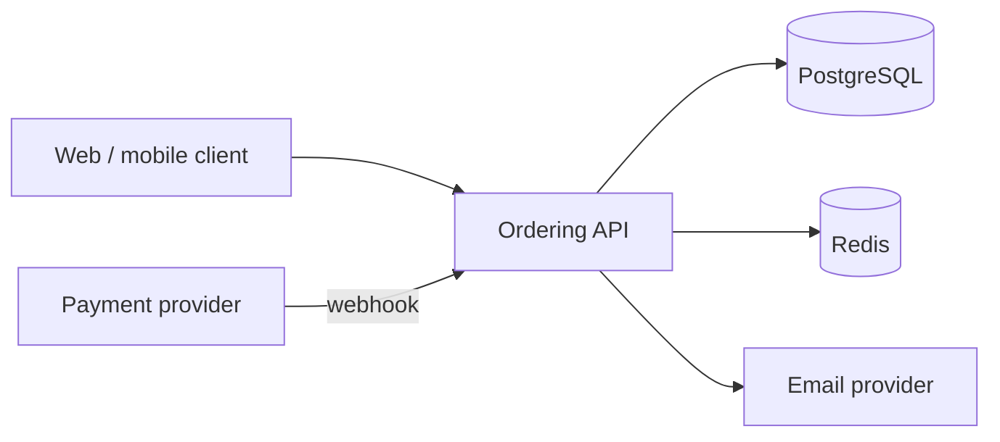
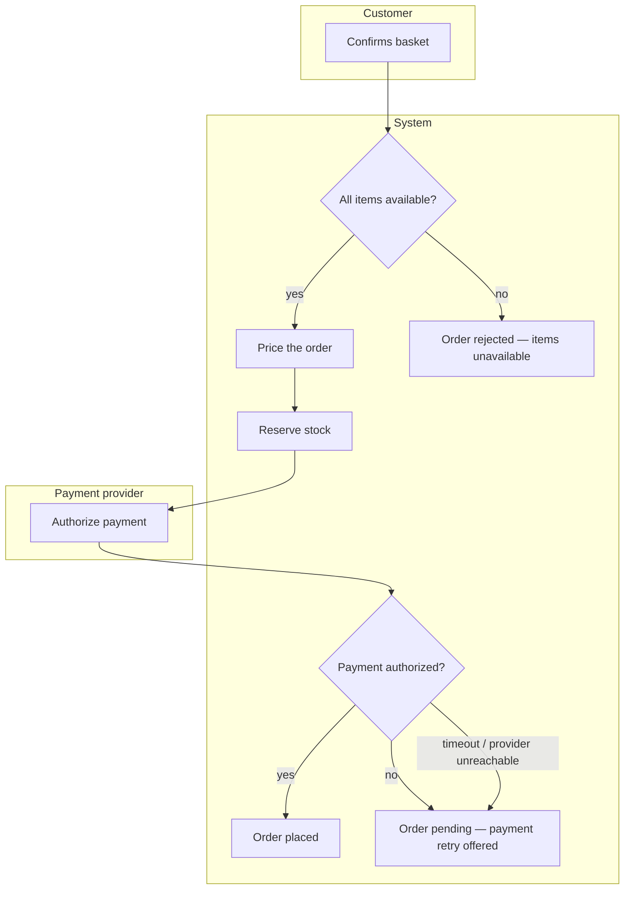

# Solution Blueprint — the high-level backend plan

The blueprint is the document the human approves. Everything downstream — data model, API surface, integrations, task sequence — is derived from it, so a wrong blueprint is not a cheap mistake to discover in Step 5. Its job is to make the *consequential* decisions visible and confirmable in one page-sized pass, and to make the uncertain ones explicit rather than silently resolved.

**Announce at start:** "I'm using the `be-shared-solution-blueprint` skill to produce the high-level plan for your approval."

## When to use

- A business case, a feature brief, an epic set, or a "we need a backend that does X" direction needs turning into an architecture and a build direction
- A human-written high-level plan needs validating and normalizing before detail work starts (`DETAIL` entry mode)
- A new functional area is being added to an existing planned system (`EXTEND` — run this for the new area only)

## When NOT to use

- The requirements themselves are missing or contradictory → `requirements-author` / `business-analyst` first. Planning against guessed requirements produces a document indistinguishable from a real plan, which is what makes it dangerous
- The blueprint is already approved → move to `be-shared-data-model-plan`
- The ask is a single endpoint or a bug fix → no blueprint; that is a `be-<stack>` task directly

## Output

**`docs/plans/<NNN>-<initiative>/blueprint.md`** under the **target project's** root — never the skills-library checkout, never a global directory. `NNN` is zero-padded, scoped to `docs/plans/` (files and folders both count toward the high-water mark); never reuse or renumber. `<initiative>` is a short kebab-case noun phrase (`billing-service`, `tenant-onboarding`), stable for the life of the initiative — the folder name is cited by every other artifact and by `HANDOFF.md`.

**A filled golden example is at `references/example-blueprint.md`** — all five planner examples describe the same toy initiative (`001-workshop-booking`), so together they show one coherent pack. Shapes and disciplines there are normative; the domain content is illustrative.

## Annotation grammar (used across the whole plan pack)

| Marker | Means |
|---|---|
| `#confirmed` | Stated by the human — in this session or in a requirements document. Never read out of code; that is `#observed` |
| `#inferred` | Your reasoning from indirect evidence — the human should scan these |
| `#observed` | Read out of existing code/behavior rather than a document — `ba-project-memory`'s grammar is the canonical definition; in the documenter lane it always carries `file:line` |
| `[TBD - <owner>, <by when>]` | Genuinely unknown; has a named owner. **Not** a synonym for vague |
| `⚠️ Assumption:` | You proceeded on an unconfirmed premise. Every one of these is also a line in Open Questions |

An unmarked claim reads as `#confirmed`. Mark honestly — the value of the pack is that a reader can tell fact from inference at a glance.

## Evidence marks (used in the tech-stack and architecture tables)

| Mark | Means |
|---|---|
| `detected` | Found in the repo — a TFM, a lockfile, an existing migration, an existing route |
| `stated` | The human said so, in this session or in the requirements |
| `proposed` | Your inference from the workload. **These are the rows the human needs to look at** |
| `proposed → approved` | A `proposed` row the human confirmed at the gate — the post-approval state, recorded when the blueprint moves to APPROVED |

The two systems encode one axis: `stated` ≈ `#confirmed` · `detected` ≈ `#observed` · `proposed` ≈ `#inferred` — the evidence marks are the table-cell form of the annotation grammar, used where a one-word cell reads better than a tag.

In an existing repo, `detected` beats the library Stack defaults every time. In a greenfield one, the Stack defaults from `CLAUDE.md` are the proposal, marked `proposed`.

---

## Procedure

### Step 1 — Frame the initiative

Three to five sentences answering: what business problem, for whom, what changes when it ships, and what success looks like. If the input is raw prose (a BRD, a transcript, an email thread), distill it first with `qa/manual/requirements-breakdown` — that produces a sourced test-basis with silent/contradictory items already flagged, which is exactly the input this step wants.

If you cannot write these sentences without inventing business facts, stop and route to `requirements-author`. Say which facts are missing.

### Step 2 — Decompose into functional areas

A **functional area** is a coherent slice of business capability that could plausibly be owned by one person and tested as a unit — `Identity & access`, `Catalog`, `Ordering`, `Billing`, `Notifications`, `Reporting`. It is not a technical layer (`Controllers`, `Repositories` are not functional areas) and not a single endpoint.

| Column | Content |
|---|---|
| Area | Short noun phrase |
| Purpose | One sentence — the capability, in business terms |
| User-facing capabilities | The things a person can *do* here, one short sentence each in the user's voice (*"a member books a session"*, *"an admin publishes a workshop"*) — empty for areas nothing user-facing sits on. `be-shared-delivery-plan` sequences user-facing work one capability per step, so this column is what it slices on; an area with none is planned layer-first |
| Primary actors | Who or what drives it (end user, admin, scheduled job, external system) |
| Key entities | The 2–5 nouns it owns — the seed of `data-model.md` |
| In scope | What this initiative builds for it |
| Out of scope | What it deliberately excludes, and where that work lives instead |
| Depends on | Other areas or external systems |

Rules:
- **Name the user-facing capabilities in the user's voice, not the system's.** *"A member books a session"* is a capability; *"exposes the bookings endpoint"* is an implementation of one. The delivery plan turns each into a step that closes when a person can actually do it, so a vague capability produces a step with no checkable exit.
- **6–8 areas is a lot.** Beyond that, either the initiative should be decomposed into separate initiatives (each with its own folder and its own executable plan), or several "areas" are really one. Say which.
- **Out of scope is not optional.** The most common plan defect is an unstated boundary that someone later reads as included.
- Every area gets at least one entity or it is not an area — it is a cross-cutting concern (auth, logging, config), which belongs in the architecture section instead.
- **Name the actors and propose the shell when anything is user-facing.** Where the table has a non-empty *User-facing capabilities* column, add a short §2b: one line per actor with their two or three most frequent tasks (*verb + object + outcome*), and the **app shell** — sidebar / top nav / hybrid, from `design/ux-patterns` §2's table — as a `proposed` row with its one-line reason. This is what lets the approver judge the experience at the gate; the nav map, journeys and screens are `be-shared-experience-plan`'s in Step 3, not the blueprint's. An initiative with no user-facing capability writes "no user-facing area" and skips the section.
- **Ask about existing data.** If any area replaces a current system of record (a spreadsheet, a legacy app, a manual process), the data living there is in scope or out — say which. What must come across, and whether it is a one-time import or an ongoing sync, is a scope boundary and usually an open question; the mapping detail belongs to `be-shared-data-model-plan`'s backfill section.

### Step 3 — Decide the architecture style

State the decision, the reason it is **earned for this system**, and what you rejected. Default toward the least structure that works:

| Style | Earned when | Costs you should say out loud |
|---|---|---|
| **Modular monolith** (default proposal) | One team, one deployable, < ~6 functional areas, no independent scaling need | Module boundaries need discipline to survive; a shared DB tempts cross-module joins |
| **Modular monolith + extracted service** | One area has a genuinely different scaling, availability, or compliance profile | A network hop, a second deployment, distributed failure modes for that seam only |
| **Services per area** | Independent teams, independent release cadence, or hard isolation requirements | Distributed transactions, versioned contracts, per-service observability, N pipelines |
| **Event-driven core** | Fan-out to multiple consumers, or ordering/replay is a business requirement | A broker to run, idempotent consumers, eventual consistency the UI must reflect |

Then, for each *pattern* in play, one line stating it is earned — CQRS, event sourcing, Saga, Outbox, Repository over the ORM. Load `backend/_shared/pattern-guide` for the concept card if the decision is live. **One pattern per problem**; a pattern with no stated reason is a finding against your own blueprint.

Include a Mermaid context diagram — the areas, the external systems, and the direction of every dependency:

````markdown

````

### Step 3.5 — Model the key flows and decisions

Prose hides the questions a diagram forces. A flowchart makes you name the failure exit nobody had thought about; a decision table makes you say what happens when two rules both apply. **This is the cheapest place in the whole pack to find a missing requirement** — before a table, an endpoint, or a task exists to be rewritten.

Model, at blueprint altitude, only what is genuinely load-bearing:

| Model | Build one for | Skip when |
|---|---|---|
| **Process flowchart** | Each primary business flow — the 2–5 journeys the system exists to serve | A single-step CRUD path; the endpoint table already says it |
| **Decision table** | Each business rule where **3+ inputs** combine to select an outcome (pricing, eligibility, routing, fees, access) | A two-branch `if`; state it as a rule in prose |
| **State diagram** | Entities with a real lifecycle | — these live in `data-model.md`, not here |

**Process flowcharts** — named actors, every decision exit labeled *including the failure exit*, and timeouts/external failures modeled rather than assumed away:

````markdown

````

The two failure exits in that diagram are the point of drawing it. A flow with only a happy path is an illustration, not a model — and the exits you cannot label are open questions, not details to settle later.

**Decision tables** — one per decision point, with a **declared hit policy** (DMN semantics: U unique · A any · F first · P priority · C collect) and the completeness and overlap checks run:

```markdown
**Decision:** shipping cost · **Hit policy:** F (first match wins) `[TBD - confirm with business]`

| # | Order total | Customer tier | Destination | → Shipping |
|---|---|---|---|---|
| R1 | ≥ £50 | any | domestic | £0 |
| R2 | < £50 | premium | domestic | £0 |
| R3 | < £50 | standard | domestic | £4.99 |
| R4 | any | any | international | £14.99 |

**Completeness:** every combination of the three inputs is matched by exactly one rule.
**Overlap:** R1 and R4 both match a £60 international order → resolved by the F policy (R1 first).
⚠️ The hit policy is **inferred from the intended reading, not sourced to a business decision** — open question Q2.
```

**The hit policy is never invented.** If nobody has decided what happens when two rules both apply, that is a `[TBD]` and an open question — an invented precedence rule is a business decision made silently by whoever wrote the table.

Load `ba-process-flow-diagram` and `ba-decision-table` for the full discipline (the event-timeline pass, swimlane rules, the completeness/overlap procedure, the KB file formats). They are bundled alongside this skill. Where the project keeps a business-model KB, the models belong in it as `FLOW-nnn` / `DEC-nnn` artifacts and the blueprint links them by ID rather than duplicating them.

### Step 4 — Settle the tech stack

One row per dimension, every row evidence-marked. Only include rows this initiative actually needs — an unused row invites a decision nobody has to make.

| Dimension | Choice | Version | Why | Evidence |
|---|---|---|---|---|
| Runtime / language | | | | detected/stated/proposed |
| Web framework | | | | |
| Primary datastore | | | | |
| Cache | | | | |
| Messaging / queue | | | | |
| ORM / data access | | | | |
| Auth provider + flow | | | | |
| Background jobs / scheduling | | | | |
| Hosting target | | | | |
| CI host | | | | |
| Observability | | | | |

Version policy: **detected wins**. Never propose an up-level runtime as a side effect of a feature — an upgrade is its own task with its own justification, and it belongs in the delivery plan as one. Never plan an up-level-only API onto a down-level project, and never flag a down-level project for lacking one. Greenfield defaults come from `CLAUDE.md`'s Stack defaults (.NET 10 primary / Java 21 + Spring Boot 3.x / Node 24 + TypeScript; Auth0; OpenTelemetry → Grafana; Allure).

### Step 5 — Name the external systems (architecture altitude only)

One line each: system, what it does for us, direction (we call it / it calls us / both), and criticality (does the feature fail without it, or degrade?). Depth — auth method, config keys, retry policy, sandbox strategy — belongs to `be-shared-integration-plan` in Step 5. Here you only need enough to make the architecture and the risk list honest.

### Step 6 — Build the routing map

**This is the section that makes the plan executable.** Each functional area and cross-cutting concern binds to the exact library agent that will build it, plus the skills that agent should load. Mission Control binds tasks on these strings, so an invented name is the most damaging defect in the pack.

| Area / concern | Agent | Skills it will load | Note |
|---|---|---|---|
| Screens, shell, navigation (`experience-plan.md` S1–Sn) | `fe-react` | `design-ux-patterns`, `fe-react-component-writer`, `fe-react-routing` | Builds from the experience plan; IA is decided there, not re-derived |
| Ordering domain + persistence | `be-dotnet` | `be-dotnet-pattern-writer`, `be-dotnet-database-code`, `be-dotnet-unit-testing` | Unit tests ship with the task, not after |
| Schema, indexes, tenancy enforcement | `data-architect` | `data-postgresql`, `data-schema-design` | Beyond ORM mechanics |
| Service-side auth | `be-dotnet` | `be-dotnet-auth0` | Frontend half is `fe-react` |
| Telemetry | `observability-engineer-dotnet` | `observability-opentelemetry-dotnet` | Runs after the first slice is real |
| Contract + integration tests | `qa-api-dotnet` | `qa-api-test-writer-dotnet` | Test basis is `api-surface.md` |
| Access-control proof | `qa-security` | `qa-permission-testing-dotnet` | BOLA/IDOR over the auth column |
| Image, IaC, pipeline, secrets | `devops-engineer` | `devops-docker`, `devops-environment-config` | |

**The agent catalog** — pick only from these names:

| Domain | Agents |
|---|---|
| Backend build | `be-dotnet` · `be-java` · `be-node` |
| Backend planning | `be-planner` (this one) |
| Data | `data-architect` |
| Frontend | `fe-blazor` · `fe-react` |
| Observability | `observability-engineer-dotnet` · `observability-engineer-java` · `observability-engineer-node` |
| DevOps | `devops-engineer` · `devops-auditor` |
| QA — per stack (`{dotnet,java,typescript}`) | `qa-api-<stack>` · `qa-ui-<stack>` · `qa-mobile-<stack>` · `qa-performance-<stack>` · `qa-llm-<stack>` · `qa-bdd-<stack>` · `qa-cicd-<stack>` · `qa-reporting-<stack>` |
| QA — stack-agnostic | `qa-security` · `qa-test-case-designer` · `qa-test-planner` |
| Requirements | `requirements-author` · `business-analyst` |
| Audit | `code-auditor` |

If a needed capability has no agent, say so plainly and name the skill or the human step that covers it — do not stretch an agent past its description.

### Step 7 — Non-functional targets

Only what is known or decidable now; the rest are `[TBD - <owner>]` lines, which is useful information rather than a gap. Cover: expected scale (users, requests/sec, data volume, growth), latency expectations on the paths that matter, availability target, data retention and deletion obligations, compliance constraints (PII, PCI, residency, audit trail), and the security posture (tenancy isolation model, who can see whose data).

**The tenancy model is load-bearing** — it decides table shape, every query, the auth model, and an entire class of security test. If the system is multi-tenant, the isolation approach is a blueprint decision, not a Step-2 detail.

### Step 8 — Risks and assumptions

| Risk | Likelihood | Impact | Mitigation / early signal |
|---|---|---|---|

Include the risks that come from the plan itself, not just the domain: an unconfirmed integration, a `[TBD]` on the critical path, an area whose requirements are `#inferred`, an upgrade the plan depends on.

Then list every `⚠️ Assumption:` from the document in one place. A reader should be able to scan the assumptions and catch a wrong one in thirty seconds.

### Step 9 — Open questions, then the gate

**Ask only what materially changes the work.** A question you can settle by reading the repo is not a question. A matter of ordinary engineering judgment is not a question — decide it, mark it `⚠️ Assumption:`, and move on. Aim for **three to six** questions; a dozen means you are outsourcing the thinking.

Each question carries:

```markdown
**Q1 — <the question>?**
*Context:* <one or two sentences on why it matters and what it blocks>
- **A. <option>** *(recommended)* — <the real trade-off>
- **B. <option>** — <the real trade-off>
- **C. <option>** — <the real trade-off>
*Blocks:* <the areas or decisions that cannot be detailed until this is answered>
```

Options must be genuinely different, and the trade-off must be real — "A is better" is not a trade-off. Use the harness's structured-question tool if one is available; otherwise present the block above and ask directly.

**Then the gate — this blocks:**

> "Blueprint saved to `docs/plans/<NNN>-<initiative>/blueprint.md`. Review it — particularly the `proposed` rows in the tech stack, the architecture decision, and the assumptions list — and answer the open questions. I'll build the detail pack (data model → API surface → integrations → delivery plan) once you approve."

Do not write `data-model.md` or anything else in Step 2+ until the human approves. Deferring a question is a valid answer — record the deferral with its owner and proceed, noting what it leaves `[TBD]`.

In `DETAIL` mode, where the human supplied the high-level plan, the gate is shorter but still blocking: present your normalized reading of their plan (the same sections, filled from their document, with everything you had to infer marked `#inferred`) plus the gaps you need settled, and wait.

---

## Blueprint template

```markdown
# <Initiative> — Solution Blueprint

**Date:** YYYY-MM-DD · **Written by:** `be-shared-solution-blueprint` · **Status:** DRAFT — awaiting approval
**Initiative folder:** `docs/plans/<NNN>-<initiative>/`
**Entry mode:** NEW | DETAIL | RESUME | EXTEND — <what settled it>
**Sources:** <requirements docs, stories, KB entries, repo paths — with what each contributed>

## 1. The initiative
<3–5 sentences: problem, for whom, what changes when it ships, what success looks like.>

**Success signals:** <measurable where possible; `[TBD - <owner>]` where not.>

## 2. Functional areas
| Area | Purpose | User-facing capabilities | Primary actors | Key entities | In scope | Out of scope | Depends on |
|---|---|---|---|---|---|---|---|

**Explicitly not in this initiative:** <the boundary, stated once, plainly.>

**Existing data & backfill:** <the system of record being replaced and what comes across, or "none — no predecessor system".>

## 2b. Actors & app shell
<!-- Only when a User-facing capabilities cell is non-empty; otherwise the single line "no user-facing area". -->
| Actor | Most frequent tasks (verb + object + outcome) | Evidence |
|---|---|---|

**App shell:** sidebar | top nav | hybrid — <one-line reason, per `design/ux-patterns` §2> · `proposed`
<!-- Nav map, journeys, screens: experience-plan.md (Step 3), not here. -->

## 3. Architecture
**Style:** <choice> — <why it is earned for this system>
**Rejected:** <what you considered and why not>
**Patterns in play:** <pattern — the reason it is earned. One line each.>

```mermaid
flowchart LR
```

**Cross-cutting concerns:** <auth, error handling, logging/telemetry, config, background work — one line each on the approach.>

## 3b. Key flows & decisions
<!-- One flowchart per primary business flow (named actors, every exit labeled incl. failure).
     One decision table per 3+-input business rule, with a declared hit policy.
     Link to KB artifacts by ID (FLOW-nnn / DEC-nnn) where a business-model KB exists. -->

## 4. Tech stack
| Dimension | Choice | Version | Why | Evidence |
|---|---|---|---|---|

**Version lane:** <what was detected and what it implies; any upgrade this plan assumes, as its own task.>

## 5. External systems
| System | What it does for us | Direction | Criticality | Detail owed to |
|---|---|---|---|---|
<!-- Detail lands in integrations.md — this is the architecture-altitude view only. -->

## 6. Routing map — who builds what
| Area / concern | Agent | Skills it will load | Note |
|---|---|---|---|

**Capabilities with no agent:** <named plainly, with what covers them instead.>

## 7. Non-functional targets
| Dimension | Target | Evidence |
|---|---|---|
| Scale | | |
| Latency | | |
| Availability | | |
| Retention & deletion | | |
| Compliance | | |
| Tenancy & isolation | | |

## 8. Risks
| Risk | Likelihood | Impact | Mitigation / early signal |
|---|---|---|---|

## 9. Assumptions
- ⚠️ **Assumption:** <…> — *confirm by:* <who/when>

## 10. Open questions
**Q1 — <question>?**
*Context:* …
- **A. …** *(recommended)* — …
- **B. …** — …
*Blocks:* …

## 11. Approval
- [ ] Functional areas and scope boundary confirmed
- [ ] Actors, their primary tasks and the app shell confirmed (or "no user-facing area")
- [ ] Architecture style and pattern choices confirmed
- [ ] Key flows modelled, every failure exit labeled; decision-table hit policies confirmed (not inferred)
- [ ] Tech stack `proposed` rows confirmed
- [ ] Non-functional targets confirmed or explicitly deferred
- [ ] Open questions answered or deferred with an owner

**Approved by:** <name> · **Date:** <YYYY-MM-DD>
```

## What NOT to put in a blueprint

- **Nav maps, routes, screen lists, page layouts** — those are Step 3 (`experience-plan.md`); the blueprint names the actors, their tasks and the shell, and stops.
- **Table columns, endpoint paths, or field-level schemas** — those are Steps 2 and 4. A blueprint that specifies columns will be wrong before it is approved, and it hides the decisions that actually need review.
- **Task lists or estimates** — Step 6 owns sequencing, and it can only sequence once the detail exists.
- **Code** — no scaffolds, no snippets beyond the diagrams and tables above.
- **Silent decisions** — anything consequential that appears without a `why` and an evidence mark.
- **A pattern with no earned reason** — the single most common way a plan makes a system worse.

## Handoffs

- **Approved →** `be-shared-data-model-plan` (Step 2). The Key entities column is its input. Then **`be-shared-experience-plan` (Step 3)** whenever the routing map names `fe-react` / `fe-blazor` — §2's capabilities, §2b's actors and shell, and §3b's flows are its inputs.
- **Requirements too thin →** `requirements-author`, or `business-analyst` when the ask may conflict with existing features. Their `docs/business-model/` KB is a first-class input here.
- **Architecture turns on a pattern question →** `backend/_shared/pattern-guide` for the concept card (loaded, not delegated).
- **Flows and decision rules need the full modelling discipline →** `ba-process-flow-diagram` / `ba-decision-table` (loaded, not delegated); `ba-entity-state-grid` for entity lifecycles, which `be-shared-data-model-plan` also draws.
- **Engine choice or tenancy enforcement needs real depth →** state the requirement here, route the decision to `data-architect`.
- **The blueprint reveals the ask spans multiple systems →** propose the decomposition, plan the first one; one initiative folder per system.

## Version policy

Version-aware, keyed to `CLAUDE.md`'s Stack defaults: **.NET 10 primary / 8-9 supported** · **Java 21 + Spring Boot 3.x** · **Node 24 active LTS / 22 maintenance** (Node 20 EOL since April 2026 — flag it, never target it) · **PostgreSQL 18 primary / 15–17**, **SQL Server 2025 / 2022 / 2019 / Azure SQL**, **MySQL 8.4 LTS**, **MongoDB 8.0 LTS**, **Redis 8.x / Valkey**. In an existing repo the **detected** version wins over every default above, and the blueprint records it as `detected`.
