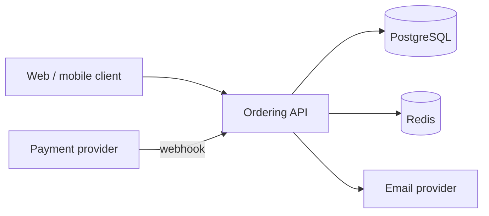

# Architecture style — the Step 3 decision

Read by Step 3 for a greenfield system or any live architecture decision. An existing codebase keeps the architecture it has; record it as `detected` and skip the styles table.

**Done when** the blueprint states the style, why it is earned, what was rejected, each pattern's reason, the repository layout and the context diagram.

State the decision, the reason it is **earned for this system**, and what you rejected. Default toward the least structure that works:

| Style | Earned when | Costs you should say out loud |
|---|---|---|
| **Modular monolith, built to be split later** (default proposal) | One team, one deployable, and none of the split triggers below is met | A boundary costs a schema, a public API and an architecture test from the first task; no foreign key across modules, so the owning module keeps referential integrity; cross-module reads go through an API call, not a join |
| **Modular monolith + extracted service** | One module meets a split trigger below | A network hop, a second deployment, distributed failure modes for that seam only |
| **Services per area** | Several areas each meet a split trigger — independent teams on their own release cadence, or hard isolation requirements | Distributed transactions, versioned contracts, per-service observability, N pipelines |
| **Event-driven core** | Fan-out to multiple consumers, or ordering/replay is a business requirement | A broker to run, idempotent consumers, eventual consistency the UI must reflect |

**Built to be split later — four rules**, written into the blueprint and enforced from the first task:

1. **A module owns its data.** Its tables live in its own schema. No other module reads or writes them: no cross-module join, no shared table, no foreign key into another module's schema — another module holds the id.
2. **Modules talk through a public surface.** Each module exposes one public API — a facade or interface shaped like the HTTP contract it would become, DTOs in and out, never an entity — and the events it publishes. Everything else is internal.
3. **An architecture test fails the build on a reach-in.** It runs with the unit tests; the first contract task writes it (`be-<stack>:patterns-apply`, "Module boundaries").
4. **One folder per module**, mirrored by one schema, one DI registration and one test folder — one module per functional area.

**Split triggers** — the only reasons a module becomes a service, each recorded as a dated decision when used: it must **scale apart** from the rest; **another team** will own it on its own release schedule; it needs **isolation the process cannot give** (untrusted input, a compliance scope — the sandboxed upload worker is the house example); it needs a **different runtime**. Size, tidiness and "we might need it later" are not triggers; the number of areas decides nothing. Splitting moves the module's folder to `services/<name>/`, gives its schema a database of its own, and replaces the in-process calls with a client generated from the same contract. An existing codebase keeps the architecture it has — this default is for new systems.

Then, for each *pattern* in play, one line stating it is earned — CQRS, event sourcing, Saga, Outbox, Repository over the ORM. Load `backend/_shared/pattern-guide` for the concept card if the decision is live. **One pattern per problem**; a pattern with no stated reason is a finding against your own blueprint.

**Propose the repository layout** beside the style. The default is **one repo per product**, because a plan runs in one worktree and a test-first plan keeps its contract, its acceptance tests and its code in one history:

```
<product>/
  contracts/                OpenAPI and AsyncAPI documents: what every side binds to
  services/<name>/          one deployable each, in its stack's native workspace
  services/<name>/tests/    unit tests and the acceptance tests that drive its implementation
  web/  mobile/             the clients, in the TypeScript workspace or their own native projects
  e2e/                      journey suites that need several deployables running together
  deploy/local/             the local Grafana stack, started with one command
  docs/plans/               the plans
```

Mixed languages are fine: each stack keeps its native workspace in its own folder, with CI on path filters. **Multi-repo needs a stated reason** — independent teams or release cadences — and means one plan per repo, with the contract travelling as the OpenAPI asset.

Include a Mermaid context diagram — the areas, the external systems, and the direction of every dependency:

````markdown

````
