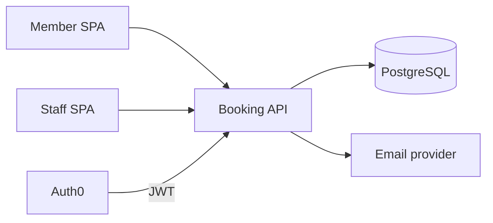
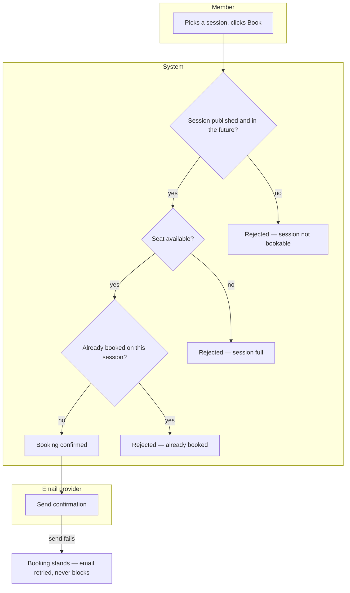

# Golden example — `blueprint.md`

This is the filled example for `be-shared-solution-blueprint`, from a deliberately small toy initiative: **workshop-booking** — a studio lets members book seats in scheduled workshops. All five planner examples (`backend/_shared/*/references/example-*.md`) describe this same initiative, so together they form one coherent pack. **The shapes and disciplines are normative; the domain content is illustrative.** This example shows the *post-approval* state, so the question→answer loop is visible.

---

# Workshop Booking — Solution Blueprint

**Date:** 2026-08-02 · **Written by:** `be-shared-solution-blueprint` · **Status:** APPROVED 2026-08-02
**Initiative folder:** `docs/plans/001-workshop-booking/`
**Entry mode:** NEW — empty repo, one-page business brief from the studio owner
**Sources:** `brief.md` (owner's email, distilled via `qa/manual/requirements-breakdown`) — contributed the capability list and the cancellation policy; everything else `proposed`.

## 1. The initiative

The studio schedules recurring workshops (pottery, life drawing) and currently takes bookings by phone and a spreadsheet. Members should browse published sessions, book a seat, and cancel within policy; staff should manage workshops and see attendance. Success: bookings self-served, no double-booked seats, staff stop maintaining the spreadsheet.

**Success signals:** ≥80% of bookings made online within 3 months `[TBD - owner, confirm target]` · zero overbooked sessions (hard invariant).

## 2. Functional areas

| Area | Purpose | User-facing capabilities | Primary actors | Key entities | In scope | Out of scope | Depends on |
|---|---|---|---|---|---|---|---|
| Identity & access | Who can sign in and what they may do | A member signs in and sees who they are | Member, Staff | Member profile | Login via IdP, member/staff roles | Self-service registration approval flows | Auth0 |
| Scheduling | Staff define workshops and their sessions | An admin publishes a workshop and adds sessions to it · anyone browses the published schedule | Staff | Workshop, Session | Create/publish/archive workshops; schedule sessions with capacity | Recurring-session templates (step 2) | Identity |
| Booking | Members book and cancel seats | A member books a session and sees it under their bookings · a member cancels a booking · staff mark attendance | Member, Staff | Booking | Book a seat, cancel within policy, staff view attendance | Payments, waitlists | Scheduling, Identity |

Each capability above becomes one step in `delivery-plan.md`, closing when a person can actually do it.

**Explicitly not in this initiative:** payments (sessions are included in membership — confirmed by owner), waitlists, and any member-facing mobile app.

**Existing data & backfill:** the spreadsheet is the system of record being replaced. The member list and the future bookings already taken come across in a one-time import at go-live; past attendance history stays in the spreadsheet, kept read-only (Q3). `#confirmed`

## 3. Architecture

**Style:** Modular monolith — one team of two, three areas, one deployable, no independent scaling need. Earned by default; nothing here justifies more.
**Rejected:** services per area (three network boundaries for a system with one consumer buys only operational cost).
**Patterns in play:** none beyond framework idioms. No CQRS (read and write shapes are identical), no outbox (the only event is a confirmation email, and a lost email is acceptable degradation — see §5).

**Cross-cutting concerns:** Auth — JWT bearer, roles from Auth0 claims. Errors — RFC 9457 API-wide. Logging/telemetry — OTel via the bundled observability lane, wired after the first capability's tasks land. Config — env vars + user-secrets locally. Background work — none; auto-release of unconfirmed holds was considered and rejected (no holds in v1). `#confirmed`

## 3b. Key flows & decisions

One flow (booking a seat — the flow the system exists for) and one decision table (cancellation outcome). Kept inline; this project has no `docs/business-model/` KB to link into.

The two non-obvious exits are the point: a full session and a duplicate booking are business outcomes, not errors to improvise; and a failed email does not fail the booking.

**Decision:** cancellation outcome · **Hit policy:** U (unique — no two rules overlap)

| # | Cancelled by | Hours before start | → Outcome |
|---|---|---|---|
| R1 | Member | ≥ 24 | Seat released, no penalty |
| R2 | Member | < 24 | Seat released, marked "late cancel" on the member's record |
| R3 | Staff | any | Seat released, no penalty, member notified |

**Completeness:** both actors × both time bands covered. **Overlap:** none — U policy holds.
The "late cancel" consequence (does it ever block future bookings?) is **Q2** — answered: recorded only, no enforcement in v1. `#confirmed`

## 4. Tech stack

| Dimension | Choice | Version | Why | Evidence |
|---|---|---|---|---|
| Runtime / language | .NET | 10 | Greenfield; library default | proposed → approved |
| Web framework | ASP.NET Core minimal APIs | 10 | Small surface, no controller ceremony | proposed → approved |
| Primary datastore | PostgreSQL | 18 | Relational fit, library default | proposed → approved |
| ORM / data access | EF Core | 10 | Matches TFM | proposed → approved |
| Auth provider + flow | Auth0 — Auth Code + PKCE (SPA), JWT bearer (API) | — | Library default | proposed → approved |
| Hosting target | Azure Container Apps | — | Owner already has Azure | stated |
| CI host | GitHub Actions | — | Repo lives on GitHub | detected |
| Observability | OTel → Grafana stack | — | Library default | proposed → approved |

**Version lane:** greenfield — nothing detected; all rows proposed from `CLAUDE.md` Stack defaults and approved as-is. No upgrade tasks.

## 5. External systems

| System | What it does for us | Direction | Criticality | Detail owed to |
|---|---|---|---|---|
| Auth0 | Identity, token issuance, roles | inbound (token validation) | critical | `integrations.md` |
| SendGrid | Booking confirmation + cancellation emails | outbound | degraded — queue and retry, never block a booking | `integrations.md` |

## 6. Routing map — who builds what

| Area / concern | Agent | Skills it will load | Note |
|---|---|---|---|
| Scaffold, all three areas, persistence | `be-dotnet` | `be-dotnet-pattern-writer`, `be-dotnet-database-code`, `be-dotnet-unit-testing` | Unit tests ship with the task |
| Service-side auth | `be-dotnet` | `be-dotnet-auth0` | SPA half is out of scope here |
| Schema depth (index review) | `data-architect` | `data-postgresql`, `data-schema-design` | Only if the session-list query needs it |
| Contract + integration tests | `qa-api-dotnet` | `qa-api-test-writer-dotnet` | Test basis: `api-surface.md` |
| Access-control proof | `qa-security` | `qa-permission-testing-dotnet` | Member-vs-staff + own-booking BOLA |
| Telemetry | `observability-engineer-dotnet` | `observability-opentelemetry-dotnet` | After the first capability's tasks land |
| Image, IaC, pipeline, secrets | `devops-engineer` | `devops-docker`, `devops-environment-config` | |

**Capabilities with no agent:** none.

## 7. Non-functional targets

| Dimension | Target | Evidence |
|---|---|---|
| Scale | ~500 members, ~40 sessions/month, peak ~5 req/s | stated |
| Latency | Session list < 300ms p95 | proposed |
| Availability | Business hours; overnight downtime acceptable | stated |
| Retention & deletion | Bookings kept 2 years; member deletion on request (GDPR) | `[TBD - owner, before T-schema]` → answered: 2 years, hard delete on request `#confirmed` |
| Compliance | GDPR only (names, emails) | stated |
| Tenancy & isolation | **Single tenant** — one studio. No `tenant_id` anywhere; revisiting means a new blueprint | `#confirmed` |

## 8. Risks

| Risk | Likelihood | Impact | Mitigation / early signal |
|---|---|---|---|
| Overbooking under concurrent bookings | Medium | High (the one hard invariant) | DB-level guard, not app-level check — see `data-model.md`; race test in the QA pass |
| SendGrid domain auth delays go-live emails | Medium | Low | Provisioning is prerequisite task T0.2, started week 1 |

## 9. Assumptions

- ⚠️ **Assumption:** members are created by staff invitation, not self-signup — *confirmed by owner 2026-08-02* `#confirmed`

## 10. Open questions

All answered before approval; recorded with their answers as the decision log seed:

**Q1 — Can a member book more than one seat per session (bring a guest)?**
*Context:* changes the booking entity (quantity vs one-row-per-seat) and the capacity check.
- **A. One seat per member per session** *(recommended)* — simplest model; guests need their own membership
- **B. Quantity per booking** — guest-friendly, but capacity, cancellation, and attendance all get per-seat complexity
**Answer: A** (owner, 2026-08-02) — guests are a step-2 question.

**Q2 — Does a late cancellation carry any consequence?**
**Answer:** recorded on the member's record, no enforcement in v1 (owner, 2026-08-02).

**Q3 — What comes across from the spreadsheet, and what stays behind?**
**Answer:** member list + already-taken future bookings, imported once at go-live; past history stays in the read-only spreadsheet (owner, 2026-08-02). Mapping detail in `data-model.md` §4.

## 11. Approval

- [x] Functional areas and scope boundary confirmed
- [x] Architecture style and pattern choices confirmed
- [x] Key flows modelled, every failure exit labeled; decision-table hit policies confirmed (not inferred)
- [x] Tech stack `proposed` rows confirmed
- [x] Non-functional targets confirmed or explicitly deferred
- [x] Open questions answered or deferred with an owner

**Approved by:** studio owner · **Date:** 2026-08-02
