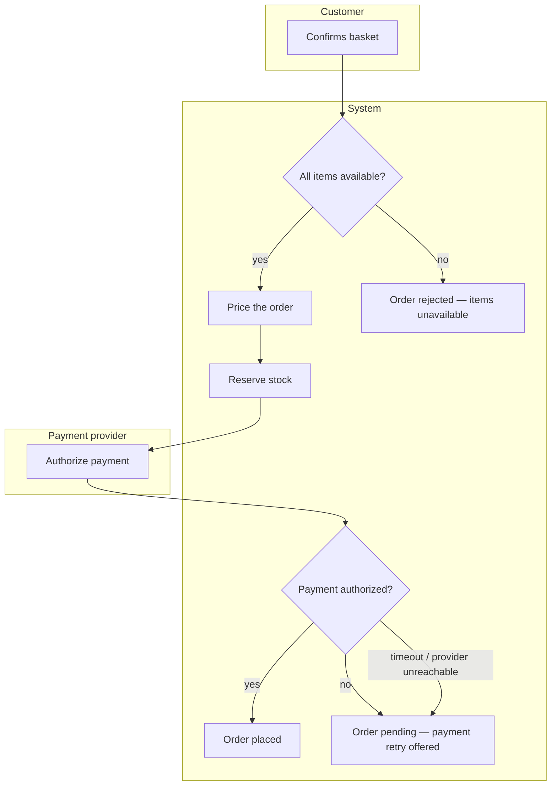

# Key flows and decisions — the Step 3.5 models

Read by Step 3.5 when the initiative has a primary business flow or a rule where three or more inputs select an outcome.

**Done when** every primary flow has a flowchart with each failure exit labelled, and every such rule has a decision table with a declared hit policy and its completeness and overlap checks run.

Prose hides the questions a diagram forces. A flowchart makes you name the failure exit nobody had thought about; a decision table makes you say what happens when two rules both apply. **This is the cheapest place in the whole pack to find a missing requirement** — before a table, an endpoint, or a task exists to be rewritten.

Model, at blueprint altitude, only what is genuinely load-bearing:

| Model | Build one for | Skip when |
|---|---|---|
| **Process flowchart** | Each primary business flow — the 2–5 journeys the system exists to serve | A single-step CRUD path; the endpoint table already says it |
| **Decision table** | Each business rule where **3+ inputs** combine to select an outcome (pricing, eligibility, routing, fees, access) | A two-branch `if`; state it as a rule in prose |
| **State diagram** | Entities with a real lifecycle | — these live in `data-model.md`, not here |

**Process flowcharts** — named actors, every decision exit labeled *including the failure exit*, and timeouts/external failures modeled rather than assumed away:

````markdown

````

The two failure exits in that diagram are the point of drawing it. A flow with only a happy path is an illustration, not a model — and the exits you cannot label are open questions, not details to settle later.

**Decision tables** — one per decision point, with a **declared hit policy** (DMN semantics: U unique · A any · F first · P priority · C collect) and the completeness and overlap checks run:

```markdown
**Decision:** shipping cost · **Hit policy:** F (first match wins) `[TBD - confirm with business]`

| # | Order total | Customer tier | Destination | → Shipping |
|---|---|---|---|---|
| R1 | ≥ £50 | any | domestic | £0 |
| R2 | < £50 | premium | domestic | £0 |
| R3 | < £50 | standard | domestic | £4.99 |
| R4 | any | any | international | £14.99 |

**Completeness:** every combination of the three inputs is matched by exactly one rule.
**Overlap:** R1 and R4 both match a £60 international order → resolved by the F policy (R1 first).
⚠️ The hit policy is **inferred from the intended reading, not sourced to a business decision** — open question Q2.
```

**The hit policy is never invented.** If nobody has decided what happens when two rules both apply, that is a `[TBD]` and an open question — an invented precedence rule is a business decision made silently by whoever wrote the table.

Load `business-analysis:process-flow` and `business-analysis:decision-table` for the full discipline (the event-timeline pass, swimlane rules, the completeness/overlap procedure, the KB file formats). They are loaded by path. Where the project keeps a business-model KB, the models belong in it as `FLOW-nnn` / `DEC-nnn` artifacts and the blueprint links them by ID rather than duplicating them.
