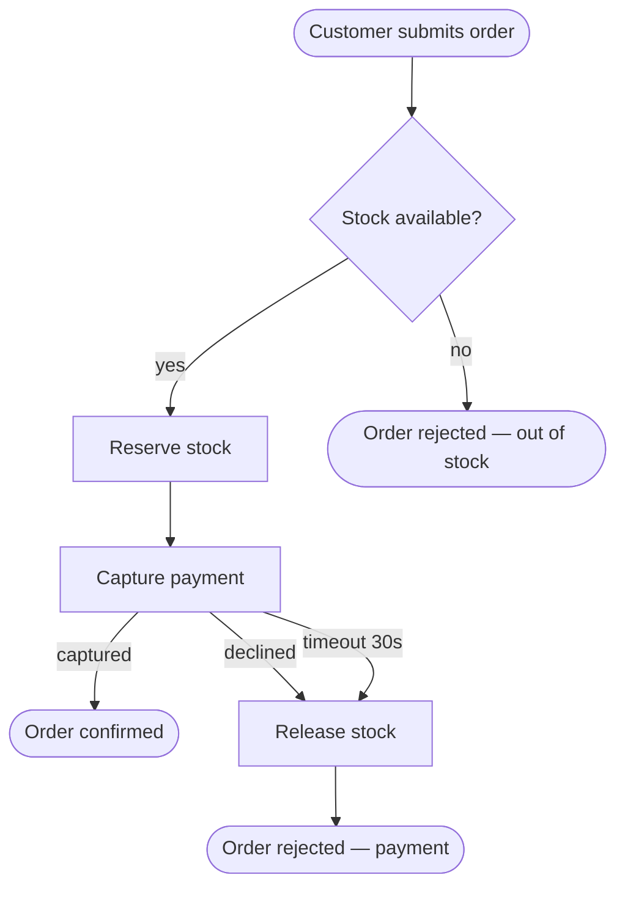

# BA — Flow Mapper

Turns requirements into a **business-flow model that forces the questions the prose never answers**: what happens on failure? who acts at this step? where does the timeout path go? which branches rejoin? The model is a reasoning instrument, not documentation — every authoring rule below exists because prose requirements systematically hide a class of gap that the diagram makes impossible to hide.

The notation is a **Mermaid flowchart** (text-based, diffable, token-cheap, renders in GitHub/artifacts) with **BPMN's discipline borrowed as authoring rules** — not BPMN XML.

## When to use

- Requirements describe a multi-step process (an order, an approval, an onboarding) and the paths need to be made explicit
- A new feature adds steps/branches to an existing flow in the KB
- A conflict sweep flagged a finding that needs the flow drawn to localize it
- The user wants "all the ways this can go" including failures

## When NOT to use

- The question is "what may happen to this *entity* over its life" → `ba-entity-state-grid`
- The question is "what outcome for every input combination" → `ba-decision-table`
- The question is timing/interleaving between two features/systems → a Mermaid `sequenceDiagram` of the specific boundary scenario (an investigation tool inside `ba-feature-conflict-check`, not a default artifact)
- Distilling a story into a testable breakdown → `qa/manual/requirements-breakdown`

## Contract with the KB

Per `business-analysis/skills/ba-project-memory`: **read first** (`INDEX.md` + any existing flow files this feature touches + `glossary.md` for the terms it uses), **update after** (the flow file, `INDEX.md`, `active-context.md`). Extending an existing flow beats creating a near-duplicate — check the INDEX before authoring `flows/<new>.md`.

## Authoring rules (the BPMN discipline)

1. **Named actors.** Every action belongs to an actor (customer, reviewer, payment provider, scheduler, *the system*). Use Mermaid `subgraph` blocks as swimlanes when more than one actor acts. An action with no actor is a finding — flag it, don't guess.
2. **Explicit start and end events.** Every flow starts from a named trigger ("Customer submits order", "Nightly job runs") and every path terminates in a named outcome. **No dead ends** — a path that just stops is a gap finding.
3. **Every decision node enumerates its full outcome set — including the failure exit.** LLMs and prose authors both systematically under-generate branches. A diamond with only a "yes" arrow is wrong. `Valid? -->|yes| … -->|no| …` at minimum; if the requirements don't say what "no" does, that's an Open question, not an omitted arrow.
4. **Every merge states which paths rejoin.** When branches converge, the join node names what's true at that point regardless of the path taken. If the branches leave the world in different states, they don't actually rejoin — model separate ends.
5. **Boundary events are modeled, not ignored.** Timeout, cancellation, and external failure (payment declined, webhook never arrives) are first-class exits from the step they interrupt. Ask per waiting step: *what if the answer never comes?*
6. **Steps carry precondition → action → postcondition** (in the step notes table, not the diagram): what must be true to enter, what the step does, what's true after. This keeps flows testable and is what `qa/manual/requirements-breakdown` mines.
7. **Node IDs are stable.** `FLOW-001.3` = flow 1, node 3. Use the node number as the Mermaid node id (`n3` ↔ `FLOW-001.3`) so the diagram and the steps table cross-reference mechanically. Referenced by findings, state models, and test bases — never renumber on edit; new nodes take the next free number.
8. **Glossary terms only.** If the requirements use a term two ways, or the flow needs a term the glossary defines differently, that's terminology drift — flag it and route to `glossary.md`.

## The event-timeline pass (do this before drawing)

A degraded — deliberately solo-agent — form of event storming. Before drawing the chart:

1. **Derive the domain-event list** from the requirements: past-tense facts ("Order Placed", "Payment Captured", "Refund Issued").
2. **Order them on a timeline.** Where order is unclear or contested, that's a hotspot → open question.
3. **Ask per event:** *what must already have happened?* (missing preconditions = missing upstream steps) and *who else reacts to this?* (hidden fan-out: notifications, quotas, lifecycle jobs, analytics — the recurring interaction hotspots).
4. **Mark pivotal events** — ownership/phase boundaries ("Payment Captured" hands off from checkout to fulfillment). Pivotal events are the natural seams for splitting a big flow into linked sub-flow files.

The timeline is scaffolding; keep it in the flow file under "Event timeline" — it's the cheapest cross-feature ordering check the sweep has.

## Flow file format (`docs/business-model/flows/<flow>.md`)

````markdown
# Flow — <Name> (FLOW-001)

**Sources**: <story/BRD/contract refs>
**Actors**: <list>
**Trigger**: <the start event>
**Outcomes**: <every terminal state, incl. failures>
**Last updated**: <date> — <one line what changed>

## Diagram


## Steps
| Node | Actor | Precondition | Action | Postcondition | Source |
|---|---|---|---|---|---|
| FLOW-001.4 | System | stock reserved | capture payment via provider | payment captured or declined or timed out | STORY-42 AC2 |

## Event timeline
Order Placed → Stock Reserved → Payment Captured *(pivotal — hands to fulfillment)* → …

## Open questions
- ❓ [TBD - source silent] What happens to the reservation if the customer abandons before payment? ⚠️ Assumption: released after 15 min `#inferred`
````

## Quality bar

- [ ] Every decision node has **all** exits labeled, including failure/no
- [ ] Every path ends in a named outcome — no dead ends
- [ ] Every waiting step has its timeout/cancel/never-arrives exit
- [ ] Every action has an actor; multi-actor flows use subgraph swimlanes
- [ ] Steps table carries precondition → action → postcondition with sources
- [ ] Event timeline present; pivotal events marked; hotspots logged as open questions
- [ ] Node IDs stable; new nodes appended, existing never renumbered
- [ ] KB updated per the contract (flow file + INDEX + active-context)

## Anti-example

Bad: a happy-path-only flowchart — `Submit → Validate → Pay → Done` — with no actors, no failure exits, drawn in chat and never persisted. That's an illustration of the requirements, not a model of them; it answers no question the prose didn't.

Good: the same flow with the declined/timeout/abandon paths forced into the open, three of them flagged `[TBD]` because the requirements are genuinely silent — those flags are the deliverable.

## Handoffs

- The flow exposes entity states → `business-analysis/skills/ba-entity-state-grid`
- A decision node hides a rule set ("eligible?" with 4 inputs) → `business-analysis/skills/ba-decision-table`
- Flow done, feature needs the conflict pass → `business-analysis/skills/ba-feature-conflict-check`
- KB mechanics → `business-analysis/skills/ba-project-memory`
- Testing this flow → `qa/manual/requirements-breakdown` consumes the flow file as test basis
