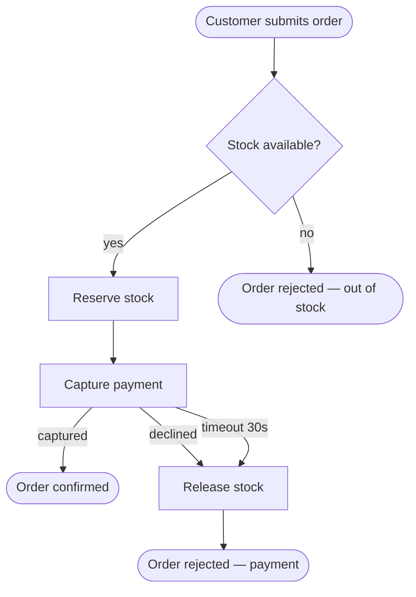

# BA — Flow Mapper

Turns requirements into a **business-flow model that forces the questions the prose never answers**: what happens on failure? who acts at this step? where does the timeout path go? which branches rejoin? The model is a reasoning instrument, not documentation — every standard it must meet exists because prose requirements systematically hide a class of gap that the diagram makes impossible to hide.

The notation is a **Mermaid flowchart** (text-based, diffable, token-cheap, renders in GitHub/artifacts) with **BPMN's discipline borrowed as authoring rules** — not BPMN XML.

## When to use

- Requirements describe a multi-step process (an order, an approval, an onboarding) and the paths need to be made explicit
- A new feature adds steps/branches to an existing flow in the KB
- A conflict sweep flagged a finding that needs the flow drawn to localize it
- The user wants "all the ways this can go" including failures

## When NOT to use

- The question is "what may happen to this *entity* over its life" → `business-analysis:state-grid`
- The question is "what outcome for every input combination" → `business-analysis:decision-table`
- The question is timing/interleaving between two features/systems → a Mermaid `sequenceDiagram` of the specific boundary scenario (an investigation tool inside `business-analysis:conflict-check`, not a default artifact)
- Distilling a story into a testable breakdown → `qa/manual/requirements-breakdown`

## Contract with the KB

Per `business-analysis/skills/ba-project-memory`: **read first** (`INDEX.md` + any existing flow files this feature touches + `glossary.md` for the terms it uses), **update after** (the flow file, `INDEX.md`, `active-context.md`). Extending an existing flow beats creating a near-duplicate — check the INDEX before authoring `flows/<new>.md`.

## Standards (the BPMN discipline)

What a flow file must meet (named actors and swimlanes, a start trigger and named outcomes with no dead ends, every decision exit labelled including failure, timeout and never-arrives exits, merges that state what rejoins, stable `FLOW-nnn.k` node ids, the precondition → action → postcondition steps table, glossary terms only) is the business-analysis rule files, not a list here: `business-model-flows.md` plus the core `business-model.md`. Read the project's copy in `.claude/rules/business-analysis/`, or the plugin's in `business-analysis/skills/rules/` when the project has not installed them (`/business-analysis:rules` does). Where they and this skill disagree, the rule files win. They are also this skill's quality bar.

## The event-timeline pass (do this before drawing)

A degraded — deliberately solo-agent — form of event storming. Before drawing the chart:

1. **Derive the domain-event list** from the requirements: past-tense facts ("Order Placed", "Payment Captured", "Refund Issued").
2. **Order them on a timeline.** Where order is unclear or contested, that's a hotspot → open question.
3. **Ask per event:** *what must already have happened?* (missing preconditions = missing upstream steps) and *who else reacts to this?* (hidden fan-out: notifications, quotas, lifecycle jobs, analytics — the recurring interaction hotspots). The answers to "who else reacts" are recorded as reactions in `events.md` through `business-analysis:dependency-map`, not left in the flow file.
4. **Mark pivotal events** — ownership/step boundaries ("Payment Captured" hands off from checkout to fulfillment). Pivotal events are the natural seams for splitting a big flow into linked sub-flow files.

The timeline is scaffolding; keep it in the flow file under "Event timeline" — it's the cheapest cross-feature ordering check the sweep has.

## Flow file format (`docs/business-model/flows/<flow>.md`)

````markdown
# Flow — <Name> (FLOW-001)

**Created:** <YYYY-MM-DD>
**Owned by:** `business-analysis:process-flow`
**Last updated:** <YYYY-MM-DD> by `business-analysis:process-flow` — <one line what changed>

**Sources**: <US<n> / BRD / contract refs> · **Feature**: <E<n> label, or AREA-nnn>
**Actors**: <list>
**Trigger**: <the start event>
**Outcomes**: <every terminal state, incl. failures>

## Diagram


## Steps
| Node | Actor | Precondition | Action | Postcondition | Source |
|---|---|---|---|---|---|
| FLOW-001.4 | System | stock reserved | capture payment via provider | payment captured or declined or timed out | US42 AC2 |

## Event timeline
Order Placed → Stock Reserved → Payment Captured *(pivotal — hands to fulfillment)* → …

## Open questions
- ❓ [TBD - source silent] What happens to the reservation if the customer abandons before payment? ⚠️ Assumption: released after 15 min `#inferred`
````

## Anti-example

Bad: a happy-path-only flowchart — `Submit → Validate → Pay → Done` — with no actors, no failure exits, drawn in chat and never persisted. That's an illustration of the requirements, not a model of them; it answers no question the prose didn't.

Good: the same flow with the declined/timeout/abandon paths forced into the open, three of them flagged `[TBD]` because the requirements are genuinely silent — those flags are the deliverable.

## Handoffs

- The flow exposes entity states → `business-analysis/skills/ba-entity-state-grid`
- A decision node hides a rule set ("eligible?" with 4 inputs) → `business-analysis/skills/ba-decision-table`
- "Who else reacts" answers become reactions → `business-analysis/skills/ba-dependency-map`
- Flow done, feature needs the conflict pass → `business-analysis/skills/ba-feature-conflict-check`
- KB mechanics → `business-analysis/skills/ba-project-memory`
- Testing this flow → `qa/manual/requirements-breakdown` consumes the flow file as test basis
