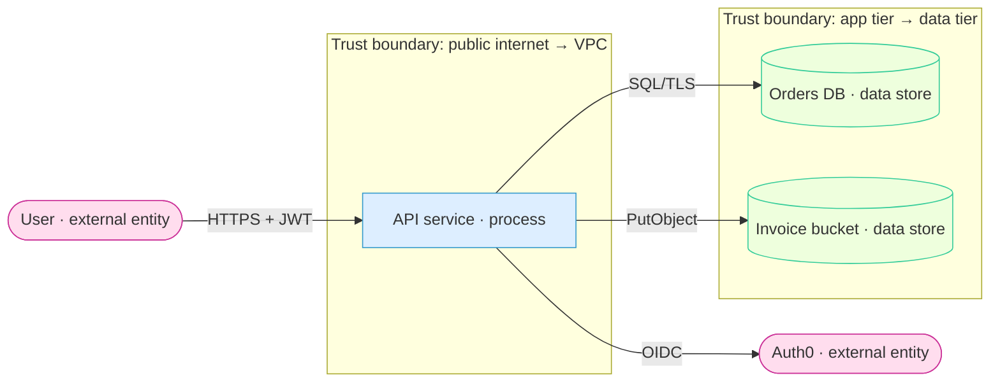

# DevOps — Threat Modeling (STRIDE · DFD · Attack Trees)

Threat modeling is the **design-time analysis that scopes every downstream security lane**. Before a scanner runs or a probe fires, it answers one question — *what can go wrong with this system, and where* — and turns the answer into a **prioritized threat register** where each threat names the mechanism, the trust boundary it crosses, its OWASP/ATT&CK spine, and **the library agent/skill that would test it**. That routing is the point: a threat model that ends in a PDF nobody scopes work from has failed; this one feeds `infra-security-tester`, `qa-security`, and `penetration-tester` their target lists.

It produces **analysis, never a payload.** No scan, no exploit, no live-target touch — it reads the design (diagrams, code, IaC, docs) and reasons. It needs no authorization to run because it sends nothing; instead it *defines the authorization each downstream lane will need*.

This skill is **language-agnostic** — a DFD and a STRIDE table are the same whether the service is .NET, Java, or Node. It is the **first thing `infra-security-tester` runs** (Step 0) and the analysis `security-test-planner` consumes to sequence a platform's assessment; it also closes the `qa-security` Step-1 forward-wire — where that agent once built a threat model inline, this is the dedicated skill it hands to.

## The two spines — stated per threat

Every threat carries both, so the register is directly consumable by both kinds of lane:

- **OWASP** — the defensive/scanner spine. **Top 10:2025** categories (A01 Broken Access Control — now absorbing SSRF · A02 Security Misconfiguration · A03 Software Supply Chain Failures · A04 Cryptographic Failures · A05 Injection · A06 Insecure Design · A07 Authentication Failures · A08 Software or Data Integrity Failures · A09 Security Logging & Alerting Failures · A10 Mishandling of Exceptional Conditions), plus the **API Top 10:2023** (BOLA/BFLA) where the surface is an API.
- **MITRE ATT&CK** — the offensive/detection spine, **keyed to the surface**: the Enterprise matrix filtered to the **Containers** platform for a Kubernetes/container threat and to the **IaaS** platform for a cloud/IAM threat — not the host-centric default. (As of ATT&CK v19 the standalone "Cloud" matrix is a platform *filter* of Enterprise, and the old *Defense Evasion* tactic is renamed *Stealth* — cite technique IDs, which are stable, not tactic names.)

`references/stride.md` carries the full threat catalogue with a spine on every row — use it as the enumeration engine.

## The four-question frame

Shostack's method-agnostic frame is the spine of a run; STRIDE and attack trees slot into questions 2 and 3:

1. **What are we building?** → the DFD (below): elements, trust boundaries, data flows, data classification.
2. **What can go wrong?** → STRIDE-per-element enumeration (`references/stride.md`), deepened by an attack tree (`references/attack-trees.md`) for each high-value goal.
3. **What are we going to do about it?** → the register: existing mitigation + evidence, or a routed test/finding.
4. **Did we do a good job?** → the coverage check: every boundary crossing enumerated, every element's applicable STRIDE letters answered (including an explicit "n/a, because —"), every high threat routed to a lane.

## Decision matrix — which instrument

| You need to… | Use | Deep dive |
|---|---|---|
| Establish the system + its trust boundaries | **DFD** (Mermaid, below) | this file |
| Enumerate technical threats element-by-element | **STRIDE-per-element** | `references/stride.md` |
| Reason about *a specific attacker goal* in depth | **Attack tree** | `references/attack-trees.md` |
| Model privacy threats (regulated personal data) | **LINDDUN** (alongside STRIDE) | `references/stride.md` (Where STRIDE runs out) |
| Model business-logic abuse (legal steps, illegal outcome) | **abuse cases / decision tables** | `qa/manual/test-design-techniques`, `business-analysis:decision-table` |
| Risk-centric, business-impact-first pass on a high-stakes system | **PASTA** (7-stage) | `references/stride.md` |

**STRIDE is the default** for a service or platform. Reach for an attack tree only after STRIDE surfaces a high-value goal worth decomposing (cross-tenant data read, cluster-admin, supply-chain compromise) — the tree explains *how far a single objective reaches*, which STRIDE's breadth does not.

## Step 1 — the data-flow diagram

Model the system as four element types crossing **trust boundaries** (the lines where privilege or trust changes — internet↔edge, app tier↔data tier, your infra↔a third party, one tenant↔another). Diagram-as-code is preferred (versionable, diffable, lives beside the code); Mermaid is enough:



- **Every element is typed** — external entity · process · data store · data flow — because STRIDE applies *by type* (a data store can't elevate privilege; a data flow can't be spoofed). Mistyping produces duplicate and orphan threats.
- **Every trust boundary is drawn**, and **every crossing is enumerated twice** — once for the sender, once for the receiver. A crossing with no threats recorded is a modelling error, not a safe flow.
- **Classify the data on each flow/store** (public / internal / PII / secret) — the classification is what turns an Information-disclosure row from theoretical into a severity.

## Step 2 — enumerate with STRIDE-per-element

Walk each element against **only its applicable letters** (the load-bearing chart lives in `references/stride.md`). Write each threat as a sentence with an **actor, an action, and a consequence** ("an authenticated tenant-B user retrieves tenant-A invoices by changing the id in the path, disclosing customer PII") — "IDOR risk" is not testable. Record the existing mitigation and its `file:line`/policy/manifest evidence in the same row; a mitigated threat is still a row, because it is what a retest re-checks.

## Step 3 — deepen high-value goals with attack trees

For each objective worth the depth, build a goal-rooted AND/OR tree (`references/attack-trees.md`): the attacker goal at the root, decomposed into sub-goals and leaf attacks, scored and rolled up so the cheapest viable path is visible. The leaves become concrete test cases the downstream lane executes.

## Step 4 — the threat register + the routing table (the deliverable)

The register is the artifact every other lane consumes. One row per threat, and the **Routes to** column is what makes the model "feed downstream scope":

| ID | Threat (actor · action · consequence) | Element / boundary | STRIDE | OWASP | ATT&CK | Likelihood×Impact | Mitigation + evidence | **Routes to (executor · skill)** |
|---|---|---|---|---|---|---|---|---|
| T-01 | Tenant-B user reads tenant-A invoices via id in path | API → Orders DB | I, E | A01 / API1:2023 | — | H×H | none found | **`qa-security` · permission-testing** |
| T-02 | SSRF on webhook URL reaches IMDS, steals role creds | API process | I, E | A01 (SSRF) | T1552.005 (IaaS) | M×H | no metadata hop block | **`qa-security` · exploit-validation** → **`penetration-tester` · initial-access** |
| T-03 | Over-broad IAM role (`*:*`) on the task role | Cloud IAM boundary | E | A01 | T1078.004 (IaaS) | M×H | policy review pending | **`infra-security-tester` · cloud-posture** |
| T-04 | Privileged container escapes to the node | Pod → host boundary | E, T | A02 | T1611 (Containers) | L×H | no `runAsNonRoot` | **`infra-security-tester` · k8s-security / container-runtime-security** |
| T-05 | Unsigned base image ships a backdoor | Build → registry boundary | T | A03 / A08 | T1195.002 | L×H | no cosign attestation | **`infra-security-tester` · supply-chain-security** |
| T-06 | Refund action leaves no audit event | API → audit log | R | A09 | T1562.008 (IaaS) | M×M | handler logs nothing | **`infra-security-tester` · infra-controls-validation** |

**The routing rule:** an authz/authn/injection/exposure threat routes to `qa-security` (its scanners, `permission-testing`, `exploit-validation`); an infra-posture threat (IAM, cluster, image, supply chain, controls) routes to the matching `infra-security-tester` skill; a threat whose real impact is a *chain* (foothold → escalate → move) routes to `penetration-tester`. Every **high** threat must route somewhere — an unrouted high is a coverage gap, not an omission.

## Tooling

Prefer **threat-model-as-code** (versioned, diffable, CI-checkable) and Mermaid DFDs over a GUI whose output is a binary blob:

- **OWASP pytm** (1.4.0, Python ≥3.11) — threat-model-as-code: declare `Boundary`/`Actor`/`Server`/`Datastore`/`Process`/`Dataflow` (and now `LLM`/`Agent`) in Python, then `pytm --dfd | dot -Tpng`, `--seq` for a sequence diagram, `--report <template>` for Markdown, `--json` for machine output. Threats come from a JSON `threatlib` with a boolean `condition` per element — the closest fit to this library's diagram-as-code norm. (`--sqldump` was removed in 1.4.0; use `--json`.)
- **OWASP Threat Dragon** (2.6.2) — GUI diagram editor (web / Electron / Docker) with rule-based suggested threats per element and STRIDE/LINDDUN/CIA/PLOT4ai diagram types. Good for a workshop; **no CLI/automation** — its JSON is GUI-shaped, and 1.x↔2.x formats are incompatible (a migration hazard). Use it to *draw*, export the register here.
- **Microsoft Threat Modeling Tool** (7.3, Windows-only, `.tm7`) — the canonical STRIDE-per-element implementation; reach for it only on a Windows-centric team already standardized on it.
- **Threagile** (v0.9.1, Go/Docker) — YAML model + configurable risk rules → PDF/JSON/Excel; suits a larger architecture kept as code.

## The output artifact

Write one file per system to `docs/security/threat-models/` on the current branch, under the repo being modelled:

```
docs/security/threat-models/<NNN>-<system>.md
```

`<NNN>` is zero-padded, minted once per system and reused when the model is revised (never renumbered), per the library-wide `<NNN>-<slug>` convention. The document contains: the **DFD** (Mermaid), the **STRIDE table per element** (applicable letters answered, "n/a because —" where blank), any **attack trees**, and the **prioritized threat register with the routing table**. Open it with `**Date:** <YYYY-MM-DD>` · `**Author:** \`devops:threat-modeling\`` · the system + version lane · the scope (what was in and out of the model). Threat IDs (`T-01…`) are permanent so a downstream lane and a later revision cite the same row.

## Anti-patterns

- **A threat model that routes nowhere.** Rows with no **Routes to** column are analysis nobody acts on. *Fix:* every high threat names an executor + skill; that is the deliverable's whole purpose.
- **Brainstorming instead of enumerating.** "What worries us?" misses the boring, common flaws. *Fix:* walk STRIDE-per-element against the DFD — finite, repeatable, and it surfaces the IDOR nobody was worried about.
- **Mistyped elements.** Filing Elevation against a data store or Spoofing against a data flow produces duplicates and orphans. *Fix:* type every element; apply only the letters its type allows (`references/stride.md`).
- **Boundaries drawn but crossings not enumerated.** The boundary is where the threats live; a crossing with no rows is the gap. *Fix:* enumerate every crossing twice (sender + receiver).
- **A vague threat.** "Injection risk" can't be tested or routed. *Fix:* actor + action + consequence, specific enough that the downstream lane knows exactly what to try.
- **Modelling once and never revisiting.** The model rots as the architecture changes. *Fix:* it is diagram-as-code beside the repo; revise it on an architecture change and re-route the new threats (question 4).
- **Threat-modelling business logic with STRIDE.** A refund loop is a legal sequence with an illegal outcome — STRIDE won't see it. *Fix:* abuse cases / `business-analysis:decision-table` / `qa/manual/test-design-techniques`.

## Rules (hard constraints)

- **Analysis only — no payloads.** This skill reads the design and reasons; it never scans, probes, or exploits. It *scopes* the authorization downstream lanes need; it needs none itself.
- **DFD first, then STRIDE-per-element, then attack trees for the high-value goals** — in that order. Type every element; draw every trust boundary; enumerate every crossing twice.
- **Both spines on every threat** — OWASP (Top 10:2025 / API:2023) and, where offensive, ATT&CK with the technique id keyed to the surface's platform (Containers / IaaS).
- **Every threat is a sentence** (actor · action · consequence) with its existing mitigation + evidence, and **every high threat routes to an executor + skill.** An unrouted high is a coverage gap.
- **Prefer threat-model-as-code** (pytm / Mermaid) over a GUI binary; the artifact lives at `docs/security/threat-models/<NNN>-<system>.md` with permanent threat IDs.
- **Green ≠ safe.** State what the model covers and what it defers (business logic, privacy → LINDDUN, deep exploit chains → `penetration-tester`).

## Cross-references

- `references/stride.md` — the STRIDE-per-element chart + the full threat catalogue (spine on every row); the enumeration engine.
- `references/attack-trees.md` — attack-tree notation, construction, worked examples, and scoring/roll-up.
- `infra-security-tester` — the step-by-step agent that runs this in Step 0 to scope its posture assessment; the register's infra rows route to its `k8s-security` / `iac-security` / `cloud-posture` / `container-runtime-security` / `supply-chain-security` / `infra-controls-validation` skills.
- `security-test-planner` — consumes the register to sequence a platform's assessment across lanes.
- `qa-security` — the app-layer executor for authz/authn/injection/exposure threats (`permission-testing`, the `_shared/security-testing/*` scanners, `exploit-validation`); the threat model this produces replaces its inline Step-1 model.
- `penetration-tester` (`security/` domain) — the executor for threats whose real impact is a multi-stage chain.
- `data-architect` — owns the data-tier trust boundary and the cross-tenant leak test that proves a tenancy threat's mitigation holds.
- `business-analysis:process-flow` / `business-analysis:decision-table` — the requirements-side flow/decision modelling; the fence is business process (theirs) vs security threats (this).
