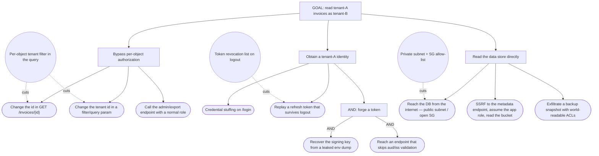
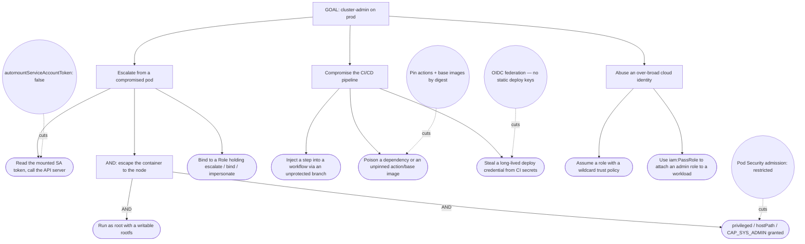

# Attack trees — construction, notation, and prioritisation

STRIDE-per-element answers *what can go wrong at each element*. It produces a **flat, wide** list — dozens of
independent rows. It cannot answer the two questions that decide where the money goes:

- **How does an attacker actually get to the thing that matters?** (a real breach is a *chain*, not a row)
- **Which single mitigation cuts the most paths?** (the leverage question)

An **attack tree** (Schneier, 1999) answers both. It is a goal-directed decomposition: the **root** is one
attacker goal stated in business terms, the **children** are the ways to achieve it, recursed until the
leaves are concrete acts you could actually attempt or test.

> **Rule of proportion.** You do **not** build an attack tree per threat. You build one per **crown-jewel
> goal** — typically 2–5 for a system. Trees are the deep pass over the register's highest-consequence rows;
> STRIDE is the wide pass. A model with 40 trees has replaced analysis with paperwork.

## Notation

| Node | Meaning | Mermaid convention used here |
|---|---|---|
| **Root** | The attacker's goal, in business terms ("read another tenant's invoices") | rectangle |
| **OR node** (default) | Any one child achieves the parent | plain edge |
| **AND node** | *All* children are required together | edge labelled `AND`, node text prefixed `AND:` |
| **Leaf** | A concrete, attemptable act — the thing a lane agent tests | rounded/stadium node |
| **Mitigation** | An existing control that cuts an edge | dashed edge to a `((control))` node |

**AND is the mitigation lever.** An OR node means every child must be defended. An **AND** node means
breaking *any one* child defeats the whole subtree — which is precisely why defence-in-depth is expressed as
converting an OR path into an AND path. When you can only fund one control, fund the one that turns an OR
into an AND, or the one that appears under the most subtrees.

## Construction procedure

1. **Pick the goal from the register, not from imagination.** Take the highest-consequence rows from the
   STRIDE pass and phrase the goal the way a breach notification would: *"exfiltrate the customer PII table"*,
   *"issue a payout to an attacker-controlled account"*, *"gain cluster-admin on the production cluster"*.
2. **Decompose one level at a time**, asking only *"what are all the ways to achieve the node above?"* Do not
   skip to leaves — the middle layers are where shared sub-goals (and therefore leverage) appear.
3. **Mark AND nodes explicitly.** The default is OR; an unmarked AND is a tree that overstates the attacker's
   difficulty and understates your risk.
4. **Stop at leaves that are attemptable.** A leaf is done when a named lane agent could take it as a task:
   *"replay a captured refresh token after logout"*, not *"break authentication"*.
5. **Overlay the existing controls** as dashed cut-edges, with the evidence (`file:line`, policy name,
   manifest path) that proves the control is actually in place. An unverified control is drawn as a control
   with a `[TBD - evidence]` marker, never as a solid cut.
6. **Score the leaves and roll up.** Score leaves on *difficulty*, *detectability*, and *impact* (or a single
   0–3 feasibility number if the team prefers). Roll up: an **OR** node takes the **easiest** child (attackers
   pick the cheap path); an **AND** node takes the **hardest** child (they must clear every one).
7. **Read the leverage off the tree** — the leaf reachable by the most paths, and the shallow cut that
   collapses a whole subtree. Those become the top rows of the register's priority table.

## Worked example — "read another tenant's invoices"

**Reading it.** `A1`/`A2`/`A3` are the cheapest paths — no credentials, no infrastructure access, just an id
edit — so the per-object tenant filter (`M1`) is the highest-leverage control in the tree: one mitigation cuts
two leaves and is the same control that defeats the whole `A` subtree once `A3` is covered by a route policy.
`B3` is an **AND** — it needs *both* a leaked signing key *and* a validation gap — so it is the most expensive
path and correctly deprioritised even though "token forgery" sounds alarming. `C2` (SSRF → metadata → bucket)
is the path that crosses lanes: it is one app-layer leaf away from becoming a cloud-IAM breach, which is why
it routes to **two** lanes (see the routing table in `SKILL.md`).

## Worked example — "gain cluster-admin on the production cluster"

**Reading it.** `M2` cuts one half of an **AND** — which is enough to defeat `P2` entirely, and is the cheapest
control in the tree. The `Q` subtree is pure supply chain and routes wholesale to
`devops:supply-chain-security`; the `P` subtree routes to `devops:kubernetes-security` +
`devops:container-runtime-security`; `R` routes to `devops:cloud-posture`. One tree, three lanes, one shared
priority ordering — this is what makes the tree the sequencing input the assessment plan needs.

## Scoring and rolling up

A lightweight scheme that survives contact with a real review (avoid DREAD-style false precision):

| Dimension | Scale | Notes |
|---|---|---|
| **Feasibility** | `low` / `med` / `high` | Skill, access, and time the leaf demands *given the current controls* |
| **Detectability** | `detected` / `partial` / `blind` | Would the existing telemetry see it? A `blind` leaf is a detection-engineering finding as well as a security one |
| **Impact** | `low` / `med` / `high` / `critical` | Consequence at the **root**, inherited by the path — a leaf's impact is the goal's impact |

Roll-up: **OR → max feasibility of the children** (easiest path wins) · **AND → min feasibility** (hardest
child gates). Priority = feasibility of the cheapest path × root impact, biased upward when detectability is
`blind`.

## Anti-patterns

- **A tree per STRIDE row.** Turns a 2-hour deep pass into a week of diagramming. Trees are for crown-jewel
  goals only; everything else stays a register row.
- **An all-OR tree.** Either the system genuinely has no layered defence — which is itself the finding — or
  the AND nodes were never marked. Check before concluding.
- **Leaves that aren't attemptable.** "Weak crypto" is a category; "downgrade the TLS handshake to a cipher on
  the deprecated list" is a leaf a lane agent can take as a task.
- **Drawing controls that were never verified.** A dashed cut-edge asserts the path is closed. Assert it only
  with evidence read this session; otherwise mark it `[TBD - evidence]`.
- **Scoring before the tree is complete.** Numbers on a half-built tree rank the paths you happened to think
  of first.
- **Leaving the tree unrouted.** Every leaf carries the lane that would test it. An unrouted tree is a
  drawing; a routed tree is a work plan.
