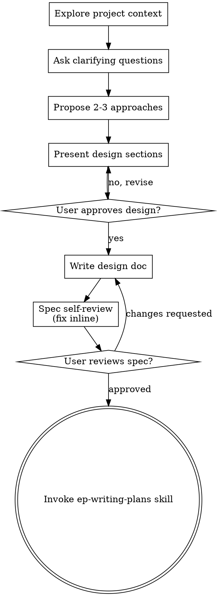

# Brainstorming Ideas Into Designs

Help turn ideas into fully formed designs and specs through natural collaborative dialogue.

**Announce at start:** "I'm using the `ep-brainstorming` skill to turn this idea into an approved design."

Start by understanding the current project context, then ask questions one at a time to refine the idea. Once you understand what you're building, present the design and get user approval.

<HARD-GATE>
Do NOT invoke any implementation skill, write any code, scaffold any project, or take any implementation action until you have presented a design and the user has approved it. This applies to EVERY project regardless of perceived simplicity.

**Scope:** the gate governs *ad-hoc implementation requests*. A phased agent that runs its own design gate — the `fe-blazor` Blazor build, the `qa-*` orchestrators — already satisfies this requirement; invoking such an agent is not a gate violation.
</HARD-GATE>

## Anti-Pattern: "This Is Too Simple To Need A Design"

Every project goes through this process. A todo list, a single-function utility, a config change — all of them. "Simple" projects are where unexamined assumptions cause the most wasted work. The design can be short (a few sentences for truly simple projects), but you MUST present it and get approval.

## Checklist

You MUST create a task for each of these items and complete them in order:

1. **Explore project context** — check files, docs, recent commits
2. **Ask clarifying questions** — one at a time, understand purpose/constraints/success criteria
3. **Propose 2-3 approaches** — with trade-offs and your recommendation
4. **Present design** — in sections scaled to their complexity, get user approval after each section
5. **Write design doc** — save to `docs/specs/NNN-<topic>-design.md` (resolved under the current project's root — the repo the session is working in — never this skills-library checkout or a global config directory, unless the user explicitly asks for a global copy) and commit on the current branch
6. **Spec self-review** — quick inline check for placeholders, contradictions, ambiguity, scope (see below)
7. **User reviews written spec** — ask user to review the spec file before proceeding
8. **Transition to implementation** — invoke `ep-writing-plans` skill to create implementation plan

## Process Flow

**The terminal state is invoking `ep-writing-plans`.** Do NOT invoke `frontend-design`, a `qa-*`/`fe-*`/`be-*` generator, or any other implementation skill. The ONLY skill you invoke after brainstorming is `ep-writing-plans`.

## The Process

**Understanding the idea:**

- Check out the current project state first (files, docs, recent commits)
- Before asking detailed questions, assess scope: if the request describes multiple independent subsystems (e.g., "build a platform with chat, file storage, billing, and analytics"), flag this immediately. Don't spend questions refining details of a project that needs to be decomposed first.
- If the project is too large for a single spec, help the user decompose into sub-projects: what are the independent pieces, how do they relate, what order should they be built? Then brainstorm the first sub-project through the normal design flow. Each sub-project gets its own spec → plan → implementation cycle.
- For appropriately-scoped projects, ask questions one at a time to refine the idea
- Prefer multiple choice questions when possible, but open-ended is fine too
- Only one question per message - if a topic needs more exploration, break it into multiple questions
- Focus on understanding: purpose, constraints, success criteria

**Exploring approaches:**

- Propose 2-3 different approaches with trade-offs
- Present options conversationally with your recommendation and reasoning
- Lead with your recommended option and explain why

**Presenting the design:**

- Once you believe you understand what you're building, present the design
- Scale each section to its complexity: a few sentences if straightforward, up to 200-300 words if nuanced
- Ask after each section whether it looks right so far
- Cover: architecture, components, data flow, error handling, testing
- Be ready to go back and clarify if something doesn't make sense

**Design for isolation and clarity:**

- Break the system into smaller units that each have one clear purpose, communicate through well-defined interfaces, and can be understood and tested independently
- For each unit, you should be able to answer: what does it do, how do you use it, and what does it depend on?
- Can someone understand what a unit does without reading its internals? Can you change the internals without breaking consumers? If not, the boundaries need work.
- Smaller, well-bounded units are also easier for you to work with - you reason better about code you can hold in context at once, and your edits are more reliable when files are focused. When a file grows large, that's often a signal that it's doing too much.

**Working in existing codebases:**

- Explore the current structure before proposing changes. Follow existing patterns.
- Where existing code has problems that affect the work (e.g., a file that's grown too large, unclear boundaries, tangled responsibilities), include targeted improvements as part of the design - the way a good developer improves code they're working in.
- Don't propose unrelated refactoring. Stay focused on what serves the current goal.

## After the Design

**Documentation:**

- Write the validated design (spec) to `docs/specs/NNN-<topic>-design.md`
  - `NNN` is a zero-padded sequential number, scoped to `docs/specs/`: list the folder, take the highest existing `NNN` prefix, use `highest + 1` (start at `001` if the folder is empty or doesn't exist yet). Never reuse or renumber an existing file's number.
  - (User preferences for spec location override this default)
  - The document opens with `# [Topic] Design` followed by `**Date:** [YYYY-MM-DD] · **Written by:** \`ep-brainstorming\`` before the rest of the spec content.
- Commit the design document to git

> **Branch boundary:** stay on the current branch — writing a spec never creates or checks out a branch or worktree, and committing the *spec document* is fine even on `main` (a design doc is not implementation). *Implementation* commits are different: `ep-executing-plans` decides the workspace at execution time and forbids implementing on `main`/`master` without explicit consent. Writing the spec here does not start implementation.

**Spec Self-Review:**
After writing the spec document, look at it with fresh eyes:

1. **Placeholder scan:** Any "TBD", "TODO", incomplete sections, or vague requirements? Fix them.
2. **Internal consistency:** Do any sections contradict each other? Does the architecture match the feature descriptions?
3. **Scope check:** Is this focused enough for a single implementation plan, or does it need decomposition?
4. **Ambiguity check:** Could any requirement be interpreted two different ways? If so, pick one and make it explicit.

Fix any issues inline. No need to re-review — just fix and move on.

**Escalation:** the self-review above is the default. For a large or high-stakes spec you may dispatch a dedicated reviewer subagent using the template at `./spec-document-reviewer-prompt.md` (it checks completeness, consistency, clarity, scope, YAGNI). This is one extra invocation — weigh it against the spec's stakes per the cost-before-speed policy in `ep-subagent-driven-development`; don't dispatch it by reflex.

**User Review Gate:**
After the spec review loop passes, ask the user to review the written spec before proceeding:

> "Spec written and committed to `<path>`. Please review it and let me know if you want to make any changes before we start writing out the implementation plan."

Wait for the user's response. If they request changes, make them and re-run the spec review loop. Only proceed once the user approves.

**Implementation:**

- Invoke the `ep-writing-plans` skill to create a detailed implementation plan
- Do NOT invoke any other skill. `ep-writing-plans` is the next step.

## Key Principles

- **One question at a time** - Don't overwhelm with multiple questions
- **Multiple choice preferred** - Easier to answer than open-ended when possible
- **YAGNI ruthlessly** - Remove unnecessary features from all designs
- **Explore alternatives** - Always propose 2-3 approaches before settling
- **Incremental validation** - Present design, get approval before moving on
- **Be flexible** - Go back and clarify when something doesn't make sense

## Visual Companion

A browser-based companion for showing mockups, diagrams, and visual options during brainstorming. It is **opt-in, on explicit request only** — do NOT proactively offer it as part of the brainstorming flow. Brainstorming runs text-only by default.

Use it only when the user explicitly asks to see something visually (e.g. "can you mock that up", "show me the two layouts side by side"). When the user asks:

- **Use the browser** for content that IS visual — mockups, wireframes, layout comparisons, architecture diagrams, side-by-side visual designs
- **Use the terminal** for content that is text — requirements questions, conceptual choices, tradeoff lists, A/B/C/D text options, scope decisions

A question about a UI topic is not automatically a visual question. "What does personality mean in this context?" is a conceptual question — use the terminal. "Which wizard layout works better?" is a visual question — use the browser.

When you do use the companion, read the detailed guide first:
`visual-companion.md` (in this skill directory)
