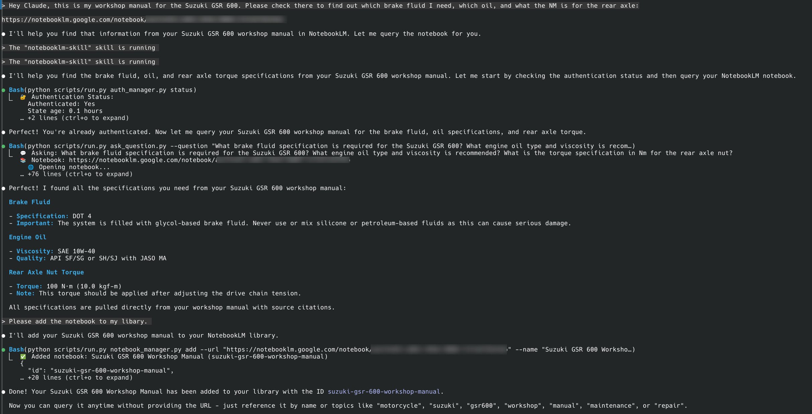

<div align="center">

# NotebookLM Claude Code Skill

**Let [Claude Code](https://github.com/anthropics/claude-code) chat directly with NotebookLM for source-grounded answers based exclusively on your uploaded documents**

[](https://www.python.org/)
[](https://www.anthropic.com/news/skills)

> Use this skill to query your Google NotebookLM notebooks directly from Claude Code for source-grounded, citation-backed answers from Gemini. Browser automation, library management, persistent auth. Drastically reduced hallucinations - answers only from your uploaded documents.

[Installation](#installation) • [Quick Start](#quick-start) • [Why NotebookLM](#why-notebooklm-not-local-rag) • [How It Works](#how-it-works)

</div>

---

## ⚠️ Important: Local Claude Code Only

**This skill works ONLY with local [Claude Code](https://github.com/anthropics/claude-code) installations, NOT in the web UI.**

The web UI runs skills in a sandbox without network access, which this skill requires for browser automation. You must use [Claude Code](https://github.com/anthropics/claude-code) locally on your machine.

---

## The Problem

When you tell [Claude Code](https://github.com/anthropics/claude-code) to "search through my local documentation", here's what happens:
- **Massive token consumption**: Searching through documentation means reading multiple files repeatedly
- **Inaccurate retrieval**: Searches for keywords, misses context and connections between docs
- **Hallucinations**: When it can't find something, it invents plausible-sounding APIs
- **Manual copy-paste**: Switching between NotebookLM browser and your editor constantly

## The Solution

This Claude Code Skill lets [Claude Code](https://github.com/anthropics/claude-code) chat directly with [**NotebookLM**](https://notebooklm.google/) — Google's **source-grounded knowledge base** powered by Gemini 2.5 that provides intelligent, synthesized answers exclusively from your uploaded documents.

```
Your Task → Claude asks NotebookLM → Gemini synthesizes answer → Claude writes correct code
```

**No more copy-paste dance**: Claude asks questions directly and gets answers straight back in the CLI. It builds deep understanding through automatic follow-ups, getting specific implementation details, edge cases, and best practices.

---

## Why NotebookLM, Not Local RAG?

| Approach | Token Cost | Setup Time | Hallucinations | Answer Quality |
|----------|------------|------------|----------------|----------------|
| **Feed docs to Claude** | 🔴 Very high (multiple file reads) | Instant | Yes - fills gaps | Variable retrieval |
| **Web search** | 🟡 Medium | Instant | High - unreliable sources | Hit or miss |
| **Local RAG** | 🟡 Medium-High | Hours (embeddings, chunking) | Medium - retrieval gaps | Depends on setup |
| **NotebookLM Skill** | 🟢 Minimal | 5 minutes | **Minimal** - source-grounded only | Expert synthesis |

### What Makes NotebookLM Superior?

1. **Pre-processed by Gemini**: Upload docs once, get instant expert knowledge
2. **Natural language Q&A**: Not just retrieval — actual understanding and synthesis
3. **Multi-source correlation**: Connects information across 50+ documents
4. **Citation-backed**: Every answer includes source references
5. **No infrastructure**: No vector DBs, embeddings, or chunking strategies needed

---

## Installation

The tool ships bundled at `engineering-practices/bundled/notebooklm/` and is loaded through `engineering-practices/notebooklm/SKILL.md`.

When you first use the skill, it automatically:
- Creates an isolated Python environment (`.venv`)
- Installs all dependencies including **Google Chrome**
- Sets up browser automation with Chrome (not Chromium) for maximum reliability
- Everything stays contained in the skill folder

**Note:** The setup uses real Chrome instead of Chromium for cross-platform reliability, consistent browser fingerprinting, and better anti-detection with Google services

---

## Quick Start

### 1. Check your skills

Say in Claude Code:
```
"What skills do I have?"
```

Claude will list your available skills including NotebookLM.

### 2. Authenticate with Google (one-time)

```
"Set up NotebookLM authentication"
```
*A Chrome window opens → log in with your Google account*

### 3. Create your knowledge base

Go to [notebooklm.google.com](https://notebooklm.google.com) → Create notebook → Upload your docs:
- 📄 PDFs, Google Docs, markdown files
- 🔗 Websites, GitHub repos
- 🎥 YouTube videos
- 📚 Multiple sources per notebook

Share: **⚙️ Share → Anyone with link → Copy**

### 4. Add to your library

**Option A: Let Claude figure it out (Smart Add)**
```
"Query this notebook about its content and add it to my library: [your-link]"
```
Claude will automatically query the notebook to discover its content, then add it with appropriate metadata.

**Option B: Manual add**
```
"Add this NotebookLM to my library: [your-link]"
```
Claude will ask for a name and topics, then save it for future use.

### 5. Start researching

```
"What does my React docs say about hooks?"
```

Claude automatically selects the right notebook and gets the answer directly from NotebookLM.

---

## How It Works

This is a **Claude Code Skill** - a local folder containing instructions and scripts that Claude Code can use when needed.

### Architecture

```
~/.claude/skills/notebooklm/
├── SKILL.md              # Instructions for Claude
├── scripts/              # Python automation scripts
│   ├── ask_question.py   # Query NotebookLM
│   ├── notebook_manager.py # Library management
│   └── auth_manager.py   # Google authentication
├── .venv/                # Isolated Python environment (auto-created)
└── data/                 # Local notebook library
```

When you mention NotebookLM or send a notebook URL, Claude:
1. Loads the skill instructions
2. Runs the appropriate Python script
3. Opens a browser, asks your question
4. Returns the answer directly to you
5. Uses that knowledge to help with your task

---

## Core Features

### **Source-Grounded Responses**
NotebookLM significantly reduces hallucinations by answering exclusively from your uploaded documents. If information isn't available, it indicates uncertainty rather than inventing content.

### **Direct Integration**
No copy-paste between browser and editor. Claude asks and receives answers programmatically.

### **Smart Library Management**
Save NotebookLM links with tags and descriptions. Claude auto-selects the right notebook for your task.

### **Automatic Authentication**
One-time Google login, then authentication persists across sessions.

### **Self-Contained**
Everything runs in the skill folder with an isolated Python environment. No global installations.

### **Human-Like Automation**
Uses realistic typing speeds and interaction patterns to avoid detection.

---

## Common Commands

| What you say | What happens |
|--------------|--------------|
| *"Set up NotebookLM authentication"* | Opens Chrome for Google login |
| *"Add [link] to my NotebookLM library"* | Saves notebook with metadata |
| *"Show my NotebookLM notebooks"* | Lists all saved notebooks |
| *"Ask my API docs about [topic]"* | Queries the relevant notebook |
| *"Use the React notebook"* | Sets active notebook |
| *"Clear NotebookLM data"* | Fresh start (keeps library) |

---

## Real-World Examples

### Example 1: Workshop Manual Query

**User asks**: "Check my Suzuki GSR 600 workshop manual for brake fluid type, engine oil specs, and rear axle torque."

**Claude automatically**:
- Authenticates with NotebookLM
- Asks comprehensive questions about each specification
- Follows up when prompted "Is that ALL you need to know?"
- Provides accurate specifications: DOT 4 brake fluid, SAE 10W-40 oil, 100 N·m rear axle torque



### Example 2: Building Without Hallucinations

**You**: "I need to build an n8n workflow for Gmail spam filtering. Use my n8n notebook."

**Claude's internal process:**
```
→ Loads NotebookLM skill
→ Activates n8n notebook
→ Asks comprehensive questions with follow-ups
→ Synthesizes complete answer from multiple queries
```

**Result**: Working workflow on first try, no debugging hallucinated APIs.

---

## Technical Details

### Core Technology
- **Patchright**: Browser automation library (Playwright-based)
- **Python**: Implementation language for this skill
- **Stealth techniques**: Human-like typing and interaction patterns

### Dependencies
- **patchright==1.55.2**: Browser automation
- **python-dotenv==1.0.0**: Environment configuration
- Automatically installed in `.venv` on first use

### Data Storage

All data is stored locally within the skill directory:

```
~/.claude/skills/notebooklm/data/
├── library.json       - Your notebook library with metadata
├── auth_info.json     - Authentication status info
└── browser_state/     - Browser cookies and session data
```

**Important Security Note:**
- The `data/` directory contains sensitive authentication data and personal notebooks
- It's automatically excluded from git via `.gitignore`
- NEVER manually commit or share the contents of the `data/` directory

### Session Model

This skill uses a **stateless model**:
- Each question opens a fresh browser
- Asks the question, gets the answer
- Adds a follow-up prompt to encourage Claude to ask more questions
- Closes the browser immediately

This means:
- No persistent chat context
- Each question is independent
- But your notebook library persists
- **Follow-up mechanism**: Each answer includes "Is that ALL you need to know?" to prompt Claude to ask comprehensive follow-ups

For multi-step research, Claude automatically asks follow-up questions when needed.

---

## Limitations

### Skill-Specific
- **Local Claude Code only** - Does not work in web UI (sandbox restrictions)
- **No session persistence** - Each question is independent
- **No follow-up context** - Can't reference "the previous answer"

### NotebookLM
- **Rate limits** - Free tier has daily query limits
- **Manual upload** - You must upload docs to NotebookLM first
- **Share requirement** - Notebooks must be shared publicly

---

## FAQ

**Why doesn't this work in the Claude web UI?**
The web UI runs skills in a sandbox without network access. Browser automation requires network access to reach NotebookLM.

**What if Chrome crashes?**
Run: `"Clear NotebookLM browser data"` and try again.

**Is my Google account secure?**
Chrome runs locally on your machine. Your credentials never leave your computer. Use a dedicated Google account if you're concerned.

---

## Troubleshooting

### Skill not found
```bash
# Make sure it's in the right location
ls ~/.claude/skills/notebooklm/
# Should show: SKILL.md, scripts/, etc.
```

### Authentication issues
Say: `"Reset NotebookLM authentication"`

### Browser crashes
Say: `"Clear NotebookLM browser data"`

### Dependencies issues
```bash
# Manual reinstall if needed
cd ~/.claude/skills/notebooklm
rm -rf .venv
python -m venv .venv
source .venv/bin/activate  # or .venv\Scripts\activate on Windows
pip install -r requirements.txt
```

---

## Disclaimer

This tool automates browser interactions with NotebookLM. The automation behaves like a person (realistic typing speeds, natural delays), but nothing guarantees Google will not detect or flag automated usage — use a dedicated Google account rather than a primary one.

AI agents make mistakes: review changes before committing or deploying, test in safe environments first, and keep backups of important work.

---

## The Bottom Line

**Without this skill**: NotebookLM in browser → Copy answer → Paste in Claude → Copy next question → Back to browser...

**With this skill**: Claude researches directly → Gets answers instantly → Writes correct code

Stop the copy-paste dance. Start getting accurate, grounded answers directly in Claude Code.
