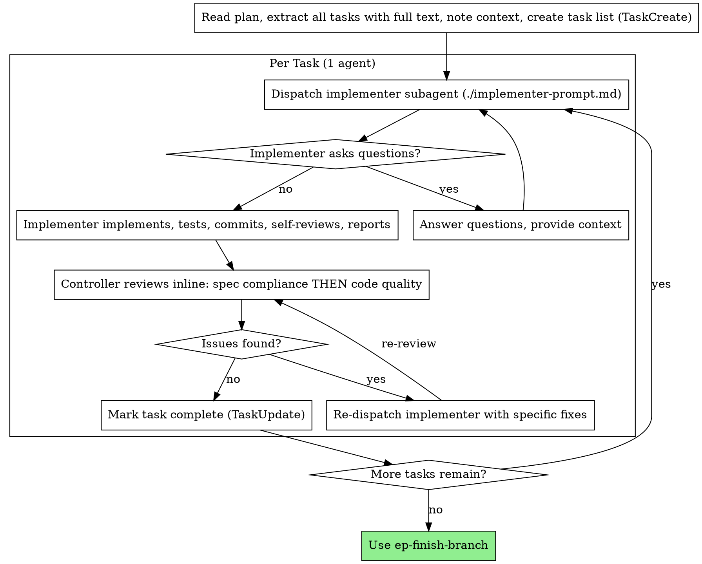

# Subagent-Driven Development

Execute a plan by delegating self-contained tasks to subagents, reviewing each result before moving on. The alternative to running the plan inline with `ep-executing-plans`.

**Dispatch tasks in the plan's order** — the order is its dependency graph, and a subagent's task assumes the tasks above it are done. Send the task's `Deliverable` in the prompt: it is what the subagent is being asked to produce, and what you check its result against.

**Announce at start:** "I'm using the `ep-delegate-to-subagents` skill to execute this plan via subagents."

**Why subagents:** you delegate a task to a specialized agent with isolated context. By precisely crafting its instructions and context, you keep it focused. It should never inherit your session's history — you construct exactly what it needs. This preserves your own context for coordination.

## Ground rules

- **1 agent per task**: dispatch a single implementer subagent, then **review its result yourself** (spec compliance + code quality — see the review rubric below). Dedicated *separate* reviewer subagents are available when a task warrants independent verification.
- Never dispatch implementation subagents in parallel (they conflict on the working tree — see `ep-parallel-agents` for the worktree escape hatch).
- Once dispatch is under way, keep executing without pausing for "should I continue?" check-ins. Stop only for BLOCKED you can't resolve, genuine ambiguity, or all tasks complete.

## When it fits

- A task carries a lot of exploration context that would pollute your coordination context
- The task is genuinely self-contained (clear spec, isolated files)
- Isolated context measurably improves the result

## The Process (1 agent per task + controller review)



For deeper independent verification on a task, dispatch dedicated reviewer subagents using `./spec-reviewer-prompt.md` and `./code-quality-reviewer-prompt.md`. Same for a final whole-implementation review agent.

### Controller review rubric

Review the implementer's diff yourself, in this order:
1. **Deliverable** — the task's stated `Deliverable` exists and you can point at it. This comes first: a diff that is clean but does not produce the deliverable has not finished the task.
2. **Spec compliance** — read the actual code (don't trust the report): everything requested is present, nothing extra/over-built, no misinterpretation. Report `file:line` gaps.
3. **Code quality** — one clear responsibility per file, tests verify real behavior not mocks, names accurate, YAGNI, follows existing patterns.

Report findings in the CLAUDE.md review format (`| Severity | Location | Issue | Suggested fix |`, severities blocker/major/minor/nit) and point to the fix — the implementer subagent applies it, you re-review.

## Model Selection

Use the least powerful model that can handle each role to conserve cost and increase speed.

**Mechanical implementation tasks** (isolated functions, clear specs, 1-2 files): use a fast, cheap model. Most implementation tasks are mechanical when the plan is well-specified.

**Integration and judgment tasks** (multi-file coordination, pattern matching, debugging): use a standard model.

**Architecture, design, and review tasks**: use the most capable available model.

**Task complexity signals:**
- Touches 1-2 files with a complete spec → cheap model
- Touches multiple files with integration concerns → standard model
- Requires design judgment or broad codebase understanding → most capable model

## Handling Implementer Status

Implementer subagents report one of four statuses. Handle each appropriately:

**DONE:** Proceed to spec compliance review.

**DONE_WITH_CONCERNS:** The implementer completed the work but flagged doubts. Read the concerns before proceeding. If the concerns are about correctness or scope, address them before review. If they're observations (e.g., "this file is getting large"), note them and proceed to review.

**NEEDS_CONTEXT:** The implementer needs information that wasn't provided. Provide the missing context and re-dispatch.

**BLOCKED:** The implementer cannot complete the task. Assess the blocker:
1. If it's a context problem, provide more context and re-dispatch with the same model
2. If the task requires more reasoning, re-dispatch with a more capable model
3. If the task is too large, break it into smaller pieces
4. If the plan itself is wrong, escalate to the human

**Never** ignore an escalation or force the same model to retry without changes. If the implementer said it's stuck, something needs to change.

## Prompt Templates

- `./implementer-prompt.md` - Dispatch implementer subagent
- `./spec-reviewer-prompt.md` - Dispatch spec compliance reviewer subagent
- `./code-quality-reviewer-prompt.md` - Dispatch code quality reviewer subagent

## Example Workflow

> The example below depicts the variant with separate spec + code reviewer subagents; the shorter path has the controller review the diff itself — see The Process above.

```
You: I'm using ep-delegate-to-subagents to execute this plan.

[Read plan file once: docs/plans/feature-plan.md]
[Extract all 5 tasks with full text and context]
[Create task list (TaskCreate) with all tasks]

T1 — Hook installation script

[Get T1 text and context (already extracted)]
[Dispatch implementation subagent with full task text + context]

Implementer: "Before I begin - should the hook be installed at user or system level?"

You: "User level (~/.config/hooks/)"

Implementer: "Got it. Implementing now..."
[Later] Implementer:
  - Implemented install-hook command
  - Added tests, 5/5 passing
  - Self-review: Found I missed --force flag, added it
  - Committed

[Dispatch spec compliance reviewer]
Spec reviewer: ✅ Spec compliant - all requirements met, nothing extra

[Get git SHAs, dispatch code quality reviewer]
Code reviewer: Strengths: Good test coverage, clean. Issues: None. Approved.

[Mark T1 complete]

T2 — Recovery modes

[Get T2 text and context (already extracted)]
[Dispatch implementation subagent with full task text + context]

Implementer: [No questions, proceeds]
Implementer:
  - Added verify/repair modes
  - 8/8 tests passing
  - Self-review: All good
  - Committed

[Dispatch spec compliance reviewer]
Spec reviewer: ❌ Issues:
  - Missing: Progress reporting (spec says "report every 100 items")
  - Extra: Added --json flag (not requested)

[Implementer fixes issues]
Implementer: Removed --json flag, added progress reporting

[Spec reviewer reviews again]
Spec reviewer: ✅ Spec compliant now

[Dispatch code quality reviewer]
Code reviewer: Strengths: Solid. Issues (Important): Magic number (100)

[Implementer fixes]
Implementer: Extracted PROGRESS_INTERVAL constant

[Code reviewer reviews again]
Code reviewer: ✅ Approved

[Mark T2 complete]

...

[After all tasks]
[Dispatch final code-reviewer]
Final reviewer: All requirements met, ready to merge

Done!
```

## What you gain and what it costs

**What you gain:**
- Isolated context per task keeps a heavy task from polluting your coordination context
- The controller curates exactly the context the subagent needs (no file-reading overhead in the subagent)
- The subagent can ask clarifying questions before and during work
- Quality gates: subagent self-review + your spec-then-quality review, with fix loops

**What it costs:**
- Extra model invocations (at minimum an implementer per task; more with reviewer agents)
- Controller prep work (extracting every task's full text upfront)
- Review/fix loops add iterations

## Red Flags

**Never:**
- Start implementation on main/master branch without explicit user consent
- Skip reviews (spec compliance OR code quality)
- Proceed with unfixed issues
- Dispatch multiple implementation subagents in parallel (conflicts)
- Make subagent read plan file (provide full text instead)
- Skip scene-setting context (subagent needs to understand where task fits)
- Ignore subagent questions (answer before letting them proceed)
- Accept "close enough" on spec compliance (spec reviewer found issues = not done)
- Skip review loops (reviewer found issues = implementer fixes = review again)
- Let implementer self-review replace actual review (both are needed)
- **Start code quality review before spec compliance is ✅** (wrong order)
- Move to next task while either review has open issues

**If subagent asks questions:**
- Answer clearly and completely
- Provide additional context if needed
- Don't rush them into implementation

**If reviewer finds issues:**
- Implementer (same subagent) fixes them
- Reviewer reviews again
- Repeat until approved
- Don't skip the re-review

**If subagent fails task:**
- Dispatch fix subagent with specific instructions
- Don't try to fix manually (context pollution)

## Integration

**Required workflow skills:**
- **`ep-worktrees`** - Ensures isolated workspace (creates one or verifies existing)
- **`ep-writing-plans`** - Creates the plan this skill executes
- **`ep-finish-branch`** - Complete development after all tasks

**Review format:** the controller's review (and any reviewer subagent) reports findings in the CLAUDE.md severity-table format (`| Severity | Location | Issue | Suggested fix |`) and points to the fix rather than rewriting.

**Subagents should use:**
- **`ep-test-driven-development`** - Subagents follow TDD for each task

**Code review:**
- **`ep-requesting-code-review`** - the per-task review path: the controller's own spec-then-quality review (above), or a dedicated reviewer subagent. Carries the reviewer prompt + native-command-first guidance.
- **`ep-receiving-code-review`** - how the controller (or a re-dispatched implementer) acts on the findings: verify before implementing, fix by severity, push back with reasoning.

**Alternative workflow:**
- **`ep-executing-plans`** - the inline execution path for the same plan
- **`ep-parallel-agents`** - for independent parallel problems
