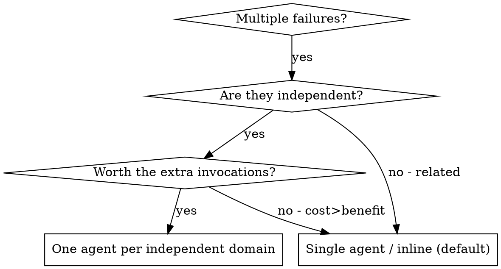

# Dispatching Parallel Agents (cost-aware)

## Overview

You delegate a task to a specialized agent with isolated context. By precisely crafting its instructions and context, you keep it focused. It should never inherit your session's history — you construct exactly what it needs. This preserves your own context for coordination.

Parallel dispatch can save wall-clock time when failures are truly independent — but each agent is an extra, expensive invocation, so it is the **exception, not the reflex**.

## Conservative agent-spawning policy (governs this whole skill)

**Cost before speed.** Default to investigating sequentially / inline. Parallelize only when the domains are genuinely independent *and* the time saved is worth the extra invocations. When sequential and parallel both work, choose sequential.

**Scale the fan-out to the work, not to the reflex.** The upstream "3+ failures → dispatch one agent each" habit is what this policy tempers: dispatch as many agents as there are genuinely independent domains, but make it a deliberate call each time — every additional agent is another expensive invocation. When the count climbs, say what you're spawning and why rather than fanning out silently.

**Core principle:** at most one agent per independent problem domain, cost weighed before speed.

## When to Use



**Use when (all must hold):**
- Genuinely independent problems with different root causes and no shared state
- Each problem can be understood without context from the others
- The wall-clock saving is worth the extra agent invocations
- No more agents than there are independent domains

**Don't use when:**
- Failures are related (fix one might fix others)
- Need to understand full system state
- Agents would interfere with each other
- You're reaching for it purely for speed

## The Pattern

### 1. Identify Independent Domains

Group failures by what's broken:
- File A tests: Tool approval flow
- File B tests: Batch completion behavior
- File C tests: Abort functionality

Each domain is independent - fixing tool approval doesn't affect abort tests.

### 2. Create Focused Agent Tasks

Each agent gets:
- **Specific scope:** One test file or subsystem
- **Clear goal:** Make these tests pass
- **Constraints:** Don't change other code
- **Expected output:** Summary of what you found and fixed

### 3. Dispatch

Dispatch one agent per independent domain. Weigh the invocation cost before each addition, and name what you're spawning so the fan-out is visible rather than silent.

```
Agent("Fix agent-tool-abort.test.ts failures")
Agent("Fix batch-completion-behavior.test.ts failures")
Agent("Fix tool-approval-race-conditions.test.ts failures")

# Say what you did and why:
# "Three independent failure domains, so three agents in parallel —
#  no shared state between them, and the sequential path would be ~3x the wall clock."
```

### 4. Review and Integrate

When agents return:
- Read each summary
- Verify fixes don't conflict
- Run full test suite
- Integrate all changes

## Agent Prompt Structure

Good agent prompts are:
1. **Focused** - One clear problem domain
2. **Self-contained** - All context needed to understand the problem
3. **Specific about output** - What should the agent return?

```markdown
Fix the 3 failing tests in src/agents/agent-tool-abort.test.ts:

1. "should abort tool with partial output capture" - expects 'interrupted at' in message
2. "should handle mixed completed and aborted tools" - fast tool aborted instead of completed
3. "should properly track pendingToolCount" - expects 3 results but gets 0

These are timing/race condition issues. Your task:

1. Read the test file and understand what each test verifies
2. Identify root cause - timing issues or actual bugs?
3. Fix by:
   - Replacing arbitrary timeouts with event-based waiting
   - Fixing bugs in abort implementation if found
   - Adjusting test expectations if testing changed behavior

Do NOT just increase timeouts - find the real issue.

Return: Summary of what you found and what you fixed.
```

## Common Mistakes

**❌ Too broad:** "Fix all the tests" - agent gets lost
**✅ Specific:** "Fix agent-tool-abort.test.ts" - focused scope

**❌ No context:** "Fix the race condition" - agent doesn't know where
**✅ Context:** Paste the error messages and test names

**❌ No constraints:** Agent might refactor everything
**✅ Constraints:** "Do NOT change production code" or "Fix tests only"

**❌ Vague output:** "Fix it" - you don't know what changed
**✅ Specific:** "Return summary of root cause and changes"

## When NOT to Use

**Related failures:** Fixing one might fix others - investigate together first
**Need full context:** Understanding requires seeing entire system
**Exploratory debugging:** You don't know what's broken yet
**Shared state:** Agents would interfere (editing same files, using same resources)

> **Working-tree conflicts ≠ abandon parallelism.** If the domains are genuinely
> independent but the agents would touch the *same working tree* (edit files that
> collide, race on the same build output), don't drop back to sequential — give
> each agent an **isolated worktree** instead. Use the harness's native
> `isolation: worktree` when dispatching, or set one up per `ep-worktrees`.
> The shared-state exclusion above is about *logical* coupling (they need each
> other's state to reason), not merely a shared checkout — a shared checkout is a
> tooling problem worktrees solve. (`ep-delegate-to-subagents` bans parallel
> *implementers* for exactly this filesystem-collision reason; worktrees are the
> escape hatch when the work is truly independent.)

## Real Example from Session

**Scenario:** 6 test failures across 3 files after major refactoring

**Failures:**
- agent-tool-abort.test.ts: 3 failures (timing issues)
- batch-completion-behavior.test.ts: 2 failures (tools not executing)
- tool-approval-race-conditions.test.ts: 1 failure (execution count = 0)

**Decision:** Independent domains - abort logic separate from batch completion separate from race conditions

**Cost check:** three domains means three concurrent agents. Independent root causes, no shared state, and sequential investigation would triple the wall clock — the extra invocations earn their keep here.

**Dispatch:**
```
Agent 1 → Fix agent-tool-abort.test.ts
Agent 2 → Fix batch-completion-behavior.test.ts
Agent 3 → Fix tool-approval-race-conditions.test.ts
```

**Results:**
- Agent 1: Replaced timeouts with event-based waiting
- Agent 2: Fixed event structure bug (threadId in wrong place)
- Agent 3: Added wait for async tool execution to complete

**Integration:** All fixes independent, no conflicts, full suite green

**If the third domain hadn't been worth an agent:** two in parallel and the third inline captures most of the saving for one fewer invocation.

## Key Benefits (when the cost check passes)

1. **Focus** - Each agent has narrow scope, less context to track
2. **Independence** - Agents don't interfere with each other
3. **Context preservation** - Heavy investigation stays out of your coordination context
4. **Parallelization** - Independent investigations proceed at once — the payoff you weigh against the extra invocations

## Verification

After agents return:
1. **Review each summary** - Understand what changed
2. **Check for conflicts** - Did agents edit same code?
3. **Run full suite** - Verify all fixes work together
4. **Spot check** - Agents can make systematic errors

## Real-World Impact

From a debugging session:
- 6 failures across 3 files
- 3 independent domains, each worth its own invocation
- 3 agents run concurrently, all fixes integrated, zero conflicts
- The cheaper alternative — 2 in parallel + 1 inline — captures most of the saving for one fewer agent

## Related skills

- **`ep-systematic-debugging`** — the per-domain investigation each agent runs; use it inline when there's only one domain (the common case)
- **`ep-delegate-to-subagents`** — the plan-execution counterpart; same cost-before-speed policy
- **`ep-verify-before-done`** — run the full suite and verify before claiming the parallel fixes worked
