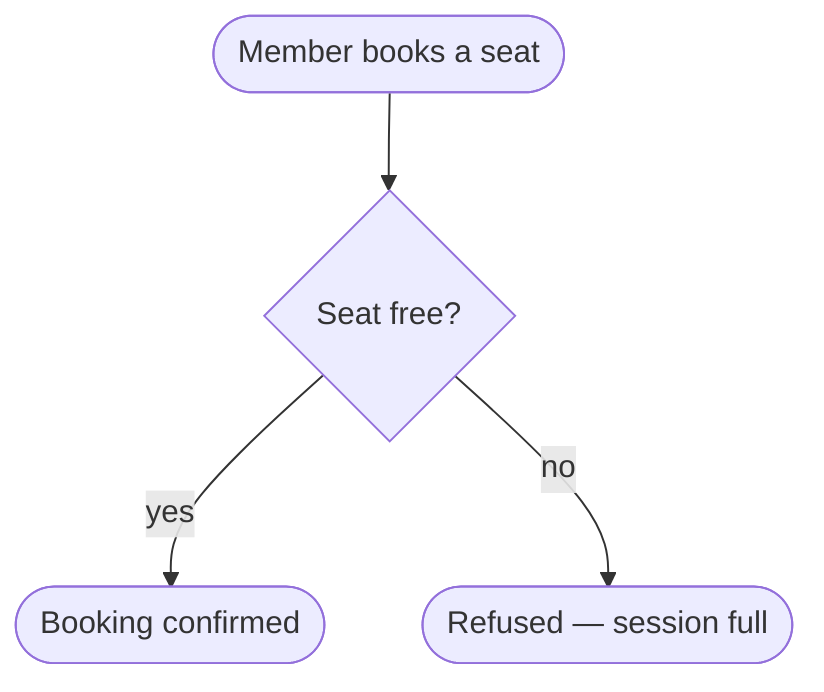

# Flow — Book a seat (FLOW-001)

**Created:** 2026-08-02
**Owned by:** `product:process-flow`

**Sources**: US3 · **Feature**: AREA-003 bookings
**Actors**: member, the system
**Trigger**: a member books a seat
**Outcomes**: booking confirmed · booking refused, session full

## Diagram

## Steps
| Node | Actor | Precondition | Action | Postcondition | Source |
|---|---|---|---|---|---|
| FLOW-001.1 | Member | signed in | books a seat | request made | US3 AC1 |
| FLOW-001.2 | The system | request made | checks for a free seat | confirmed or refused | US3 AC2 |

## Event timeline
Seat Requested → Booking Confirmed *(pivotal — hands to credits)*
