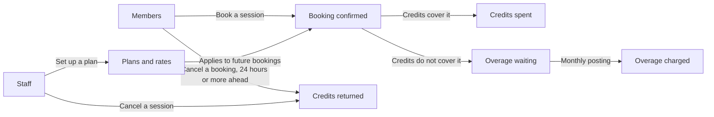

# Credit pricing and overage charges

Spend your plan's monthly session credits on bookings, and pay only for the bookings that go beyond them.

> [!IMPORTANT]
> A booking is priced after it is confirmed, from the session's tier cost and the rate in force then. A later change to a plan does not re-price a booking already made.

## In short

- Each plan gives members session credits every month (Basic 8, Plus 16), and a seat costs 1, 2 or 3 credits by session tier.
- A booking is never refused for lack of credits; the shortfall is charged as an overage, £6.00 per credit on Basic and £5.00 on Plus.
- Cancelling 24 hours or more before a session starts returns the credits the booking spent; cancelling later returns nothing.
- On the 1st of every month each member's overage is charged as one amount, and credits start again from the plan's full allowance.
- Staff set a plan's name, monthly credits and overage rate, and can cancel a whole session, which returns every member's credits.

## Who uses it

| Who | What they do here |
|---|---|
| Members | Book and cancel their own sessions, which are priced after the booking is confirmed; see their plan, credits used, credits left and overage waiting. |
| Staff | Change a plan's name, monthly credits and overage rate; cancel a whole session. |

## How it fits together

Every plan gives a number of session credits each month. A booking spends credits by the session's tier. When credits run out the booking still goes ahead, and the shortfall waits as an overage until the monthly posting charges it.

- **Session credits** — what a booking spends. A plan grants a number each month, its **Monthly allowance**, such as 8 on Basic; unused credits do not carry over.
- **Session tier** — how many credits one seat costs: Standard 1, Workshop 2, Masterclass 3.
- **Overage** — the part of a booking that your credits do not cover, charged at a per-credit rate.
- **Overage rate (per credit)** — the price of one overage credit, set on the plan. A member can carry a personal rate, which wins over the plan's.

## For members

### Book a session

You can book a seat on any session. If your credits have run out, the booking still goes ahead and the extra is charged later.

1. Choose the session you want.
2. Book a seat on it.

**What happens next**

- You see the booking confirmed. Its cost in credits comes from the session's tier.
- If your credits cover it, the booking spends them and nothing is charged.
- If they do not, the booking spends the credits you have left and the shortfall is charged as an overage — see *The overage charge*.
- The overage waits on your account until the 1st of next month.
- A booking is never refused for lack of credits.

**Example**

Ana is on the Basic plan: 8 monthly credits, an overage rate of £6.00. On 11 March she has used 6 credits. She books *Sculpture masterclass*, a Masterclass that costs 3 credits.

Credits remaining = 8 − 6 = 2
Overage credits = 3 − 2 = 1
Overage charge = 1 × £6.00 = £6.00

Two credits are spent, and £6.00 is waiting for the month end.

### See your credits

You can see where you stand this month.

1. Ask for your credits.

**What happens next**

- You see your plan, its monthly credits, the credits you have used and the credits you have left.
- You see the overage rate that applies to you: your personal rate if you have one, otherwise your plan's.
- You see the overage waiting on your account this month.

### Cancel a booking

You can cancel a booking yourself. Whether your credits come back depends on how long before the session starts you cancel.

1. Choose the booking you want to cancel.
2. Cancel it.

**What happens next**

- If you cancel 24 hours or more before the session starts, the credits the booking spent are returned and any overage waiting for that booking is removed.
- If you cancel less than 24 hours before the start, nothing is returned. The credits stay spent and any overage for the booking stays.
- Returned credits are available for future bookings only; they do not reduce an overage waiting for another booking.

> [!WARNING]
> A late cancellation cannot be undone: the credits stay spent.

## For staff

### Set up a plan

You change a plan's name, its monthly credits and its overage rate.

**Where:** **Session credits**

1. Open **Session credits**.
2. Choose the plan.
3. Change its name, **Monthly allowance** or **Overage rate (per credit)**.
4. Save the plan.

**What happens next**

- The plan is saved. A new overage rate applies to future bookings only; nothing already booked is re-priced.
- A new monthly allowance changes the credits that members on the plan have left this month.

**If it doesn't go through**

| Situation | What you see | What to do |
|---|---|---|
| The name is already used by another plan | “That plan name is already taken” | Nothing is saved. Choose a different name |
| Monthly credits are below 0 | “Monthly credits must be 0 or more” | Nothing is saved. Enter 0 or more |
| The overage rate is below 0 | “Overage rate must be 0 or more” | Nothing is saved. Enter 0 or more |

### Cancel a session

You cancel a whole session, and every booking on it is cancelled with it.

**Where:** **Cancel session**

1. Find the session.
2. Press **Cancel session**.

**What happens next**

- Every booking on the session is cancelled.
- Every member's credits for it come back, however close the session is, and any overage waiting for those bookings is removed.

## What happens automatically

### Monthly posting

**When:** the 1st of every month at 00:00, for every member.

**What people notice**

- Members with overage that month see one charge for the month's total, named Overage and the month it covers, such as “Overage September 2026”.
- Members with no overage that month see no charge.
- Every member's credits used go back to 0, so the new month starts with the plan's full allowance; unused credits from the month before are lost.

## Rules and limits

The most specific overage rate wins: member, then plan.

| Rule | Level | Value | Where you meet it | Can it be changed? |
|---|---|---|---|---|
| Credits per seat | Session tier | Standard 1 · Workshop 2 · Masterclass 3; every session has exactly one tier | *Book a session* | No — fixed in the system |
| Monthly credits | Plan | A whole number, 0 or more; Basic 8, Plus 16 | *Set up a plan* | On the Session credits screen |
| Credits come first | — | A booking spends the credits a member has left; only the shortfall becomes an overage | *Book a session* | No — fixed in the system |
| Booking is never refused | — | A booking goes ahead even when credits have run out | *Book a session* | No — fixed in the system |
| Overage rate | Plan | 0 or more; Basic £6.00 per credit, Plus £5.00 | *Book a session* | On the Session credits screen |
| Personal overage rate | Member | When a member has one it is used instead of the plan's rate | *Book a session* | No — nothing in the product sets it |
| Pricing moment | — | A booking is priced after it is confirmed, from the tier cost and rate in force then | *Book a session* | No — fixed in the system |
| Credits left shown | — | Never below 0 | *See your credits* | No — fixed in the system |
| Late-cancellation cut-off | — | 24 hours before the session starts | *Cancel a booking* | No — fixed in the system |
| Credits on cancelling | — | 24 hours or more ahead: the credits the booking spent return and its overage is removed. Later: nothing returns | *Cancel a booking* | No — fixed in the system |
| Returned credits | — | Available for future bookings only; they do not reduce an overage waiting for another booking | *Cancel a booking* | No — fixed in the system |
| Plan name | Plan | Unique; not empty; at most 100 characters | *Set up a plan* | On the Session credits screen |
| Effect of a change | Plan | A new overage rate affects future bookings only; a new monthly allowance changes the credits members have left this month | *Set up a plan* | No — fixed in the system |
| Cancelling a session | — | Credits always return, however close the session is | *Cancel a session* | No — fixed in the system |
| Posting moment | — | The 1st of the month at 00:00 | *Monthly posting* | No — fixed in the system |
| Overage charge | — | One charge for the month's total, only when it is above 0 | *Monthly posting* | No — fixed in the system |
| Unused credits | — | Do not carry over; every member starts the month with the plan's full allowance | *Monthly posting* | No — fixed in the system |

## How it is calculated

### What a booking costs in credits

Credit cost = the session tier's *Credits per seat*

### How many credits are left

Credits remaining = Monthly credits − Credits used this month

Where: *Credits remaining* is never below 0. When it is at least the Credit cost, the booking spends that many credits and nothing is charged.

### The overage charge

Overage credits = Credit cost − Credits remaining
Overage charge = Overage credits × Overage rate

Where: *Overage rate* is the member's personal rate if one is set, otherwise the plan's rate. This applies only when Credits remaining is less than the Credit cost; the booking then spends the credits that remain. Amounts are in pounds and pence.

### The month's charge

Month's charge = SUM of the overage charges still waiting on the member's account

Where: an overage charge is removed when its booking is cancelled 24 hours or more ahead.

## Open questions

These are questions for the product owner that the code cannot answer. Write the answer in the last column.

| # | Question | Why it matters | Answer |
|---|---|---|---|
| Q1 | The credits of a booking cancelled less than 24 hours before the session are not returned. What is the cut-off for? | Nothing in the product says why the cut-off is 24 hours | The studio needs a day to offer the freed seat to another member. |
| Q2 | A new overage rate applies to future bookings only; what members have already accrued keeps its price. Is that intended? | A rate change part-way through a month leaves members on one plan paying different rates in the same month | No. Everything accrued in a month is charged at the rate in force when the month is posted. |
| Q3 | Unused credits are lost at month end. Is that the intended policy, or is roll-over missing? | Members on lighter months pay for credits they cannot use | |
| Q4 | A late cancellation keeps the credits spent but carries no fee. Was a fee intended? | The forfeiture is the only consequence today | |
| Q5 | A member can carry a personal overage rate that wins over the plan's, but nothing in the product sets or clears it. Who sets it, and where? | Staff cannot give a member a different rate | |

## About this document

**Created:** 2026-10-12
**Describes:** the product as it was on 2026-10-12
**Screenshots:** waived — the screens of this product are not part of the codebase

<!-- guide · source: feature-documenter @ 0000000 · audience: shareable -->
