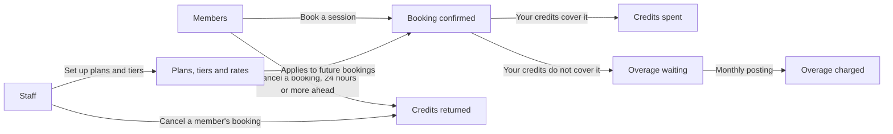
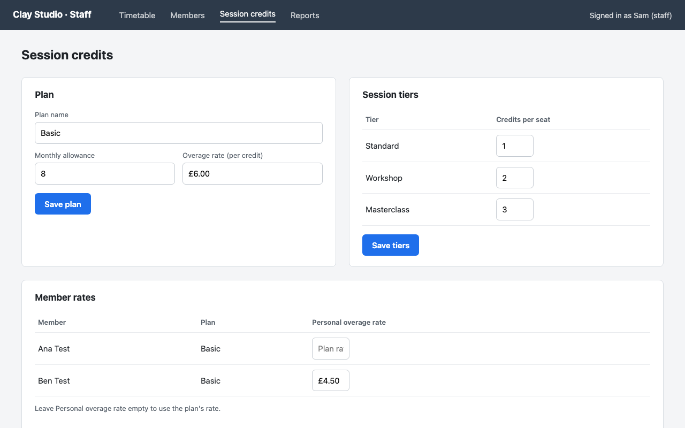

# Golden example — `areas/<area>.md` (the guide)

The example for `product:doc-business-model`: one area guide as a `documenter` run would write it into `docs/business-model/areas/credits-and-charges.md`, with its one screenshot in `areas/screenshots/credits-and-charges/`. The system is the same **workshop-booking** toy the planner examples build — imagined here as an *inherited* codebase being documented after the fact. **Shape, tone, the example discipline and the screenshot discipline are normative; domain content and the screenshot are illustrative.**

Note what the example demonstrates: a guide for three readers — the member and the staff member who use the product, the analyst who needs every rule and formula, the product owner who needs the open questions. It opens with **In short**, then reads in the order a person meets the product: who uses it, the few ideas and a picture of how it fits together, each person's tasks in lifecycle order. The tasks hold no formula: the outcome says the result in one sentence and points to **How it is calculated**, while the example, with its arithmetic, stays in the task. **Rules and limits** is the one complete list of rules — every threshold, cut-off, limit and effect of a change the guide states is a row, with the task or work where a person meets it. The picture is a `flowchart LR` of the people and what happens in order, because the member tasks have **no screen** in the product the documenter was given, so the product shows the member no status. Those tasks carry no `**Where:**`, no bold label and no screenshot; the **staff — the area's administrators —** have their own section, and their busiest screen gets the guide's **one screenshot**, showing the example's own values (Basic, 8, £6.00, Ben's £4.50) and every label the steps name. A **task two people do** (cancelling a booking) sits under two headings. The automatic work is told from the member's side (**When**, **What people notice**), and *See also* is a plain list of where to go next.

The guide was written on 2 August and updated on 14 September. The update shows two ways a purpose reaches the body. One is a story the plan that built the area held: the stamp's `stories` names it, and the body states the purpose in one plain sentence (a booking is never refused, so members can keep booking beyond their plan). The other is a person's answer to an open question: its row is gone and its id, Q3, is spent, and the answer is one plain sentence where the rule is stated (the 24-hour cut-off is a policy the business chose) — never struck through, never flagged as an answer. The questions still open have an empty *Answer* cell. There are no ids in the body — the stamp comment closes the file — and no `file:line`, tier tag, code noun or defect word. Optional sections that do not apply (*Good to know*) are dropped. Links to sibling guides are written as `<bookings>.md` patterns here; a real guide links the file name.

---

# Session credits & charges

Spend your plan's monthly credits on sessions, and pay only for the bookings that go beyond them.

> [!IMPORTANT]
> A booking is priced once, after it is confirmed, from the tier cost and rate in force at that point — it is never re-priced afterwards. A credit returned by a later cancellation is available for future bookings; it does not reduce an overage already accrued.

## In short

- Members get session credits each month, such as 8 on Basic, and each booking spends them: Standard 1, Workshop 2, Masterclass 3 per seat.
- A booking is never refused for lack of credits; the shortfall is charged as an overage, £6.00 per credit on Basic.
- Cancelling 24 hours or more before a session starts returns the credits; cancelling later does not.
- On the 1st of every month the month's overage is charged, credits start again and unused credits are lost.
- Staff set up plans, tiers and personal rates, and can cancel anyone's booking.

## Who uses it

| Who | What they do here |
|---|---|
| Members | Book and cancel their own sessions, which are priced automatically; see their own credits used, credits remaining and accrued overage. This applies to every member. |
| Staff | Define plans and session tiers, set or clear a member's personal overage rate, and cancel anyone's booking. |

## How it fits together

Every membership plan comes with a number of session credits per month. Booking a session spends credits according to the session's tier. When you run out, the booking still goes ahead and the shortfall is charged as an overage. Overage charges build up during the month and are charged once, at the start of the next month, when credits reset.

- **Credit** — what a booking spends. A plan grants a number each month, such as 8 on Basic; unused credits do not carry over.
- **Session tier** — how many credits one seat costs: Standard 1, Workshop 2, Masterclass 3.
- **Overage** — the part of a booking that your credits do not cover, charged at a per-credit rate.
- **Overage rate** — the price of one overage credit, set on the plan. A member can carry a personal rate, which wins over the plan's.

## For members

### Book a session

You can book a seat on any session. If your credits have run out, the booking still goes ahead and the extra is charged later.

1. Choose the session you want.
2. Book a seat on it.

**What happens next**

- You see the booking confirmed. Its cost in credits comes from the session's tier.
- If your credits cover it, the booking spends them and nothing is charged.
- If they do not, the booking spends the credits you have left and the shortfall is charged as an overage — see *How it is calculated*.
- The overage is waiting on your account and is charged at the start of next month.
- A booking is never refused for lack of credits, so you can keep booking beyond your plan.

**Example**

Ana is on the Basic plan: 8 monthly credits, an overage rate of £6.00. On 11 March she has used 6 credits. She books *Sculpture masterclass*, a Masterclass that costs 3 credits.

Credits remaining = 8 − 6 = 2
Overage credits = 3 − 2 = 1
Overage charge = 1 × £6.00 = £6.00

Two credits are spent, and £6.00 is waiting for the month end.

> [!NOTE]
> The seat itself is allocated by [Bookings](<bookings>.md); this guide covers what the booking costs.

### Cancel a booking

You can cancel a booking yourself. Whether your credits come back depends on how long before the session starts you cancel; the 24-hour cut-off is a policy the business chose.

1. Choose the booking you want to cancel.
2. Cancel it.

**What happens next**

- If you cancel 24 hours or more before the session starts, the credits the booking spent are returned and any overage accrued for that booking is removed.
- If you cancel less than 24 hours before the start, nothing is returned. The credits stay spent and any overage accrued for the booking stays.
- Returned credits are available for future bookings only.

> [!WARNING]
> A late cancellation cannot be undone: the credits stay spent.

## For staff

### Set up plans and tiers

You define the plans, the session tiers and, for a member who needs one, a personal overage rate.

**Where:** **Session credits**

1. Open **Session credits**.
2. Give a plan a name, its monthly credits in **Monthly allowance**, and its **Overage rate (per credit)**.
3. Set *Credits per seat* for each session tier.
4. To give one member their own rate, set **Personal overage rate** on the member. Clear it to go back to the plan's rate.

**What happens next**

- The plan, tier or rate is saved and applies to future bookings only. Nothing already booked is re-priced.
- A member's personal rate wins over the plan's rate.

**If it doesn't go through**

| Situation | What you see | What to do |
|---|---|---|
| A plan is saved with a name another plan already has | “That plan name is already taken.” | Nothing is saved. Choose a different name |
| Monthly credits or a rate is below 0 | “Monthly credits must be 0 or more.” / “Overage rate must be 0 or more.” | Nothing is saved. Enter 0 or more |

### Cancel a member's booking

You cancel a member's booking the same way a member does (see *Cancel a booking*). The difference is that the credits always come back.

1. Find the member's booking.
2. Cancel it.

**What happens next**

- The credits the booking spent are returned, however close the session is, and any overage accrued for that booking is removed.

> [!NOTE]
> When you cancel a whole session with **Cancel session**, [Scheduling](<scheduling>.md) cancels each booking on it, so every member's credits come back.

## What happens automatically

### Monthly posting

**When:** the 1st of every month at 00:00, for every member.

**What people notice**

- Members with overage that month see one charge for the month's total on their account.
- Every member's credits used go back to 0, so the new month starts with the plan's full allowance; unused credits from the month before are lost.

## Rules and limits

The most specific overage rate wins: member, then plan.

| Rule | Level | Value | Where you meet it | Can it be changed? |
|---|---|---|---|---|
| Credits per seat | Session tier | Standard 1 · Workshop 2 · Masterclass 3; every session has exactly one tier | *Book a session* | On the Session credits screen |
| Credits come first | — | A booking spends the credits a member has left; only the shortfall becomes an overage | *Book a session* | No — fixed in the system |
| Booking is never refused | — | A booking goes ahead even when credits have run out | *Book a session* | No — fixed in the system |
| Overage rate | Plan | 0 or more; for example £6.00 per credit | *Book a session* | On the Session credits screen |
| Overage rate override | Member | 0 or more; for example £4.50 per credit | *Book a session* | On the Session credits screen |
| Pricing moment | — | A booking is priced once, after it is confirmed, and never re-priced | *Book a session* | No — fixed in the system |
| Late-cancellation cut-off | — | 24 hours before the session starts | *Cancel a booking* | No — fixed in the system |
| Credits on cancelling | — | 24 hours or more ahead: credits return and the booking's overage is removed. Later: nothing returns | *Cancel a booking* | No — fixed in the system |
| Returned credits | — | Available for future bookings only; they do not reduce an overage already accrued | *Cancel a booking* | No — fixed in the system |
| Cancelling for a member | — | Credits always return, however close the session is, also when a whole session is cancelled | *Cancel a member's booking* | No — fixed in the system |
| Plan name | Plan | Unique; for example Basic | *Set up plans and tiers* | On the Session credits screen |
| Monthly credits | Plan | A whole number, 0 or more; for example 8 | *Set up plans and tiers* | On the Session credits screen |
| Effect of a change | Plan, tier | A new tier cost or plan rate affects future bookings only | *Set up plans and tiers* | No — fixed in the system |
| Posting moment | — | The 1st of the month at 00:00 | *Monthly posting* | No — fixed in the system |
| Overage charge | — | One charge for the month's total, only when it is above 0 | *Monthly posting* | No — fixed in the system |
| Unused credits | — | Do not carry over; every member starts the month with the plan's full allowance | *Monthly posting* | No — fixed in the system |

## How it is calculated

### What a booking costs in credits

Credit cost = the session tier's *Credits per seat*

### How many credits are left

Credits remaining = Monthly credits − Credits used this month

When Credits remaining is at least the Credit cost, the booking spends that many credits and nothing is charged.

### The overage charge

Overage credits = Credit cost − Credits remaining
Overage charge = Overage credits × Overage rate

Where: *Overage rate* is the member's personal rate if one is set, otherwise the plan's rate. This applies only when Credits remaining is less than the Credit cost; the booking then spends the credits that remain.

## A month in numbers

**Setup**

| Plan | Monthly credits | Overage rate |
|---|---|---|
| Basic | 8 | £6.00 |

| Tier | Credits per seat |
|---|---|
| Standard | 1 |
| Workshop | 2 |
| Masterclass | 3 |

Ana is on the Basic plan with no personal override. Ben is also on Basic but carries a personal overage rate of £4.50. It is March; both start the month with 0 credits used.

**Ana's month**

| Date | What happens | Credit cost | Credits remaining before | Spent from credits | Overage | Credits used after |
|---|---|---|---|---|---|---|
| 2 Mar | Books *Wheel basics* (Standard, starts 9 Mar 18:00) | 1 | 8 | 1 | — | 1 |
| 4 Mar | Books *Glazing workshop* (Workshop, starts 16 Mar 10:00) | 2 | 7 | 2 | — | 3 |
| 6 Mar | Books *Raku masterclass* (Masterclass, starts 21 Mar 14:00) | 3 | 5 | 3 | — | 6 |
| 11 Mar | Books *Sculpture masterclass* (Masterclass, starts 28 Mar 14:00) | 3 | 2 | 2 | 1 credit × £6.00 = **£6.00 accrued** | 8 |
| 15 Mar 09:00 | Cancels *Glazing workshop* — 25 hours before it starts | — | 0 | 2 returned | — | 6 |
| 20 Mar 20:00 | Cancels *Raku masterclass* — 18 hours before it starts | — | 2 | nothing returned (late) | — | 6 |
| 25 Mar | Books *Wheel basics II* (Standard, starts 30 Mar 18:00) | 1 | 2 | 1 | — | 7 |
| 1 Apr 00:00 | Monthly posting | — | — | — | **£6.00 charged** to Ana's account | 0 |

Walking through the lines that matter:

- **11 Mar.** Credit cost 3, credits remaining 8 − 6 = 2. 2 is less than 3, so 2 credits are spent. The shortfall is 3 − 2 = 1 overage credit. Overage charge = 1 × £6.00 = £6.00, accrued.
- **15 Mar.** The workshop's 2 credits come back, so Ana has 2 credits again. The £6.00 accrued on 11 Mar stays, because a returned credit never re-prices an earlier booking.
- **1 Apr.** One charge of £6.00 is posted. Ana's 1 unused credit is lost; she starts April with 8.

**Ben's override.** Had Ben made the 11 Mar booking in Ana's position, his shortfall would have been charged at his personal rate: 1 × £4.50 = £4.50.

## See also

- [Bookings](<bookings>.md) — where a booking's seat is allocated and a booking is cancelled; this guide covers what it costs.
- [Scheduling](<scheduling>.md) — where staff cancel a whole session, which returns every member's credits.

## Open questions

These are questions for the product owner that the code cannot answer. Write the answer in the last column.

| # | Question | Why it matters | Answer |
|---|---|---|---|
| Q1 | Unused credits are lost at month end. Is that the intended policy, or is roll-over missing? | Members on lighter months pay for credits they cannot use; either is a valid policy, but nobody wrote it down | |
| Q2 | A credit returned by a cancellation does not reduce an overage already accrued that month. Intended? | It is the rule most likely to generate a support query ("I cancelled, why was I still charged?") | |
| Q4 | A late cancellation forfeits the credits but carries no fee. Was a fee intended? | The forfeiture is the only consequence today | |
| Q5 | Is it intended that a member can run up any amount of overage in a month? | A booking is never refused for lack of credits, so the month-end charge has no ceiling | |

## About this document

**Created:** 2026-08-02
**Last updated:** 2026-09-14
**Describes:** the product as it was on 2026-09-14
**Screenshots:** captured from the staging environment on 2026-08-02

<!-- guide · id: AREA-004 · owner: product:doc-business-model · source: documenter @ e5d7b02 · models: FLOW-004, ENT-003, DEC-002 · stories: US2 · audience: shareable -->
