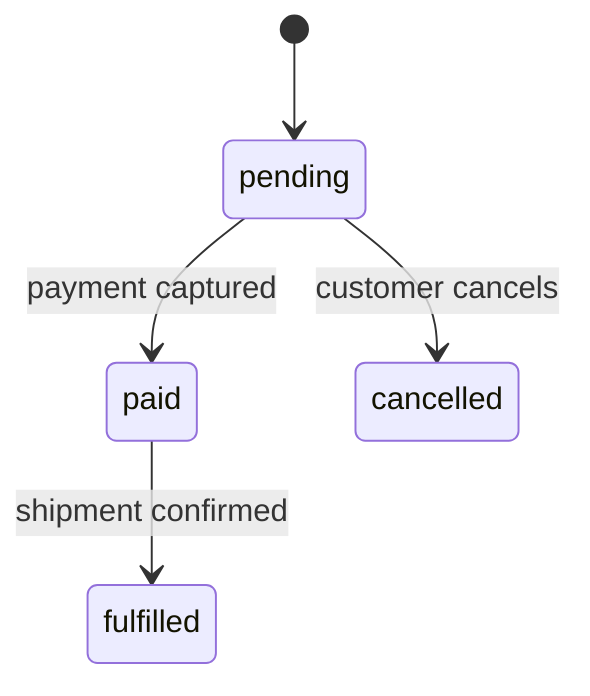

# Data Model — the feature spec's `## Data model` section

The design altitude for one feature's stored data: **every table and column the feature adds or changes, every key, every index, and why each exists**, so the implementing agent writes the migration without inventing structure and a reviewer sees the feature's data in one read. Engine-specific DDL, index internals, partitioning and row-level-security mechanics are `data-architect`'s; this section states the *requirement* they satisfy.

`/product:plan-feature` reads this file in its step 8 when the feature adds or changes stored data, and presents the result as one section of the spec. The user's approval of that section, then of the spec, is the gate; there is no other.

## Input

- **The spec so far:** the feature's goal, the decisions from the interview and the chosen approach. The data model serves them and nothing else.
- **The system plan's §3, when the feature came from one:** the shared entities (name, owner area, one line), the modules and their schemas, the cross-cutting conventions (ids, dates, tenancy) and auth. Read the specs named in the `As built` notes of the features this one depends on: they hold the tables already designed.
- **Standalone (no system plan):** the repo's existing schema, migrations and ORM model. What is there is `#observed` with `file:line`.

## Output

The `## Data model` section of `docs/specs/NNN-<feature>-design.md`, with these subsections in this order: `### Builds on` · `### Conventions` · `### Entities` · `### Tables` · `### Reference and seed data` · `### Diagrams` · `### Ownership` · `### Migrations` · `### Open questions` · `### Routed to data-architect`. A subsection with nothing to say is one line saying so, never dropped silently.

[`references/example-data-model-section.md`](references/example-data-model-section.md) is a filled section from the toy spec all four design skills share: its shapes are normative, its domain content illustrative.

## Scope

**This feature only, on top of what exists.** An entity the system plan's §3 owns, or that an earlier feature's spec designed, is **referenced, never redefined**: it is a row in `### Builds on` naming where it is defined, and the only columns this section writes for it are the ones the feature adds or changes. A change that would alter §3 itself (a new shared entity, a moved owner, a different id or tenancy convention) is not made here: put it to the user as "this changes the system plan's §3 <line>: keep it or change it?", and `plan-feature`'s close-out records an approved change.

---

## Procedure

### Step 1 — What this feature builds on

One row per existing entity the feature reads or changes:

| Entity | Owner (module · schema) | Defined in | This feature |
|---|---|---|---|
| Booking | Booking · `booking` | §3; table `bookings` in `docs/specs/005-foundation-design.md` | adds cancellation columns, widens `status` |

Standalone, `Defined in` cites the migration or model file. An entity the feature needs that exists nowhere is new, and goes to Step 3.

### Step 2 — Conventions: inherit, then state deviations

The conventions are §3's (or the existing schema's) and are inherited silently. List only a convention this feature has to *decide* because nothing above it did, and any deviation, each with its reason. Where nothing above decided them (a standalone feature in a new repo), decide them here, once, before any table:

| Convention | Default | Decide by |
|---|---|---|
| **Primary key** | `UUIDv7` (time-ordered, index-friendly, safe to expose) | Exposure in URLs, insert volume, whether an external system dictates ids |
| **Natural / business keys** | A unique constraint beside the surrogate PK, never *as* the PK | Does the business value ever change? If it can, it is not a key |
| **Money** | Integer minor units, or `decimal(19,4)`, **never** float/double | The currency set; multi-currency means an explicit currency column |
| **Timestamps** | `created_at` / `updated_at`, UTC, timezone-aware type | Business time that differs from system time is its own column |
| **Soft delete** | **Off by default** | If on: every query filters it, every unique constraint becomes partial, stated once |
| **Tenancy** | Per §3 | DB-enforced (RLS) or app-enforced; app-enforced makes `qa-security`'s cross-tenant leak test **mandatory** |
| **Concurrency** | A version column on entities with contended writes | Which entities actually have concurrent writers |
| **Audit trail** | `created_by` / `updated_by` where accountability matters; an audit table where history matters | "Who changed it" and "what did it look like then" are different requirements |
| **Enums** | A stable string or a lookup table, never an ordinal int | Closed and app-owned (string) or business-editable (lookup table) |
| **Naming** | Match the existing schema; otherwise `snake_case`, plural tables | The existing schema always wins |

### Step 3 — The entities this feature adds or changes

| Entity | Owning area · schema | Purpose | Lifecycle states | Volume / growth | New or changed |
|---|---|---|---|---|---|

- **The owning area and schema come from §3's areas and modules.** An entity no area owns is a §3 question (Scope), not a decision here.
- **Lifecycle states** matter more than they look: `—` means created and never changed, worth confirming. Every real state change is drawn in Step 6, and each transition becomes a `409` rule in the spec's `## API surface` and a state-transition test case.
- **Volume / growth** is what says whether an index matters. `[TBD - <owner>]` is fine; a guess presented as fact is not.

### Step 4 — Specify each table

For a **new** table, one full block. For a **changed** table, the same block holding only the added or altered columns, keys and indexes, headed with where the table is defined. This is the level of detail that lets an implementer write the migration without a decision:

````markdown
#### `orders` — Ordering area (schema `ordering`), new
Purpose: one customer purchase, from placement through fulfilment.
Lifecycle: `pending → paid → fulfilled → closed`; `pending|paid → cancelled`.

| Column | Type | Null | Default | Constraint / note |
|---|---|---|---|---|
| `id` | uuid | no | — | PK, UUIDv7 |
| `customer_id` | uuid | no | — | FK → `customers.id`, restrict on delete |
| `status` | text | no | `'pending'` | one of `pending,paid,fulfilled,cancelled,closed` |
| `total_minor` | bigint | no | — | minor units; `>= 0` |
| `version` | int | no | `0` | optimistic concurrency |

**Keys & constraints:** PK `id` · UNIQUE (`order_number`), the customer-facing reference · CHECK `total_minor >= 0` · FK `customer_id` ON DELETE RESTRICT, because an order outlives a customer edit
**Indexes**
| Index | Columns | Serves |
|---|---|---|
| `ix_orders_status_placed` | (`status`, `placed_at` DESC) | the order list, filtered by status |

**Retention:** closed orders kept 7 years (finance); cancelled purged after 90 days. `#inferred`
````

Rules that keep this subsection honest:

- **Every index names the query it serves.** An index with no named query is speculative or a missing requirement. FKs do not index themselves in every engine; say so where it matters.
- **Every FK states its delete behaviour** (`RESTRICT` / `CASCADE` / `SET NULL`) and why.
- **Composite index order is not arbitrary.** The leading column is the one every query filters on; where ordering needs real analysis, state the access pattern and route it to `data-architect`.
- **Nullable is a decision.** A nullable column is a state the code must handle; if the value arrives later, name that lifecycle fact.
- **Denormalization is allowed but never silent:** what it duplicates, what keeps it consistent, what happens when they drift.
- **A change to an existing constraint is spelled out** (old form → new form), because the migration has to drop one and create the other.

### Step 5 — Reference and seed data, and existing data

Lookup tables, enum tables and any row the feature cannot run without: what it is, who owns its contents (migration or business-editable), and whether it differs per environment.

**Existing data & backfill:** where the feature replaces a source of record (a spreadsheet, a legacy table), or a new non-null column needs values on existing rows, one row per source:

| Source | Data | Target tables | One-time or sync | Validated by |
|---|---|---|---|---|

The implementation plan turns each row into a task ordered after the schema it targets, and the named human validates the imported data before cutover. Nothing to import → one line saying so.

### Step 6 — Diagrams

An ER diagram of the tables this feature touches (referenced ones drawn as context), and a state diagram for each entity whose lifecycle the feature adds to:

````markdown

````

Every arrow that does *not* exist becomes a `409 illegal state transition` rule in the spec's `## API surface`. Where the project keeps a business-model KB, read `product/skills/ba-entity-state-grid/SKILL.md` and record the lifecycle there as an `ENT-nnn` state × event grid instead of drawing it twice: its `—` cells are exactly the refused transitions.

### Step 7 — Ownership

Each table belongs to one module's schema (or one service). For every table this feature reads from another module, one row: reader, table, the owner's public API it goes through. **A cross-module join, a cross-module write, or a foreign key into another module's schema is a finding**, not a design: the other module holds the id, and the owner keeps referential integrity. So is two services writing one table. Route each one back to §3's modules as a question.

### Step 8 — Migrations

Ordered:

| Order | Migration | Contains | Depends on | Online-safe? |
|---|---|---|---|---|
| 1 | `003_booking_cancellation` | four columns on `bookings`, the widened status check | `001_foundation` | yes |

- **Reference tables before the tables that point at them;** FK order is the dependency order. A migration of an earlier feature is cited by name.
- **Changes to an existing schema use expand-contract:** add the nullable column → backfill → make it required and start reading it → drop the old one, in **separate** migrations across separate deployments. Never one migration that adds a NOT NULL column with a default onto a large live table. `data/_shared/migrations` owns the pattern; state that it applies.
- **Say which migrations are online-safe** and which need a maintenance window; if you cannot tell, it is a `data-architect` question.
- **Seed data is a migration too.** The implementation plan assigns each migration to the task that applies it.

---

## Section template

```markdown
## Data model

**Engine:** <engine + version> (detected | per §3)

### Builds on
| Entity | Owner (module · schema) | Defined in | This feature |
|---|---|---|---|

### Conventions
<"All per §3." or the decided conventions and each deviation with its reason>

### Entities
| Entity | Owning area · schema | Purpose | Lifecycle states | Volume / growth | New or changed |
|---|---|---|---|---|---|

### Tables
<one block per new or changed table: columns, keys & constraints, indexes with the query each serves, retention>

### Reference and seed data
<the tables, or "none">; **Existing data & backfill:** <the rows, or "none">

### Diagrams
<ER diagram; a state diagram per entity whose lifecycle this feature adds to>

### Ownership
| Table | Owner (module schema or service) | Reader | How it reads |
|---|---|---|---|

### Migrations
| Order | Migration | Contains | Depends on | Online-safe? |
|---|---|---|---|---|

### Open questions
| # | Question | Blocks | Owner |
|---|---|---|---|

### Routed to `data-architect`
| Decision | Why it needs depth |
|---|---|
```

## Self-check before presenting the section

1. Every entity the feature touches is either in `### Builds on` with where it is defined, or new in `### Entities`; nothing §3 or an earlier spec owns is redefined.
2. Every new table has a PK, a tenancy position and, with concurrent writers, a concurrency column; every new table's owner is one of §3's areas.
3. Every FK states its delete behaviour, every index names its query, every enum column names its allowed values.
4. Every lifecycle the feature adds to has a state diagram, and every impossible transition is listed for the `## API surface` to turn into a `409`.
5. The migration order satisfies every FK dependency; no table is read, written or referenced by foreign key from outside its module's schema.
6. Nothing here is DDL, ORM code or an index-tuning decision; those crossed the fence.

## Version policy

Version-aware per `CLAUDE.md`: **PostgreSQL 18 primary / 15–17** · **SQL Server 2025 / 2022 / 2019 / Azure SQL evergreen** · **MySQL 8.4 LTS primary / 9.x / 8.0** (+ MariaDB fork deltas) · **MongoDB 8.0 LTS / 7.0** · **Redis 8.x / 7.2–7.4 + Valkey**. On an existing database the **detected** version wins and every recipe is keyed to it: never design a feature the running server does not have (`UUIDv7` generation, native `MERGE`, partial indexes), and never flag a down-level server for lacking one.
