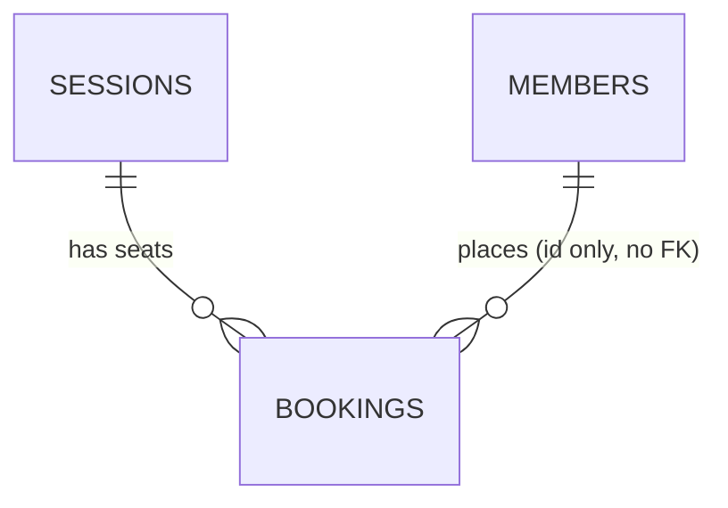
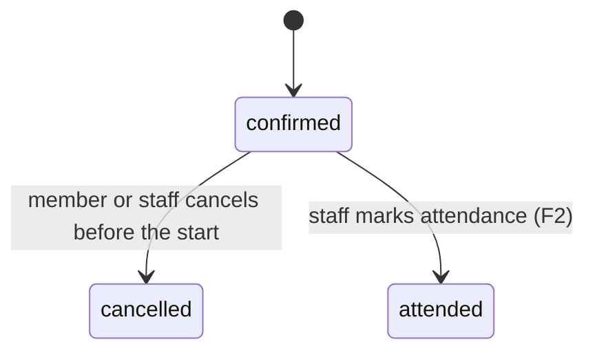

# Golden example — a spec's `## Data model`

The filled `## Data model` section for `product/skills/data-model-plan`, from the toy spec the four
design skills share: `docs/specs/006-booking-cancellation-design.md`, feature F3 *Booking
cancellation* of the system plan `docs/plans/004-workshop-booking-system.md` (the example in
`product/skills/solution-blueprint/references/system-plan-format.md` §9). **The shapes and disciplines
are normative; the domain content is illustrative.**

The state it shows: the owner answered the system plan's Q1 (B: a cancellation less than 24 h before
the start is late and not refunded), F3 was resumed from its draft, and by then F2 had been specced as
`docs/specs/007-booking-a-seat-design.md`. F1's spec, `docs/specs/005-foundation-design.md`, designed
the shared tables. The spec's acceptance criteria, which every design section cites:

- **AC1** — A member cancels their own confirmed booking 24 h or more before the session starts; the booking shows as cancelled and the seat can be booked again at once.
- **AC2** — A member cancelling less than 24 h before the start is told, before confirming, that a late cancellation is not refunded; once confirmed, the booking is cancelled and marked late.
- **AC3** — Staff cancel any member's booking before the session starts, with an optional reason; a staff cancellation is never marked late.
- **AC4** — A member cannot cancel another member's booking, and cannot tell that it exists.
- **AC5** — A booking already cancelled or attended, or whose session has started, cannot be cancelled, and the user is told why.
- **AC6** — The member is emailed when their booking is cancelled, by them or by staff; an email that fails to send never undoes the cancellation.

---

````markdown
## Data model

**Engine:** PostgreSQL 18 (per §3)

### Builds on
| Entity | Owner (module · schema) | Defined in | This feature |
|---|---|---|---|
| Booking | Booking · `booking` | §3; table `bookings` in `docs/specs/005-foundation-design.md` | adds four cancellation columns, widens `status`, narrows the one-seat rule to live bookings |
| Session | Booking · `booking` | §3; table `sessions` in 005, with the seat counter `seats_taken` (D1) | reads `starts_at`; gives a seat back on `seats_taken` |
| Member | Membership · `membership` | §3; table `members` in 005 | reads name and email through `IMembershipApi`, never the table |

### Conventions
All per §3 and 005: UUID v7 ids, UTC instants, single tenant, `snake_case`, enums as stable strings.
No deviation.

### Entities
| Entity | Owning area · schema | Purpose | Lifecycle states | Volume / growth | New or changed |
|---|---|---|---|---|---|
| Booking | Booking · `booking` | One member's seat in one session | confirmed → cancelled \| attended | ~10 cancellations a week | changed: gains `cancelled` |

No new entity. A cancellation is a state of the booking, not a row of its own: nothing in the spec
asks for a booking's history beyond who cancelled it and when.

### Tables

#### `bookings` — Booking area (schema `booking`), changed; defined in 005
Lifecycle after this feature: `confirmed → cancelled`; `confirmed → attended` (F2).

| Column | Type | Null | Default | Constraint / note |
|---|---|---|---|---|
| `status` | text | no | `'confirmed'` | widened: one of `confirmed,attended,cancelled` (005: `confirmed,attended`) |
| `cancelled_at` | timestamptz | yes | — | null until cancelled; a lifecycle fact, not an omission |
| `cancelled_by` | uuid | yes | — | the member's or the staff member's id, held without a foreign key: `members` belongs to the `membership` schema |
| `cancel_reason` | text | yes | — | staff only, at most 200 characters; shown in the member's email (AC3) |
| `late_cancel` | bool | no | `false` | set by the API when a member cancels less than 24 h before `sessions.starts_at` (AC2, Q1: B); never on a staff cancellation (AC3) |

**Keys & constraints**
- CHECK `status` widened, old form → new form: `IN ('confirmed','attended')` → `IN ('confirmed','attended','cancelled')`.
- The one-seat rule (O1), old form → new form: UNIQUE (`session_id`, `member_id`) → UNIQUE (`session_id`, `member_id`) **WHERE `status` <> 'cancelled'**, so a member who cancels can book the same session again (AC1).
- CHECK (`status` = 'cancelled') = (`cancelled_at` IS NOT NULL): a cancelled booking always says when.
- The seat counter is 005's: `sessions.seats_taken` with CHECK `seats_taken <= capacity` (D1). Cancelling decrements it **in the same transaction** that sets `cancelled`, so the freed seat is bookable at once (AC1) and a concurrent booking cannot overshoot. Nothing in the counter changes.

**Indexes**
| Index | Columns | Serves |
|---|---|---|
| `ux_bookings_session_member_live` | (`session_id`, `member_id`) WHERE `status` <> 'cancelled' | the one-seat rule above; replaces 005's `ux_bookings_session_member` |

No other new index: a cancellation looks its booking up by primary key, and 005's `ix_bookings_member`
already serves "my bookings", cancelled ones included.

**Retention:** 005's two years, cancelled bookings included; the owner reads late cancellations from
them. `#confirmed`

### Reference and seed data
None. **Existing data & backfill:** none: every existing booking is `confirmed` or `attended`, and the
new columns are nullable or default `false`.

### Diagrams





Every arrow **not** drawn is a `409` in `## API surface`: cancel a `cancelled` booking, cancel an
`attended` one, cancel a `confirmed` one after the session started (AC5).

### Ownership
| Table | Owner (module schema) | Reader | How it reads |
|---|---|---|---|
| `members` | `membership` | Booking, for the cancellation email | `IMembershipApi.GetContactAsync(memberId)`: display name and email |

`bookings` and `sessions` share the `booking` schema, so the counter decrement is one module's own
transaction. No cross-module join, write or foreign key.

### Migrations
| Order | Migration | Contains | Depends on | Online-safe? |
|---|---|---|---|---|
| 1 | `003_booking_cancellation` | the four columns, the widened status check, the cancelled-at check, the partial unique index replacing 005's | `001_foundation` | yes: nullable columns and a constant default; the index is built `CONCURRENTLY` before the old one is dropped |

### Open questions
| # | Question | Blocks | Owner |
|---|---|---|---|
| 1 | Should a member be able to give a cancellation reason too? | nothing in v1: `cancel_reason` already exists, only the API rule would change | studio owner |

### Routed to `data-architect`
None: the decrement runs inside the transaction 005 already designed for the seat counter.
````
