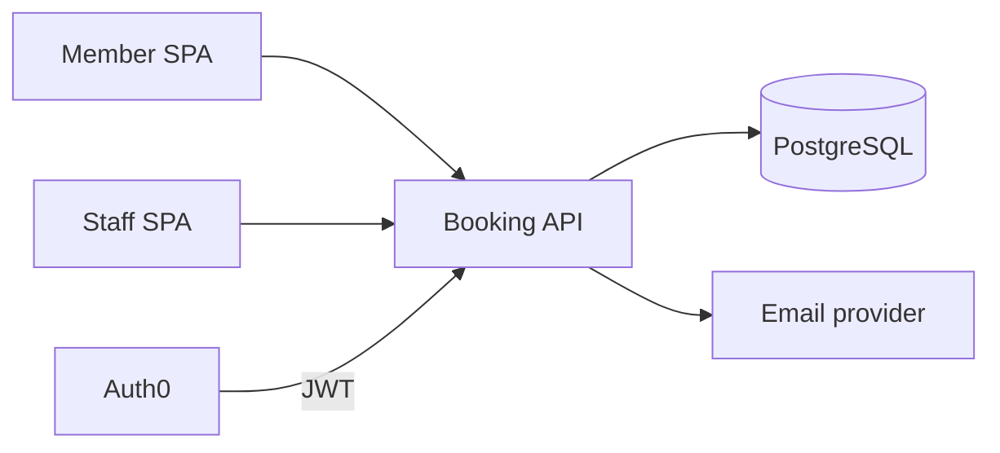

# Golden example — the system plan's §3

The filled §3 for `product/skills/solution-blueprint`, from the toy system **workshop-booking**: a
studio lets members book seats in scheduled workshops. It is the §3 of the example in
[`system-plan-format.md`](system-plan-format.md) §9, written out in full. **The shapes and disciplines
are normative; the domain content is illustrative.** It shows the state after the user approved the
skeleton and F1's spec added D3.

Read it for what it leaves out as much as for what it holds: no table columns, no endpoints, no
screens, no key flows, no decision tables. Each feature's spec designs those on top of this.

---

````markdown
## 3. The skeleton

### Stack and versions
| Dimension | Choice | Version | Why | Evidence |
|---|---|---|---|---|
| Runtime and language | .NET | 10 | Greenfield; library default | proposed → approved |
| Web framework | ASP.NET Core minimal APIs | 10 | Small surface, no controller ceremony | proposed → approved |
| Frontend | React + TypeScript, Vite SPA with React Router 7 | 19 | No server rendering needed; library default | proposed → approved |
| Primary datastore | PostgreSQL | 18 | Relational fit; the seat limit is a constraint (D1) | proposed → approved |
| Data access | EF Core | 10 | Matches the TFM | proposed → approved |
| Auth provider | Auth0 | — | Library default | proposed → approved |
| Hosting | Azure Container Apps | — | The owner already pays for Azure | stated |
| CI | GitHub Actions | — | The repo lives on GitHub | detected (`.git/config:7`) |
| Observability | OpenTelemetry → Grafana stack | — | Library default | proposed → approved |

**Version lane:** greenfield; nothing detected beyond the remote. Every row proposed from the
`CLAUDE.md` Stack defaults and approved as is. No upgrade feature.

### Architecture
**Style:** modular monolith, built to be split later — one team of two, one deployable, and no split
trigger met: nothing scales apart, no second team, no isolation the process cannot give, one runtime.
**Rejected:** a service per area — three network boundaries for a system with one consumer.
**Patterns in play:** none beyond framework idioms. No CQRS (read and write shapes match), no outbox
(a lost confirmation email is acceptable degradation).
**Modules:**

| Module | Schema | Owning area | Public surface | Split trigger |
|---|---|---|---|---|
| `Membership` | `membership` | Membership | `IMembershipApi`: resolve a member by Auth0 `sub` | none |
| `Booking` | `booking` | Booking | `IBookingApi`: sessions, book, cancel, a member's bookings | none |

`Booking` holds a member id, never a foreign key into `membership`. An architecture test, written by
F1, fails the build on a reach-in.

**Repository layout:** one repo: `contracts/` (the OpenAPI document both sides bind to), `src/Api/`,
`src/Membership/`, `src/Booking/`, `tests/`, `web/`, `deploy/local/`.



### Areas
| Area | Purpose | Serves | Trees | Agents |
|---|---|---|---|---|
| Foundation | Scaffold, config, auth wiring, telemetry base, CI, app shell | all | `src/Api/*`, `contracts/*`, `web/app/layout.tsx`, `web/lib/*`, `.github/*`, `deploy/local/*` | `be-dotnet`, `fe-react`, `observability-engineer-dotnet`, `devops-engineer` |
| Membership | Who a member is and what role they hold | E1, E2 | `src/Membership/*`, `tests/Membership.Tests/*` | `be-dotnet` |
| Booking | Sessions, seats, cancellations | E1, E2 | `src/Booking/*`, `tests/Booking.Tests/*`, `web/app/bookings/*`, `web/app/schedule/*` | `be-dotnet`, `fe-react`, `qa-api-dotnet`, `qa-ui-typescript` |

**Capabilities with no agent:** the Auth0 tenant and the email sender domain are provisioned by the
owner, as human tasks in F1's implementation plan.

### Auth
Auth0. The SPA signs in with Authorization Code + PKCE; the API validates JWT bearer tokens. Roles
`member` and `staff` come from a namespaced claim set by an Auth0 Action. Every endpoint checks the
role at the route; a member reads and changes only their own bookings, enforced in the query, not in
the UI. No service-to-service calls.

### Shared entities
| Entity | Owner area | One line |
|---|---|---|
| Member | Membership | A person who may book; keyed by the Auth0 `sub` (D3) |
| Workshop | Booking | A kind of class staff publish, such as life drawing |
| Session | Booking | A dated occurrence of a workshop with a seat capacity |
| Booking | Booking | One member's seat in one session; at most one per member per session |

### Cross-cutting conventions
| Concern | Convention |
|---|---|
| Error envelope | RFC 9457 problem details on every error, with a stable `type` URI per business outcome ("session full") |
| Ids | UUID v7, generated by the API, never by the client |
| Pagination | Cursor-based, `?cursor=&limit=`, limit at most 100 |
| Dates and time zones | Stored as UTC instants; shown in the studio's zone, Europe/London |
| Tenancy | Single tenant: one studio, no tenant id anywhere; a second studio means a new system plan |
| Config and secrets | Env vars, user-secrets locally, Key Vault in Azure; config validated at startup |
| Telemetry base | OpenTelemetry to the local Grafana stack in `deploy/local/` (Collector, Loki, Tempo, Prometheus, Grafana), wired in F1; each feature instruments what it builds |
| App shell | Top nav: two actors and few areas — per `design/ux-patterns` §2 |
````
