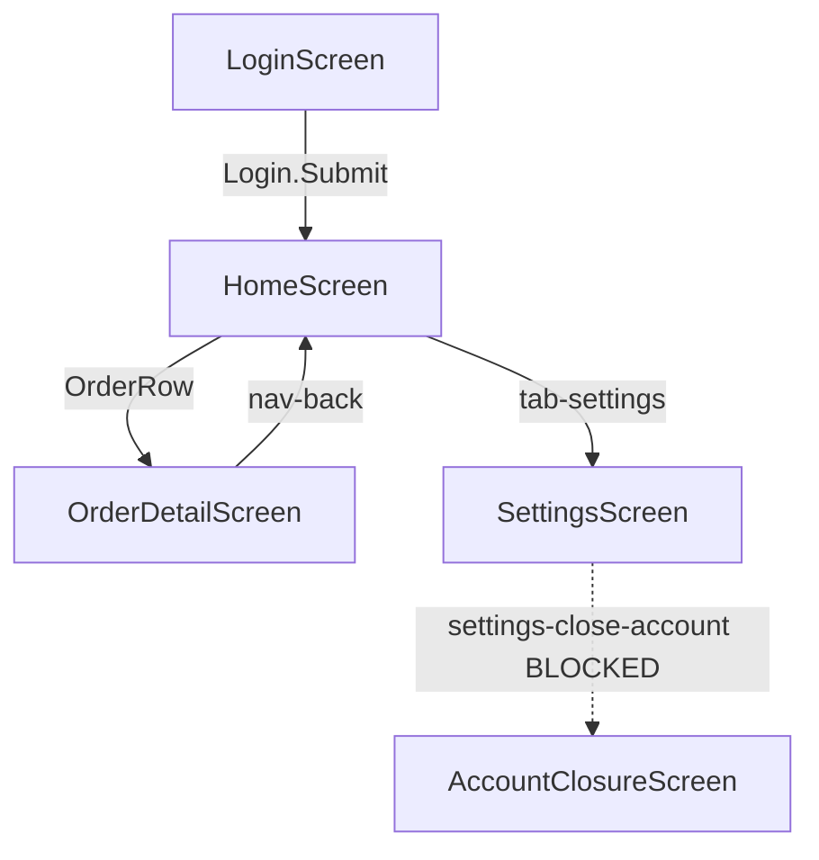

# App screen map — {{AppName}}

<!--
  Generated by qa-mobile-app-crawler. APPEND/UPDATE ONLY — never overwrite.
  This file is the crawl's saved state: the Status and Path columns are what a
  resumed run reads to rebuild its frontier. Keep every row.
-->

## Capture conditions

| | |
|---|---|
| App | `{{package.or.bundle.id}}` build `{{version}}` (`{{buildNumber}}`) |
| Platform | {{Android 15 / iOS 18}} |
| Device | {{Pixel 8 emulator / iPhone 15 sim, UDID …}} |
| Orientation | {{portrait}} |
| Account | `{{test-account}}` — **test account, non-production** (confirmed {{YYYY-MM-DD}}) |
| Environment | {{staging}} |
| Locale | {{en-US}} |
| Runs | r1 {{YYYY-MM-DD}} · r2 {{YYYY-MM-DD}} (resumed) |

**Bounds in force** — maxScreens {{40}} · maxDepth {{6}} · timeBox {{30m}} · rowsPerList {{1}}

**Denylist overrides** — {{none}}
<!-- Any standing denial the user explicitly lifted, one line each, with the date and their words. -->

**Stop condition of the last run** — {{frontier empty (complete) | maxScreens | timeBox | session lost | all exits denylisted}}

> {{⚠ This map is PARTIAL — the crawl stopped on <bound>, not an empty frontier. Delete this line only when a run ends with the frontier genuinely empty.}}

---

## Screens

| # | Screen | Signature | Status | Depth | Path from start | Elements (a11y-id / fallback / ⚠ XPath) | Detail |
|---|---|---|---|---|---|---|---|
| 1 | LoginScreen | `a1b2c3d4` | captured | 0 | *(start)* | 3 / 0 / 0 | [screens/LoginScreen.md](screens/LoginScreen.md) |
| 2 | HomeScreen | `e5f6g7h8` | captured | 1 | Login → `Login.Submit` | 8 / 2 / 1 | [screens/HomeScreen.md](screens/HomeScreen.md) |
| 3 | OrderDetailScreen | `i9j0k1l2` | captured | 2 | Home → `OrderRow` (1 of 24) | 6 / 1 / 0 | [screens/OrderDetailScreen.md](screens/OrderDetailScreen.md) |
| 4 | SettingsScreen | `m3n4o5p6` | frontier | 2 | Home → `tab-settings` | — | — |
| 5 | AccountClosureScreen | — | blocked | 3 | Settings → `settings-close-account` | — | denylist: destruction |

**Variants** (same screen, different state — one page object, not two)

| Parent screen | Variant | Signature | Differs by |
|---|---|---|---|
| LoginScreen | `[validation-error]` | `a1b2c3d9` | + `Login.ErrorBanner` |
| HomeScreen | `[empty-state]` | `e5f6g7h1` | − `Orders.List`, + `Home.EmptyCta` |

---

## Navigation graph

<!-- Solid edge = walked and verified. Dotted = discovered but not entered. -->

---

## Component candidates

Grouped by accessibility id across captured screens — the evidence `page-object-design` uses for its page-vs-component-vs-flow call. **Never grouped by visible text.**

| Candidate | Accessibility id(s) | Screens | Count | Reading |
|---|---|---|---|---|
| BottomTabBar | `tab-home`, `tab-orders`, `tab-settings` | Home, OrderDetail, Settings | 3 of 4 | App-wide chrome → component **and** a base-screen-class candidate |
| ToastBanner | `app-toast` | Login, Home, OrderDetail | 3 of 4 | Shared chrome → component |
| OrderRow | `OrderRow` (repeating siblings) | Home | 1 (×24) | In-screen repeater → component scoped to a parent element |
| NavHeaderBack | `nav-back` | OrderDetail, Settings | 2 of 4 | Shared chrome → component |

**Screen-specific** (appear once — stay on their own screen object): `Login.Email`, `Login.Password`, `Login.Submit`, `Order.Total`, …

**⚠ Weak-signature screens** — {{none}}
<!-- Screens with no stable ids, identified provisionally. A testability gap, not just a crawl inconvenience. -->

---

## Coverage gaps

What a human or a purpose-built fixture must reach — the crawl could not, and says so rather than implying full coverage.

| Unreached screen / area | Blocked by | To reach it |
|---|---|---|
| Account closure flow | Denylist (destruction) | Manual walkthrough on a disposable account |
| Payment confirmation | Denylist (money) | Sandbox payment fixture |
| OTP verification | Needs a live code | Seed via API, or a Mailpit/Mailosaur sink per `email-testing` |
| Premium dashboard | Test account lacks entitlement | Entitled test account |

---

## Handoff status

- [ ] `page-object-design` — folder tree designed from this map + component candidates
- [ ] `mobile-screen-objects` — one class per captured screen
- [ ] `ui-test-author/appium` — tests authored
- [ ] `missing-testids.md` — {{n}} elements escalated to the app devs
